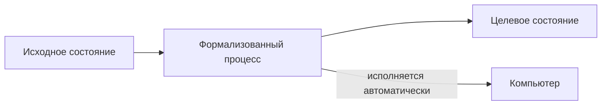
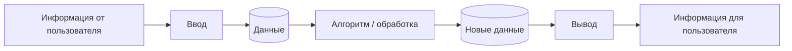
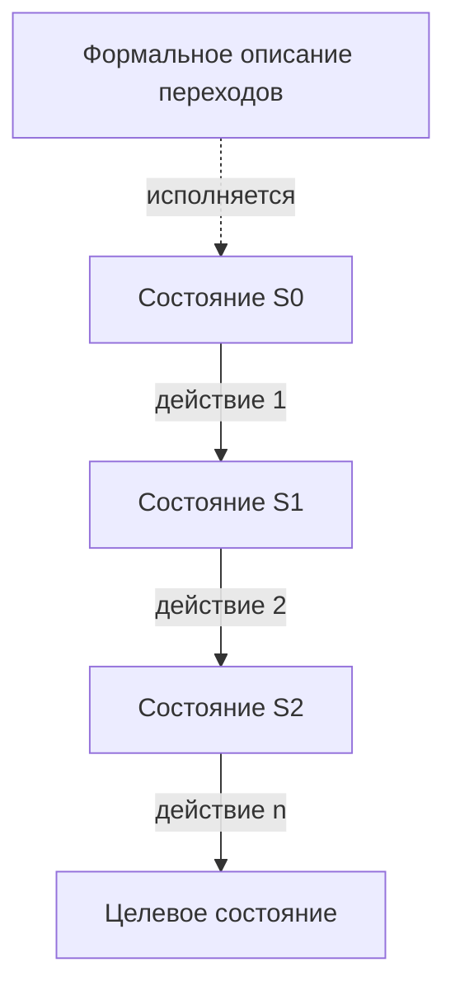
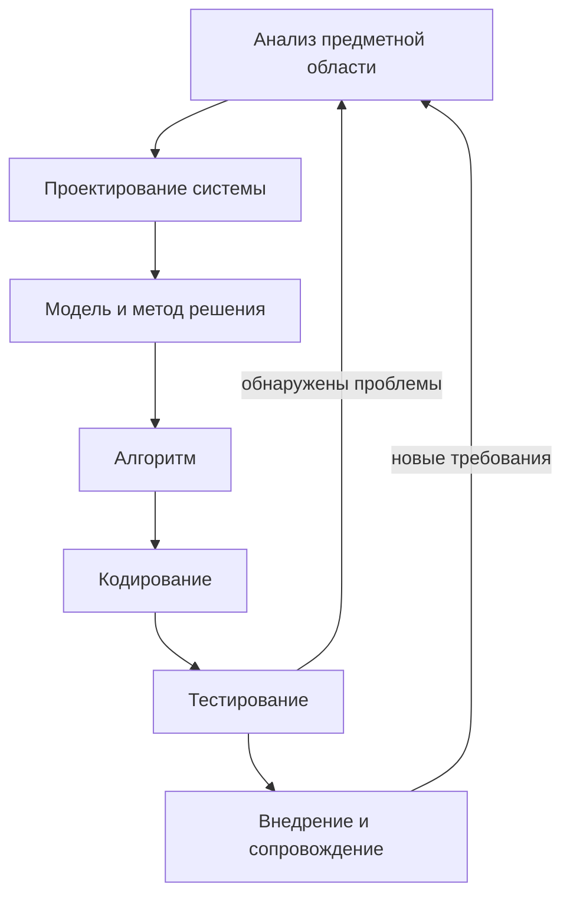
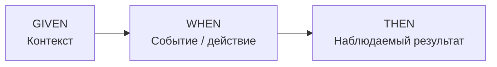
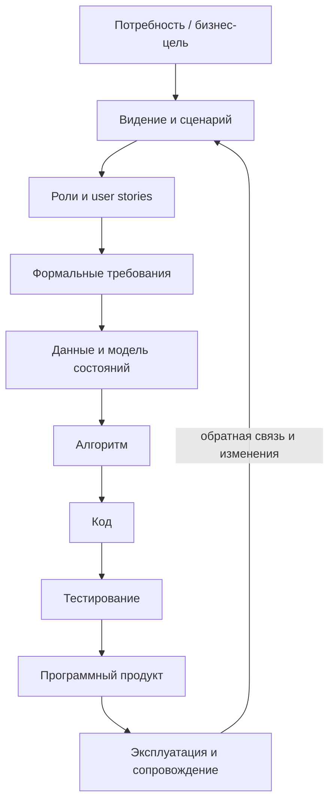

# Технологии программирования — лекция 1

**Дата:** 29 сентября 2026 г.  
**Тема:** введение в технологию разработки ПО; программная инженерия; программа, информация и данные; программный продукт; жизненный цикл; требования и пользовательские истории.  
**Практический результат занятия:** выбрать тему учебного проекта и начать его анализ: сформулировать цель/видение, определить классы пользователей и подготовить пользовательские истории.

> Главная установка лекции: программирование рассматривается не как набор конструкций языка, а как управляемый процесс преобразования исходной информации и данных в полезный программный результат. Код — только один из артефактов этого процесса.


## 1. Организация курса и формат работы

Курс вводный, но его темы дальше предполагаются как уже известные. Поэтому первые занятия намеренно теоретические: они дают терминологию и «каркас», на который затем накладываются языки программирования, алгоритмы, проектирование, Git и командная работа.

Основные организационные положения занятия:

- материалы курса собраны в общей папке: презентации, литература, практические задания и дополнительные ссылки;
- часть презентаций предназначена для самостоятельного просмотра и не обязательно соответствует одному занятию «один к одному»;
- запись занятий ведётся; презентация и запись используются как основной конспективный источник;
- вопросы можно задавать во время занятия и после него; для индивидуальной обратной связи преподаватель просит присылать работу по электронной почте, не дожидаясь следующей пары;
- практика в дистанционном формате строится не как отдельный «час самостоятельного кодирования», а как совместный разбор кейсов плюс самостоятельная доработка между занятиями;
- зачётная часть в первую очередь связана с анализом и проектированием. Сложная реализация кода не является обязательным условием: важнее пройти процесс осознанно и уметь объяснить свои решения;
- в дальнейшем предполагается знакомство с Git и GitHub: создать репозиторий, сохранить код и документы, пройти базовый цикл контроля версий.

На первой практике предлагается выбрать небольшую программу: игру, менеджер задач, учёт расходов/товаров, тестовую систему, сервис маршрутизации, аналог существующего приложения и т. п. Хорошая учебная тема должна быть достаточно содержательной, чтобы в ней были несколько ролей, данные, действия и хотя бы один нетривиальный алгоритм.

### Использование ИИ

ИИ разрешён и рассматривается именно как **ассистент**, а не как источник безусловно верного ответа и не как замена мышления. Рекомендуемый порядок работы: сначала сформулировать собственное решение, затем попросить модель предложить вариант или проверить полноту, после чего сравнить ответы и понять расхождения. Генерация большого фрагмента кода «целиком по запросу» без понимания структуры решения в учебных целях мало полезна и несёт риск ошибок.


## 2. Что означает «технология программирования»

Слово **технология** здесь используется в инженерном смысле: это организованный процесс с определёнными стадиями, приёмами и правилами. Даже бытовая задача вроде приготовления блюда имеет порядок действий, исходные материалы, ограничения и критерий результата; разработка ПО устроена аналогично, только объектом преобразования становятся данные и состояния информационной среды.

Курс связывает две стороны разработки:

1. **Теория разработки** — что такое программа, алгоритм, данные, функции, классы, жизненный цикл, требования и проектирование.
2. **Реализация в коде** — как эти абстрактные понятия выражаются в конкретном языке, среде разработки, библиотеках и программных конструкциях.

Важно различать три уровня освоения материала:

- **знания** — понимать термин и наблюдать, как его использует другой разработчик;
- **умения** — суметь самостоятельно применить знание для решения новой задачи;
- **навыки** — устойчиво выполнять действие без постоянного возвращения к образцу.

Просмотр чужого кода не создаёт навык так же, как наблюдение за водителем не формирует умение водить автомобиль. Поэтому даже в теоретическом курсе нужно самому формулировать задачи, строить модели и делать небольшие реализации.


## 3. От учебной программы к реальной разработке

В учебнике часто показывают «чистую» задачу: например, массив уже существует, данные корректны, остаётся продемонстрировать конкретный алгоритм. Реальная разработка сложнее, потому что приходится решать одновременно несколько классов вопросов.

Преподаватель выделяет типичные ситуации, с которыми сталкивается разработчик:

- создание простой учебной программы;
- разработка новой системы «с нуля»;
- расширение уже существующей программы;
- сопровождение старой кодовой базы.

Сопровождение особенно важно: клиент может годами использовать старую версию платформы или фреймворка, поскольку существующее решение работает и миграция не даёт достаточной выгоды. Поэтому профессионалу требуется понимать не только новые возможности языка, но и старый код, ограничения конкретной версии, совместимость и стоимость изменений.

Разработка также зависит от окружения: аппаратной платформы клиента, доступной памяти и процессора, операционной системы, IDE, одновременной работы нескольких пользователей, требований к синхронности и устойчивости. В промышленной системе программист почти никогда не работает в полной изоляции — нужно учитывать команду, правила взаимодействия и общий процесс.


## 4. Литература и инженерный взгляд

В качестве базовых ориентиров упоминаются книги и стандарты по программной инженерии, разработке требований и гибким процессам. Среди них:

- Б. Я. Цилькер, С. А. Орлов — «Технологии разработки программного обеспечения»;
- И. Соммервилл — «Инженерия программного обеспечения»;
- Титус Винтерс, Том Мэншрек, Хайрам Райт — «Делай как в Google. Разработка программного обеспечения»;
- ГОСТ Р ИСО/МЭК 12207-99 по процессам жизненного цикла программных средств;
- материалы по объектно-ориентированному анализу и проектированию, Scrum и Agile;
- в теме требований — материалы Карла Виггерса;
- в теме интерфейсов — книги Алана Купера.

**Программная инженерия** рассматривает создание ПО как инженерную дисциплину: не просто «написать работающий код», а применять методы, инструменты и процессы, обеспечивающие разработку, проверяемость, сопровождение и совместную работу. Существенная разница с разовой учебной программой состоит в необходимости поддерживать продукт во времени и для большого числа пользователей.


## 5. Выбор языка программирования и долгосрочное обучение

Вопрос «какой язык изучать первым» нельзя решать вне дальнейшей специализации. Если цель — машинное обучение или анализ данных, естественным выбором становится Python. Если основная траектория связана с C#, Java или C++, слишком долго оставаться только в Python нежелательно: у языков различаются модели типизации, объявление переменных и многие фундаментальные концепции.

Простота Python на первых шагах обманчива. Запись вроде `a = 5` выглядит легче, чем явное объявление типа, но по мере углубления появляются вопросы объектов, ссылок, изменяемости/неизменяемости, итераторов, генераторов, декораторов и поведения коллекций. То есть низкий порог входа не означает малой глубины языка.

Пример разных способов объявления показывает, что одна и та же предметная операция может выражаться различно:

```text
Python:  a = 5
C#/C++:  int a = 5;
C#:      var a = 5;
```

Выбор синтаксиса — лишь верхний слой. Важнее понимать, **что означает операция**, какой тип данных получается, где хранится значение и как оно будет использоваться.


## 6. Иерархия мастерства

Развитие программиста удобно представлять как несколько уровней:

1. **Написание кода:** синтаксис, логика, функции.
2. **Работа с данными:** типы, потоки, массивы, файлы, структуры хранения.
3. **Библиотеки:** фреймворки и шаблоны проектирования.
4. **Рефакторинг:** улучшение уже работающего кода без изменения его назначения.
5. **Архитектура:** проектирование системы как целого.

Нельзя надёжно перепрыгнуть к архитектуре, не имея представления о данных, коде и повторном использовании компонентов. Но и ограничиваться синтаксисом языка недостаточно: конечная цель обучения — научиться связывать уровни между собой.


## 7. Что такое программа: не файл, а реализованный процесс

С программой возникает концептуальная трудность: у неё нет одного «естественного» физического представления. Мост можно показать как объект, а программа одновременно существует как исходный код, исполняемая система, набор моделей, документация, репозиторий и наблюдаемое пользователем поведение.

Для понимания программирования предлагается модель перехода состояний. Есть некоторое **исходное состояние**, известен желаемый **результат**, а между ними задаётся **путь/процесс**. Пример с уборкой показывает ту же структуру: беспорядок — начальное состояние, порядок — целевое состояние, а уборка — последовательность действий, изменяющая состояния предметов.

Отсюда практическое определение: программирование описывает процессы обработки данных так, чтобы их выполнение могло автоматически происходить на компьютере. Программа — формализованное описание такого процесса, пригодное для исполнения вычислительной системой.





## 8. Что должно быть результатом разработки

Результат работы разработчика не сводится к исходному файлу. В учебном проекте постепенно появляются два крупных класса артефактов:

- **документация** — описание требований, модели, решения, пояснения и другие документы, оформленные по понятным правилам;
- **код и работающая реализация** — исходный текст, исполняемый результат и история изменений в системе контроля версий.

В курсе предполагается познакомиться с Git и GitHub: создать репозиторий, фиксировать изменения и хранить код так, чтобы его можно было использовать и обсуждать в команде. Даже если итоговый код очень простой, важен сам профессиональный способ организации артефактов.

К качеству программы предъявляются не только функциональные требования. Программа должна быть:

- **понятной и расширяемой** — изменения не должны требовать полного переписывания;
- **повторно используемой** — полезные части желательно применять повторно;
- **устойчивой** — некорректный ввод не должен приводить к непредсказуемому разрушению состояния;
- **корректной** — результат должен соответствовать ожидаемому поведению.

Понятность имеет две стороны: понятный пользователю интерфейс и понятный разработчику код. Для UI преподаватель рекомендует работы Алана Купера; для исходного кода — следование соглашениям конкретного языка, например PEP 8 для Python и руководствам Microsoft/Google для соответствующих экосистем.


## 9. Сложность программы нельзя оценивать по количеству кнопок

Для начинающего разработчика визуальная насыщенность легко становится ложным критерием сложности. Большое окно с множеством элементов управления может реализовывать довольно простую логику, а маленькая консольная утилита — выполнять сложную обработку файлов, каталогов и данных без заметного интерфейса.

Полезнее спрашивать:

- какие данные входят в систему;
- какие состояния и переходы существуют;
- какие правила и ограничения нужно соблюдать;
- сколько ролей взаимодействуют с системой;
- насколько сложны алгоритмы и интеграции;
- как обрабатываются ошибки и нетипичные ситуации.

В качестве наглядного примера предлагается смотреть на обычный электронный кассир/кассу самообслуживания как разработчик: кто определил порядок действий, где взвешивается товар, как распознаётся категория, как проводится оплата, какие данные и проверки нужны на каждом шаге. Повседневные программы становятся источниками учебных требований, если анализировать их внутреннюю логику, а не только внешний вид.


## 10. Программное обеспечение и его виды

**Программное обеспечение (ПО)** — совокупность программ, хранящихся на всех устройствах пользователя, а также сопутствующей документации и конфигурационных данных.

Условно выделяются три группы:

- **системное ПО** — обеспечивает работу вычислительной среды;
- **прикладное ПО** — решает задачи конечного пользователя;
- **инструментальное ПО / системы программирования** — используется для создания других программ: IDE, компиляторы, интерпретаторы и вспомогательные средства.

Это деление важно, потому что назначение продукта определяет требования к среде, интерфейсу, установке, сопровождению и взаимодействию с пользователем.


## 11. Информация и данные

Ключевое различие лекции:

- **информация** — смысл, который человек способен воспринять и интерпретировать: текст, звук, изображение, описание маршрута;
- **данные** — формализованное представление информации, пригодное для хранения и обработки компьютером: числа, строки, записи, координаты, файлы и другие структуры.

Программная система постоянно выполняет два преобразования:

1. из человеческой информации формируются входные данные;
2. данные обрабатываются и превращаются в новую информацию, понятную пользователю.

Пример с маршрутом из точки A в точку B: пользователь формулирует задачу естественным языком; система получает формальные координаты, ограничения и параметры; алгоритм обрабатывает эти данные; на выходе пользователь получает перечень маршрутов, время, стоимость и другие сведения.

Данные нужно где-то хранить. На время выполнения это могут быть переменные и структуры в оперативной памяти; после завершения программы — файлы, база данных или внешняя система. У данных есть тип, а тип влияет на допустимые операции, представление в памяти и правила проверки.





## 12. Пример формализации: високосный год

Пример с високосным годом показывает разницу между бытовым пониманием и формальным условием. Человек может сказать: «високосный год — тот, в котором есть 29 февраля». Это понятное наблюдение, но для программы требуется правило, позволяющее определить результат по входному числу года без обращения к календарю.

Стандартное условие можно сформулировать так:

```text
год високосный, если
    он делится на 400
или
    он делится на 4, но не делится на 100.
```

Логически:

```text
leap = (year % 400 == 0) OR ((year % 4 == 0) AND (year % 100 != 0))
```

Смысл упражнения не в самом календарном правиле, а в переходе от человеческого описания к **полным и однозначным условиям**, которые можно реализовать в алгоритме и проверить на всех классах входных данных.


## 13. Программирование как обработка данных и смена состояний

На уровне модели программирование можно описать через четыре понятия:

- **цель программирования** — описать процесс обработки данных;
- **данные** — факты и идеи в формализованном представлении, пригодном для передачи и переработки;
- **информация** — смысл, который придаётся данным при их представлении;
- **состояние информационной среды** — конкретный набор данных, существующий в определённый момент.

**Обработка данных** — систематическая последовательность действий над данными. **Процесс** — последовательность сменяющих друг друга состояний информационной среды. Если нужный процесс описан формально настолько, что компьютер способен выполнить его автоматически, это описание становится программой.

Таким образом, алгоритм — не «сам код», а логическая последовательность преобразований. Код — один из способов формализовать алгоритм для конкретной вычислительной платформы.





## 14. Программное средство и программный продукт

В лекции различаются близкие понятия.

**Программное средство** — программа или логически связанная совокупность программ на носителях данных, снабжённая программной документацией.

**Программный продукт** акцентирует не только техническую реализацию, но и передачу результата потребителю. Условно рассматриваются два типа:

### Общий программный продукт

Создаётся для открытого рынка и большого числа неизвестных заранее пользователей. Примеры: СУБД, текстовые процессоры, графические редакторы, системы управления проектами, массовые сервисы. Требования определяются разработчиком/поставщиком на основании представления о рынке; установка обычно стандартизирована.

### Продукт на заказ

Разрабатывается под конкретного клиента и его процессы. Требования формируются совместно с заказчиком; часто нужна адаптация, интеграция и развёртывание в конкретной инфраструктуре.

Для сложной системы отдельная программа — только часть результата. Программный комплекс требует интерфейсов и системной интеграции, а превращение программы в продукт добавляет обобщение, тестирование, документирование и сопровождение. Системный программный продукт сочетает оба измерения: интегрированный комплекс и продуктовую готовность.


| Измерение | Обычная программа | Программный комплекс | Программный продукт | Системный программный продукт |
|---|---|---|---|---|
| Базовая реализация | Да | Да | Да | Да |
| Интеграция компонентов/интерфейсов | Ограниченно | Да | Может быть | Да |
| Обобщение, тестирование, документация, сопровождение | Минимально | По необходимости | Да | Да |
| Ориентация на длительную эксплуатацию | Не обязательно | Да | Да | Да |


## 15. Зачем нужна технология разработки ПО

Подход **code and fix** («пишем и правим») допустим для маленькой разовой личной автоматизации, но плохо масштабируется. В нём нет единого плана, а итоговая система превращается в смесь краткосрочных решений.

Для сложных систем требуется организация работы. В лекции технология разработки ПО определяется как комплекс организационных мер, операций и приёмов, направленных на создание качественного программного продукта в рамках заданного бюджета и срока.

Методики отличаются моделью жизненного цикла и степенью формализма. Упоминаются RUP и гибкие подходы, в частности Scrum и Kanban. Важно не название методики само по себе, а то, что она отвечает на вопросы: какие стадии пройти, какие артефакты получить, кто принимает решения и как контролируются изменения.


## 16. Процесс и стадии создания ПО

**Процесс создания ПО** — совокупность мероприятий, целью которых является создание или модернизация программного обеспечения.

Базовая цепочка, показанная на лекции:

1. **Анализ предметной области / постановка задачи.** Понять контекст и потребности.
2. **Разработка проекта системы.** Создать модель функций и требований; выбрать метод решения; разработать алгоритм.
3. **Реализация.** Закодировать решение на выбранном языке.
4. **Анализ результатов / тестирование.** Проверить соответствие требованиям и корректность.
5. **Внедрение и сопровождение.** Развернуть систему, обеспечить эксплуатацию и последующие изменения.

Разные жизненные циклы организуют эти стадии по-разному: последовательно, итерационно, небольшими инкрементами и т. д. Но анализ требований возникает в любой модели, потому что нельзя проверить результат, пока не зафиксировано, что именно должно быть получено.





## 17. Проблема желаний и требования к ПО

Начальная стадия сложна не потому, что пользователь «ничего не знает», а потому, что у пользователя и разработчика разные предметные знания. Заказчик хорошо знает свою деятельность, но может не представлять технические возможности и ограничения. Разработчик знает технологии, но изначально не знает всех деталей предметной области.

Дополнительная трудность — требования часто конфликтуют: удобство, производительность, стоимость, устойчивость, надёжность и сроки могут тянуть проект в разные стороны. Многие требования неявны и становятся заметны только после обсуждения прототипа или конкретного сценария.

По IEEE Standard Glossary of Software Engineering Terminology требование связывается с условиями или возможностями, необходимыми пользователю для решения проблемы/достижения цели, а также с условиями, которым система или компонент должны соответствовать для выполнения контракта, стандарта или иной формальной спецификации.

Практическая задача этапа требований: **выявить, обсудить и зафиксировать**, что действительно требуется, в форме, понятной и клиенту, и команде разработчиков.


## 18. Пользовательские истории (User Stories)

Для первичного сбора и обсуждения требований удобно использовать **пользовательские истории**. Это короткие описания использования системы с точки зрения конкретной роли. История не заменяет всю спецификацию, но помогает начать разговор на языке пользовательской ценности.

Пользовательская история должна отвечать как минимум на три вопроса:

- **кто** действует — роль/класс пользователя;
- **что** он хочет сделать — действие или событие;
- **зачем / какой результат** нужен — ценность или наблюдаемый результат.

На слайде также предлагается структура **Given — When — Then** для сценария и приёмочных условий:

- **Given** — контекст: «находясь в такой-то ситуации…»;
- **When** — событие/действие: «когда выполняю…»;
- **Then** — результат: «получаю…».

Примеры:

> Как постоянный покупатель, я хочу учитывать бонусные баллы при оплате, чтобы использовать накопленную скидку.

```text
GIVEN покупатель авторизован и на его счёте есть бонусы
WHEN он выбирает оплату с использованием бонусов
THEN система уменьшает сумму покупки и списывает допустимое число бонусов
```

Для каждой учебной темы стоит сначала определить классы пользователей: например, покупатель, VIP-клиент, кассир, администратор, кладовщик, бухгалтер. После этого истории формулируются отдельно для значимых целей каждой роли.





## 19. Видение проекта и бизнес-цель

До детальной спецификации полезно сформулировать **видение** — сжатое объяснение того, какой продукт создаётся, для кого и какую проблему он решает. В лекции рекомендуется ориентироваться на шаблоны из литературы по требованиям, в частности на подход Карла Виггерса.

Первый вопрос — **бизнес-цель**. Она отвечает не «что будет в интерфейсе», а зачем вообще существует продукт. Для коммерческой системы это может быть рост прибыли, снижение расходов, сокращение времени операции, уменьшение ошибок. Для учебной игры — достижение игровой цели или обучение конкретному навыку.

Затем формируется свободный **сценарий**: что происходит сейчас или как заказчик представляет использование будущей системы. Сценарий служит сырьём для более формализованных пользовательских историй и требований.


## 20. Практическое задание после первой лекции

К следующему занятию преподаватель предлагает выполнить **пункты 1–3 начальной фазы**. Требования в строгом виде будут продолжены позднее.

### Что сделать

1. **Выбрать тему программы.** Можно взять собственную идею или аналог существующей системы. Предпочтительна тема, в которой есть несколько ролей и обработка данных.
2. **Сформулировать бизнес-цель и видение/концепцию.** Коротко объяснить, для чего продукт нужен и какой результат должен давать.
3. **Определить классы пользователей.** Перечислить роли, которые взаимодействуют с системой, и их основные интересы.
4. **Подготовить пользовательские истории** для ключевых ролей; в конце занятия преподаватель уточняет, что к ближайшему сроку достаточно пунктов до пользовательских историй, а формальные требования будут разбираться дальше.

Работу можно присылать частями, чтобы получить раннюю обратную связь. Не нужно ждать, пока весь документ станет «идеальным»: анализ требований итеративен и уточняется по мере появления новых знаний о данных, алгоритмах и реализации.

Для самопроверки можно использовать ИИ: дать ему описание задачи и собственный перечень ролей/историй и попросить найти пропуски. Полезно именно **сравнение** с собственной моделью, а не мгновенная генерация готового задания.


## 21. Сводная модель первой лекции

Логику занятия можно свести к цепочке:

**потребность → информация от заказчика → формализация данных и требований → модель процесса → алгоритм → код → тестирование → программный продукт → эксплуатация и сопровождение.**

На каждом шаге меняется степень формальности. Пользователь начинает с естественного языка и желаемого эффекта; разработчик превращает это в роли, сценарии и требования; затем проектирует данные и алгоритмы; после реализации проверяет, что программа действительно выдаёт ожидаемый пользователем результат.

Ключевые тезисы:

- технология разработки нужна прежде всего для сложных и долгоживущих систем;
- код — не вся программа и не весь программный продукт;
- программирование удобно понимать как формализованное управление изменением состояний данных;
- информация ориентирована на человека, данные — на машинную обработку;
- качество включает понятность, расширяемость, повторное использование, устойчивость и корректность;
- выбор языка важен, но не заменяет понимания моделей, данных и процесса;
- требования нельзя «просто спросить один раз»: их выявляют, уточняют и согласуют;
- пользовательские истории дают удобную первую форму для разговора о потребностях;
- хороший учебный проект начинается не с кода, а с ответа на вопросы «зачем?», «для кого?» и «что должно происходить?».



