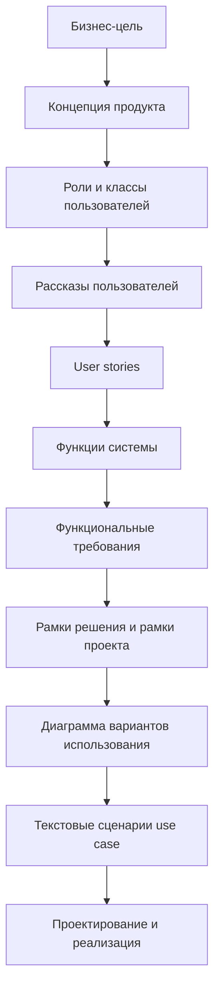
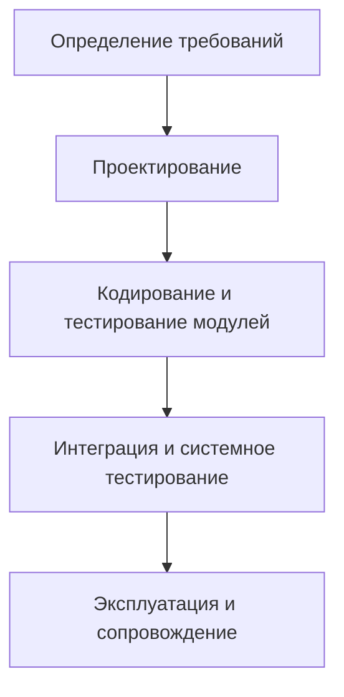
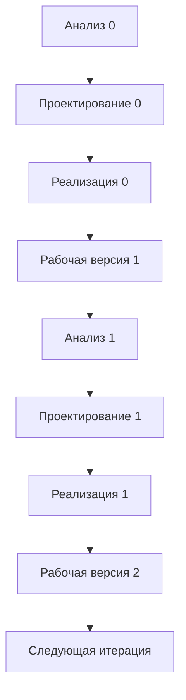
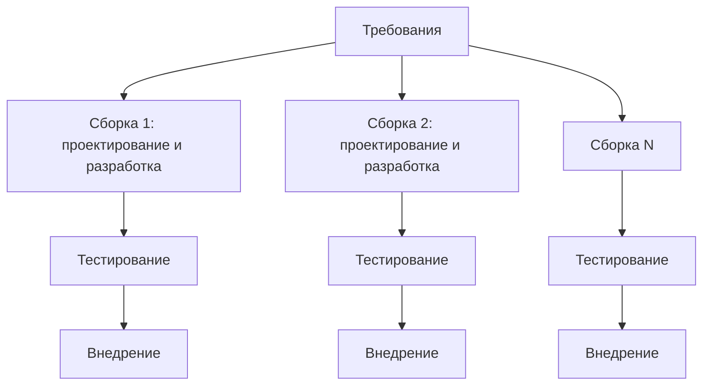
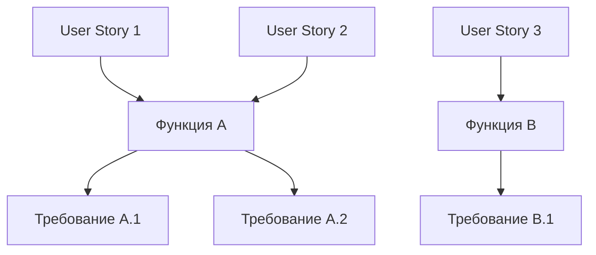
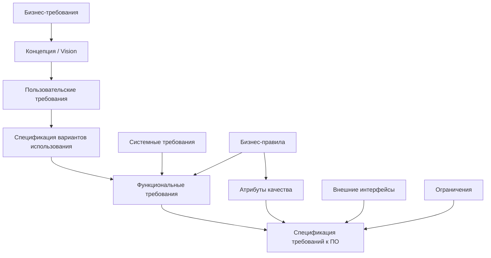
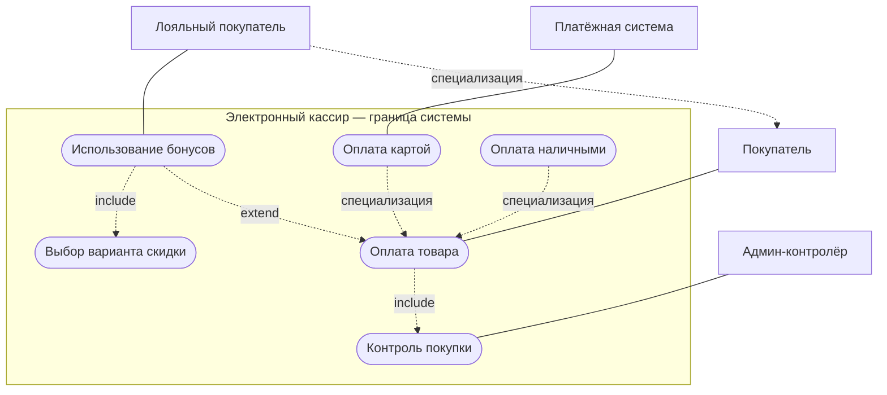
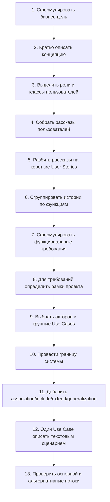

# Технологии программирования — 1 октября 2026

## Содержание занятия

Лекция продолжает тему **анализа при разработке программного обеспечения**. Главная линия занятия: прежде чем писать код, нужно определить, **что именно создаётся, для кого, в каком процессе разработки и как требования будут доведены до реализуемых сценариев**.

Рабочая цепочка занятия:

Ключевой тезис: **кодирование — только один из этапов жизненного цикла ПО**. До него идут анализ и проектирование; после — тестирование, внедрение и сопровождение. Ошибка на раннем этапе требований часто обходится дороже ошибки, обнаруженной при кодировании.

## 1. Программный продукт и источник требований

Перед анализом нужно определить, какого рода продукт создаётся.

### 1.1. Массовый продукт

Если продукт рассчитан на широкий рынок, отдельного заказчика может не быть. Требования приходится получать из анализа рынка, поведения будущих пользователей, аналогов, обратной связи и продуктовой гипотезы. Здесь особенно важно понимать ценность продукта и не путать собственные предположения разработчика с реальными потребностями пользователей.

### 1.2. Продукт под конкретного заказчика

Программный продукт, создаваемый на заказ, ориентирован на определённого потребителя/организацию и обычно поддерживает конкретные производственные или бизнес-процессы. Он разрабатывается по договорённости с заказчиком, внедряется в его среду и разворачивается с учётом особенностей клиента.

Важно различать:

- **заказчика** — лицо или организацию, определяющую цели и финансирование;
- **пользователя** — того, кто непосредственно работает с системой;
- **разработчика** — того, кто переводит цели, рассказы и ограничения в требования и реализацию.

Заказчик и конечный пользователь могут быть разными людьми и иметь разные ожидания.

## 2. Жизненный цикл и модели разработки

Модель жизненного цикла определяет, **как организованы переходы между анализом, проектированием, реализацией, тестированием и эксплуатацией**. Выбор модели нужен уже на этапе анализа: он влияет на глубину документации, допустимый уровень неопределённости и способ планирования работ.

### 2.1. Каскадная модель

Каскадная модель предполагает последовательное прохождение стадий:

На каждый этап выделяются ресурсы и время, результаты этапа оформляются документально, после чего команда переходит дальше. Проблема каскада — сложность возврата назад, если на позднем этапе выяснилось, что требования были неполными или неверно поняты.

Практический вывод занятия: чистый каскад удобен только там, где требования действительно стабильны и понятны. Для большинства современных задач приходится допускать возвраты и уточнения.

### 2.2. Эволюционная модель и прототипирование

Эволюционный подход уменьшает риск непонимания требований за счёт ранних версий/прототипов. В показанной схеме параллельно уточняются спецификации, ведётся разработка и аттестация, а результат проходит через начальную, промежуточную и конечную версии.

**Прототип** — работающий программный модуль, реализующий отдельные функции будущего ПО. Он нужен прежде всего для проверки понимания задачи и коммуникации с заказчиком/пользователем, а не обязательно как часть финальной архитектуры.

### 2.3. V-образная модель

V-модель связывает этапы спецификации и проектирования с соответствующими уровнями проверки и приёмки. Идея: каждому уровню декомпозиции слева соответствует уровень сборки/испытаний справа. Подход полезен там, где важны формальные проверки, испытания и прослеживаемость между требованиями и подтверждением их выполнения.

### 2.4. Спиральная модель

Спиральная модель организует разработку по виткам. На каждом витке повторяются анализ, определение требований, проектирование, реализация/тестирование и интеграция, но уже для новой версии или нового уровня детализации.

Ценность спирали — **легитимный возврат к предыдущим вопросам** и постепенное снижение неопределённости. При этом остаётся организационная задача: понять, когда достаточно информации, чтобы перейти из одного сектора деятельности в другой.

### 2.5. Итерационная модель

В итерационной модели продукт строится и улучшается шаг за шагом. Каждая итерация должна давать осмысленный результат, а промежуточные версии — оставаться работоспособными. Дефекты и ошибочные предположения можно выявлять раньше, чем в длинном одноразовом цикле.

Упрощённо:

### 2.6. Инкрементная модель

Инкрементная модель делает акцент на **добавлении функциональности частями**. Сначала выпускается работающая базовая версия, затем к ней последовательно добавляются новые функции — инкременты.

В лекции это связано с идеей MVP/базовой версии: сначала определить минимальный или базовый набор, который уже имеет практический смысл, а затем расширять продукт.

Итерационность и инкрементность часто используются вместе: продукт уточняется по циклам и одновременно наращивается новыми возможностями.

## 3. Как выбирать процесс разработки

Преподаватель предлагает оценивать задачу как минимум по двум группам признаков:

1. **Насколько понятны исходные требования.**
2. **Насколько уникален создаваемый продукт и сколько времени допустимо потратить.**

Примерная логика из лекции:

| Тип задачи | Понятность исходных данных | Уникальность | Характерный горизонт | Подход |
|---|---|---|---|---|
| Большая система управления/учёта под организацию | требования во многом неясны | высокая | месяцы/годы | более формализованный процесс, например Unified Process/RUP |
| Типовой веб-портал/онлайн-продажи | многое известно заранее | сравнительно низкая | недели/1–2 месяца | Agile, короткие задачи, Kanban |
| Игра или продукт с заметной неопределённостью поведения | общая идея понятна, детали требуют проверки | средняя/высокая | месяцы | итерации, спринты, Scrum/прототипы |

Это не жёсткая классификация, а способ **осознанно выбрать организацию работы**.

### 3.1. RUP / Unified Process

Для сложной и формализуемой разработки характерно больше времени на анализ и проектирование: исследования, модели, согласования, документы, прототипы, проверку решений. В лекции этот класс процессов противопоставляется облегчённым Agile-подходам.

### 3.2. Kanban

Kanban рассматривается как непрерывный поток относительно небольших задач. Работа перемещается по состояниям вроде «запланировано → выполняется → выполнено». Подход удобен, когда задачи понятны и их нужно быстро доводить до результата без длинного закрытого цикла.

Главная идея из примера: если рынок ждёт решение сейчас, ценность может быть в быстром выпуске и последующем улучшении по обратной связи.

### 3.3. Scrum и спринты

В Scrum набор задач планируется на ограниченный отрезок времени — в лекции в качестве типичного примера фигурируют две недели. На время спринта состав работ фиксируется, команда концентрируется на выбранной функциональности и по завершении должна показать работающий результат/прототип.

Разница с описанным Kanban: Kanban — непрерывный поток коротких задач; Scrum — работа пакетами в жёстче ограниченном спринте.

## 4. Начало анализа: бизнес-цель и концепция

Анализ начинается не с перечня функций, а с ответа на вопрос **зачем вообще нужна система**.

Примеры бизнес-целей:

- увеличить прибыль;
- уменьшить потери и расходы;
- снизить число ошибок или сбоев;
- ускорить обработку заказов;
- автоматизировать конкретный бизнес-процесс.

После бизнес-цели формулируется **концепция продукта**: для кого он создаётся, какую проблему решает и какую ценность даёт. В лекции рекомендуется сначала описать концепцию и только затем переходить к требованиям.

Полезная проверка: если функция не помогает бизнес-цели и не нужна пользовательскому сценарию, её включение должно быть отдельно обосновано. Иначе возникает риск «улучшить за свой счёт» то, чего заказчик не просил, потратить сроки и бюджет и сорвать основной результат.

## 5. Роли, типы и классы пользователей

До функциональных требований нужно понять, **кто взаимодействует с будущей системой**.

В учебном примере «электронный кассир» были выделены, в частности:

- покупатель;
- администратор/контролёр;
- инженер, обслуживающий ПО/оборудование;
- возможные внешние системы.

При этом полезно различать:

- **типы/классы пользователей по отношению к продукту** — например, обычный, «любимый»/лояльный, VIP-покупатель;
- **роли по возможностям и полномочиям** — обычный пользователь, администратор, сотрудник с расширенными правами;
- **внешние не-человеческие участники** — платёжная система, CAPTCHA-сервис, банковская система и т. п.

Классификация нужна не ради списка. Разные роли дают разные ожидания, функции, права доступа и сценарии.

Итерационная разработка позволяет вернуться к этому шагу позже, если обнаружен забытый тип пользователя или внешний участник.

## 6. От рассказа пользователя к User Story

### 6.1. Рассказ и история — не одно и то же

Сначала пользователь или заказчик может в свободной форме рассказать, как он работает и чего хочет. Разработчик извлекает из длинного рассказа **короткие отдельные истории**, каждая из которых должна быть связана с конкретной полезной функциональностью.

В лекции подчёркивается: формулировать такие истории — работа разработчика/аналитика. Пользователю не следует просто поручать «написать правильные user stories».

### 6.2. История должна быть небольшой и реализуемой

Одна длинная история, содержащая несколько разных целей, плохо превращается в требования и задачи. Лучше разделить её на несколько независимых историй.

Пример из разбора системы продажи билетов: вместо одного абзаца разумно выделить отдельные намерения — купить билет, выбрать билет по выгодной цене, получить упорядоченную информацию, отменить заказ/вернуть деньги и т. п.

В лекции в качестве формализованного шаблона также упоминается **Given / When / Then**: контекст → событие → ожидаемый результат. Практически этот формат особенно удобен как проверяемое описание условия/поведения.

### 6.3. Типичные ошибки в User Stories

**Слишком абстрактная эмоциональная цель.** Фраза вроде «насладиться моментом с друзьями» не говорит разработчику, какую функцию реализовать.

**Слишком ранний уход в интерфейс.** Формулировки «интерфейс должен быть понятным» не описывают бизнес-логику и плохо проверяются. UI-требования формулируются отдельно и должны быть измеримее.

**Смешение нескольких функций в одной истории.** Такая история плохо декомпозируется и затрудняет оценку работ.

**Отсутствие роли.** Если истории для разных типов пользователей отличаются, роли нужно развести уже на этом этапе.

## 7. User Stories → функции → функциональные требования

Между историями и требованиями нет обязательного отношения «одна история = одно требование». Возможны оба варианта:

- одна история порождает несколько требований;
- несколько историй объединяются в одно более крупное требование.

Чтобы не потерять структуру, в лекции предлагается промежуточный слой — **функция/функциональность системы**.

Пример книжного интернет-магазина:

| User Story | Функция системы |
|---|---|
| Как клиент я хочу обновить профиль, чтобы оплачивать покупки новой кредитной картой | Обновление профиля клиента |
| Как клиент я хочу просматривать и выбирать товары из каталога | Поиск товара |
| Как клиент я хочу оплачивать товар кредитной картой | Покупка товара |
| Как клиент я хочу отменять заказ в любой момент | Отмена заказа |

Далее для каждой функции формулируются конкретные функциональные требования.

## 8. Формулировка функциональных требований

### 8.1. Шаблон от лица системы

Общий шаблон со слайда:

> **[необязательное предварительное условие] [необязательный триггер события] система должна [ожидаемая реакция системы].**

Пример со слайда: если запрошенный материал есть на складе, система должна отобразить список всех контейнеров, в которых хранится этот материал.

Фраза «система должна» полезна как якорь: она заставляет формулировать проверяемое поведение самой системы, а не пожелание или впечатление.

### 8.2. Альтернативный шаблон от лица пользователя

Для быстрых задач, особенно близких к Kanban, требование может быть сформулировано как возможность пользователя: «пользователь должен иметь возможность ...». Это похоже на прямое преобразование истории в задачу.

### 8.3. Рамки решения и рамки проекта

Ключевое различие лекции:

- **рамки решения (solution scope)** — что должна уметь система, то есть функции и требования;
- **рамки проекта (project scope)** — какие конкретные работы должен выполнить разработчик, чтобы реализовать решение.

Пример таблицы:

| ID требования / рамки решения | Что должна обеспечивать система | ID работы | Что должен сделать разработчик |
|---|---|---|---|
| URS-1 | Система обеспечивает пользователям функцию X | FRS-101 | Создать меню/механизм вызова функции |
| URS-1 | То же требование | FRS-102 | Реализовать просмотр результата |

Рамки проекта важны для оценки сроков, стоимости и ресурсов. Если работа не входит в рамки проекта, она не должна «самопроизвольно» появляться в реализации без пересогласования.

### 8.4. Функциональные и нефункциональные требования

Показанная в лекции структура требований разделяет функциональную и нефункциональную части.

Функциональная ветвь включает бизнес-требования, концепцию, пользовательские требования, варианты использования и собственно функциональные/системные требования.

Нефункциональная ветвь включает, в частности:

- бизнес-правила;
- атрибуты качества;
- внешние интерфейсы;
- ограничения.

Итоговый формальный документ — спецификация требований к ПО (SRS), в которой эти категории сводятся вместе.

## 9. Варианты использования (Use Cases)

Диаграмма вариантов использования нужна, когда набор историй и требований уже надо показать как **целостную картину взаимодействия внешних участников с системой**.

Важно: в лекции подчёркивается, что use case — это прежде всего описание поведения системы в ответ на действия участника, а диаграмма — лишь компактная иллюстрация имён, границ и отношений.

### 9.1. Назначение диаграммы прецедентов

Диаграмма должна документировать:

1. **действующих лиц (акторов)** — всё, что находится вне системы;
2. **варианты использования** — поведение/функции в пределах системы;
3. **отношения**:
   - между акторами;
   - между акторами и вариантами использования;
   - между самими вариантами использования.

### 9.2. Акторы

Актор — внешняя по отношению к моделируемой системе сущность, которая взаимодействует с системой и использует её функции для достижения цели.

Актором может быть не только человек. Возможны внешние информационные или технические системы, например платёжная система или мобильный телефон.

Вопросы для поиска акторов:

- Кто заинтересован в требованиях?
- Где будет применяться система?
- Кто получает выгоду от её использования?
- Кто предоставляет системе информацию, изменяет или удаляет её?
- Кто поддерживает систему?
- Использует ли система внешние ресурсы?
- Может ли один человек выполнять несколько ролей?
- Взаимодействует ли система с другими системами?

### 9.3. Граница системы

Граница системы отделяет то, **что мы программируем**, от окружающего мира. Ошибка учебного примера: включить «выбор товара в магазине» в систему электронного кассира. Покупатель действительно выбирает товар в физическом магазине, но этот процесс не выполняется программой кассира и потому находится вне её границ.

Определение рамок решения помогает не включать в проект чужую функциональность.

### 9.4. Виды связей

**Ассоциация.** Показывает участие актора в use case. В учебной работе между актором и вариантом использования рекомендуется использовать именно ассоциацию, а не пытаться показывать «порядок» стрелками.

**`include` / включение.** Один сценарий обязательно включает другой в определённой точке. Пример: при оплате товара может потребоваться обязательный контроль покупки для определённой категории товара.

**`extend` / расширение.** Дополнительное поведение подключается при условии и не обязательно выполняется всегда. Пример: использование бонусов при оплате — возможность, а не обязательный этап каждой покупки.

**Обобщение (generalization).** Показывает отношение общего и частного: например, «лояльный покупатель» — специализация обычного покупателя; «оплата картой» и «оплата наличными» могут быть частными вариантами общей оплаты.

### 9.5. Учебный пример «Электронный кассир»

Ниже — схематичное, а не строгое UML-представление того же содержания в Mermaid:

Схема должна отвечать на вопрос «кто какими возможностями системы пользуется и как крупные возможности связаны друг с другом», а не «что выполняется первым, вторым и третьим».

## 10. Чего диаграмма вариантов использования НЕ показывает

Главная ошибка — пытаться изобразить стрелками **последовательность выполнения сценария**. Расположение use cases на листе не означает порядок действий.

Если нужно показать временной порядок сообщений/действий, для этого применяется другая UML-диаграмма — **диаграмма последовательности (sequence diagram)**, которая будет изучаться позднее.

Для учебной диаграммы преподаватель рекомендует не перегружать схему: ориентировочно **5–7 крупных вариантов использования**, чтобы были видны смысл и основные типы отношений.

## 11. Текстовая спецификация варианта использования

Диаграмма — не достаточная спецификация для программиста. Она фиксирует участников, крупные use cases и связи, но не описывает пошаговое поведение.

Поэтому каждый существенный use case в реальном проекте должен иметь **текстовый сценарий**.

### 11.1. Что такое сценарий

Сценарий — специально написанный текст, описывающий поведение моделируемой системы как последовательность действий акторов и самой системы.

- **Основной сценарий (Main Success Scenario)** — успешный ход без ошибок.
- **Расширения/альтернативные потоки (Extensions)** — отклонения, ошибки, отмены, исключительные ситуации.

Use case в итоге представляет собой набор взаимосвязанных успешных и неуспешных сценариев, которые описывают достижение актором некоторой цели.

### 11.2. Рекомендуемая карточка use case

В лекции показан формат карточки, содержащей как минимум:

- название варианта использования;
- акторов;
- цель;
- краткое описание;
- тип/важность при необходимости;
- ссылки на включаемые или связанные варианты использования;
- предусловия;
- постусловия;
- основной поток;
- альтернативные/исключительные потоки.

Шаблон:

| Поле | Содержание |
|---|---|
| Use Case | Название |
| Основной актор | Кто инициирует взаимодействие |
| Цель | Какой результат хочет получить актор |
| Предусловия | Что должно быть истинно до начала сценария |
| Постусловия | Что должно быть истинно после успешного завершения |
| Основной поток | Нумерованные шаги нормального сценария |
| Альтернативы/исключения | На каком шаге основной поток меняется и что происходит |

### 11.3. Предусловия и постусловия

**Предусловия** гарантируют, что сценарий можно начать: например, карта вставлена/считана, система доступна, пользователь идентифицирован.

**Постусловия** описывают состояние после завершения: например, платёж зарегистрирован, чек сформирован, новый аккаунт создан.

### 11.4. Исключения должны ссылаться на шаг основного потока

На слайде с банкоматом исключения привязаны к конкретным номерам шагов: недействительная карта, просроченная карта, неверный PIN и т. п. Это важно: альтернативный поток не существует сам по себе, он **заменяет или изменяет часть основного сценария в конкретной точке**.

Для учебной работы преподаватель предлагает выбрать один достаточно содержательный use case и описать:

- основной успешный поток;
- как минимум два альтернативных/исключительных потока.

## 12. Практический алгоритм анализа из этой лекции

Последовательность, пригодная для выполнения учебного проекта:

### Контрольные вопросы

Перед переходом дальше полезно проверить:

- Понятно ли, какую бизнес-проблему решает система?
- Не смешаны ли заказчик и пользователь?
- Все ли роли действительно взаимодействуют с системой?
- Нет ли функций, которые разработчик придумал сам, но заказчик их не заказывал?
- Каждая ли User Story описывает одну понятную ценность/задачу?
- Можно ли из требования понять проверяемое поведение системы?
- Отделены ли требования к системе от работ разработчика?
- Проведена ли граница системы?
- Не используется ли use-case диаграмма для показа последовательности?
- Есть ли у важного use case основной и альтернативные потоки?

## 13. Инструменты, упомянутые на занятии

Для UML/use-case диаграмм преподаватель допускает как специализированные редакторы, так и простые средства рисования. В качестве примеров в лекции упоминались **Visual Paradigm**, средства вроде **PlantUML**, а также обычный графический/досочный редактор; для учебной работы важнее корректность смысла и отношений, чем «красота» схемы.

Допускается даже аккуратная схема «как на салфетке», если она читаема и правильно передаёт акторов, use cases, границу системы и связи.

Искусственный интеллект рекомендуется использовать как **проверяющего/подсказывающего помощника**: например, попросить проверить уже сформулированное требование или сценарий, а не отдавать ему всю задачу без собственного анализа.

## 14. Что будет дальше

Следующее занятие должно перейти от требований и сценариев к **предметной области**:

- сущностям;
- атрибутам;
- типам данных и типизации;
- хранению данных в таблицах;
- более непосредственной реализации.

Для демонстрации Python преподаватель рекомендует минимальную среду. Для Windows упоминается портативный **WinPython**, который можно распаковать в папку без полноценной установки; в комплекте есть IDLE и дополнительные инструменты (включая Jupyter/Spyder в зависимости от сборки). Онлайн-компиляторы пригодны для небольших примеров, но могут быть неудобны из-за задержек сети.

## 15. Самостоятельная работа и стандарты

По итогам занятия преподаватель уточнил, что к следующему занятию нужно продолжить текущую практическую работу, в частности этапы, связанные с функциональными требованиями и вариантами использования.

Для диаграммы вариантов использования ожидается:

- несколько крупных use cases (ориентировочно 5–7);
- акторы вне границы системы;
- ассоциации акторов с use cases;
- примеры `include`, `extend` и обобщения там, где они действительно оправданы;
- отсутствие стрелок, изображающих простой временной порядок;
- текстовый сценарий для одного выбранного use case;
- основной поток и не менее двух альтернативных/исключительных ситуаций.

Для самостоятельного знакомства также упомянуты группы стандартов и методик, используемых при документировании разработки: российские стандарты серий **ГОСТ 34**, **ГОСТ 19 / ЕСПД**, а также корпоративные/международные методики. Их общая задача — регламентировать стадии разработки и состав документов, хотя в конкретном проекте степень формализации может сильно различаться.

## Краткий итог

1. Сначала определяется **цель продукта и источник требований**, а не код.
2. Процесс разработки выбирается по масштабу, неопределённости, уникальности и срокам.
3. Истории пользователей — промежуточный слой между живым рассказом и формализованными требованиями.
4. Функциональное требование должно описывать проверяемое поведение системы.
5. Рамки решения отвечают на вопрос **«что должна уметь система?»**, рамки проекта — **«что должен сделать разработчик?»**.
6. Use-case диаграмма показывает **акторов, границу системы, крупные варианты использования и их отношения**, но не последовательность шагов.
7. Реальная спецификация use case — это прежде всего **текстовый основной сценарий плюс альтернативы/исключения**.
