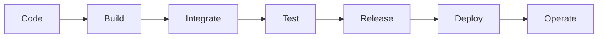
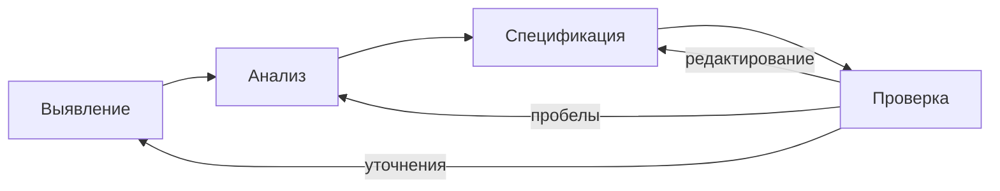
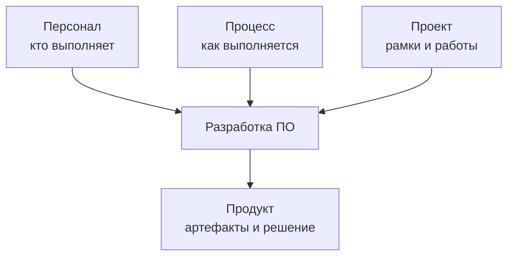
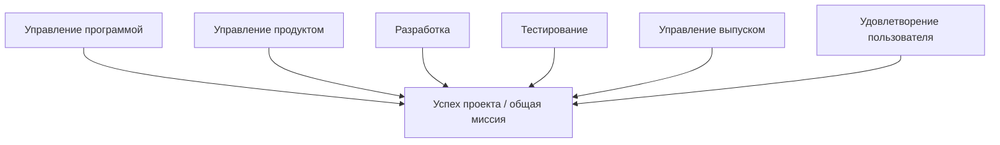
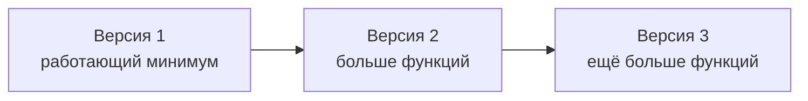
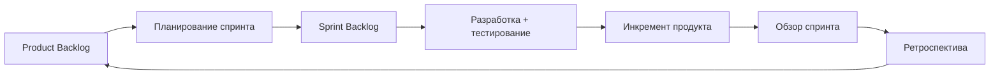
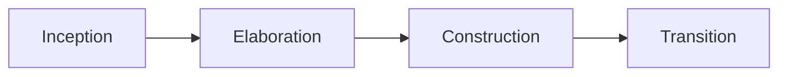
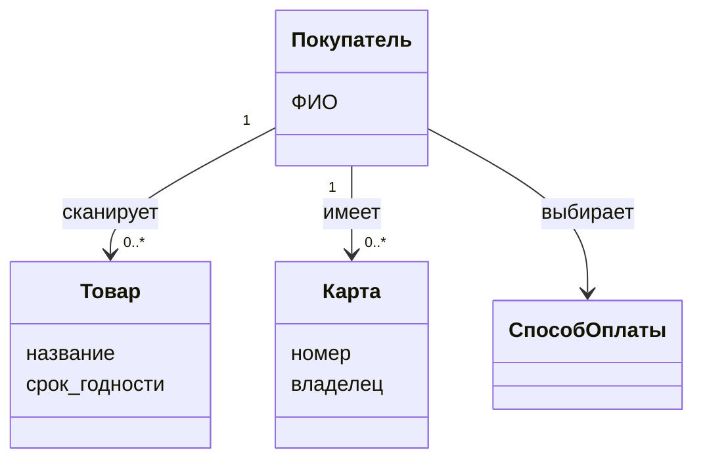
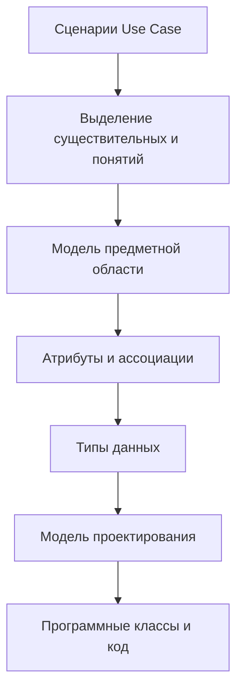

# Технологии программирования — 06.10.2026

## 1. Цели занятия

Лекция завершает вводный блок по технологиям программирования и связывает уже выполненный анализ требований с дальнейшей разработкой. Основные темы занятия:

- место командной работы в жизненном цикле ПО;
- документирование, тестирование, управление версиями и CI/CD;
- различия водопадного и итеративного подходов;
- Microsoft Solutions Framework (MSF) как пример формализованной организации команд и процессов;
- Agile, Scrum и Kanban;
- Rational Unified Process (RUP);
- переход от требований и сценариев к объектному анализу и модели предметной области;
- практическое задание: выделить сущности, их атрибуты, связи и типы данных.

## 2. Жизненный цикл разработки ПО: повторение

Жизненный цикл рассматривается как системный процесс, который должен привести к качественному программному продукту в заданные сроки. В лекции повторяется типовая цепочка этапов:

1. **Анализ требований** — сбор пожеланий, User Stories, Use Cases, бизнес-правила, формализация требований.
2. **Проектирование** — переход от описания потребностей к структуре решения, моделям и взаимодействию компонентов.
3. **Реализация** — написание кода и сборка программного продукта.
4. **Тестирование** — проверка корректности, в том числе нормальных, граничных и ошибочных входных данных.
5. **Внедрение (deployment)** — развёртывание решения у пользователя или в целевой среде.
6. **Сопровождение** — эксплуатация, исправление дефектов и развитие уже используемого решения.

Ключевая мысль: реальные процессы разработки редко являются строго однонаправленными. При уточнении требований, проектировании, тестировании и реализации приходится возвращаться к предыдущим решениям и уточнять их. Это **итеративность**, а не признак того, что работа «сделана неправильно».

## 3. Командная разработка

Работа в команде — одно из необходимых условий успешности крупного программного проекта. По мере расширения контекста меняются и требования к разработчику: от индивидуальной способности писать код — к коммуникации, координации, совместному принятию решений и ответственности за общий результат.

Команда может быть организована вокруг:

- отдельного программного компонента в большом проекте;
- компонента, который позднее войдёт в общий продукт;
- нескольких проектов, над которыми одна группа работает параллельно.

Помимо технических компетенций важны **soft skills**: умение объяснять решения, договариваться, принимать обратную связь, работать удалённо в общей команде и понимать границы проекта.

### 3.1. Базовые навыки участника команды

| Навык | Что означает на практике |
|---|---|
| Документирование | Требования и проектные решения фиксируются формально, а не «из головы». Комментарии к коду должны объяснять смысл, а не дублировать очевидный синтаксис. |
| Тестирование | Проверяются обычные, граничные и ошибочные случаи; постепенно тестирование автоматизируется с помощью тестовых фреймворков. |
| Управление версиями | История изменений хранится в системе контроля версий; Git рассматривается как основной практический инструмент курса. |
| Совместная работа | Репозиторий (в частности GitHub) становится общей точкой хранения исходного кода и результатов работы команды. |
| CI/CD | Код регулярно интегрируется, автоматически проверяется, собирается и подготавливается к поставке/развёртыванию. |

## 4. CI/CD и непрерывный жизненный цикл поставки

В лекции CI/CD объясняется через последовательность стадий разработки:

**Code → Build → Integrate → Test → Release → Deploy → Operate**.

Различаются три понятия:

- **Continuous Integration (CI)** — частое объединение изменений разработчиков в общую ветвь с автоматической проверкой и сборкой;
- **Continuous Delivery (CD)** — постоянная готовность проверенной версии к поставке; выпуск в целевую среду остаётся контролируемым действием;
- **Continuous Deployment** — автоматизированное развёртывание успешно прошедшего проверки изменения в целевую среду.

Практический смысл CI: разработчики не накапливают большие изолированные изменения, а интегрируют небольшие порции кода и рано обнаруживают конфликты. Автоматические проверки могут включать тесты, линтеры, правила форматирования и проверки качества кода.

## 5. Система разработки: люди, процесс, проект, продукт

Разработка ПО рассматривается не только как написание кода. В ней одновременно присутствуют четыре взаимосвязанных аспекта:

- **персонал** — кто выполняет работу;
- **процесс** — каким способом организована работа;
- **проект** — совокупность работ и ограничений, в рамках которых достигается результат;
- **продукт** — артефакты и программное решение, получаемые в результате.

**Артефакт** — любой значимый результат процесса: документ с требованиями, Use Case, модель, исходный код, тест, сборка, отчёт и т. п.

## 6. Анализ, проектирование и требования

На стадии анализа исследуются системные требования и предметная область. В лекции различаются:

- **анализ требований (requirements analysis)** — исследование требований к системе;
- **объектный анализ (object analysis)** — исследование объектов и понятий предметной области.

Проектирование следует за анализом и описывает, **как** система будет реализована. При этом анализ и проектирование не образуют жёсткой границы: решения уточняются итеративно.

### 6.1. Итеративное формулирование требований

Типовой цикл работы с требованиями:

**выявление → анализ → спецификация → проверка**, после чего возможен возврат на предыдущие этапы для уточнения, заполнения пробелов и исправления противоречий.

Требования делятся как минимум на:

- **функциональные** — что система должна делать;
- **нефункциональные** — ограничения и качественные характеристики: производительность, надёжность, безопасность, удобство и т. п.

Результатом формализации требований может быть **SRS (Software Requirements Specification)**; в российской практике аналогичную роль часто выполняет техническое задание в соответствии с применимыми стандартами.

## 7. Программная документация и стандарты

Лекция подчёркивает, что разработчик должен ориентироваться и в международной, и в российской системе программной документации.

| Документ / группа | Роль в контексте лекции |
|---|---|
| IEEE 830-1998 | Методика подготовки спецификации требований к программному обеспечению (SRS). |
| ГОСТ 34.601-90 | Стадии создания автоматизированных систем. |
| ГОСТ 34.602-89 | Техническое задание на создание автоматизированной системы. |
| ГОСТ 34.603-92 | Виды испытаний автоматизированных систем. |
| ГОСТ 19.101-77 | Виды программ и программных документов в ЕСПД. |
| ГОСТ 19.102-77 | Стадии разработки. |
| ГОСТ 19.201-78 | Требования к техническому заданию. |
| ГОСТ 19.202-78 | Требования к спецификации. |
| ГОСТ 19.401-78 | Требования к тексту программы. |
| ГОСТ 19.402-78 | Требования к описанию программы. |
| ГОСТ 19.501-78 | Требования к формуляру. |

Перечень стандартов на слайдах используется как ориентир: конкретный набор документов зависит от проекта и принятой нормативной базы.

## 8. Водопадный, итеративный и гибкий подходы

Сравнение подходов строится вокруг того, **когда и насколько интенсивно** выполняется работа с требованиями.

- В **водопадной модели** основная масса требований должна быть определена в начале. Поздние изменения дороги и нежелательны.
- В **итеративной модели** требования уточняются на каждой итерации; объём изменений распределён по времени.
- В **Agile-подходах** обратная связь и изменение требований происходят часто, а продукт развивается короткими циклами.

При этом отдельная итерация или спринт может внутри себя иметь последовательность, похожую на мини-«водопад»: анализ → реализация → проверка результата.

## 9. Microsoft Solutions Framework (MSF)

MSF приводится как исторически важный пример формализации командной разработки. В лекции он представлен как сочетание **двух моделей** и **трёх дисциплин**:

- модель проектной группы;
- модель процессов;
- дисциплина управления проектами;
- дисциплина управления рисками;
- дисциплина управления подготовкой/готовностью.

### 9.1. Модель проектной группы MSF

Идея модели — организовать не жёсткую административную иерархию, а набор **ролевых кластеров / областей компетенции**, совместно отвечающих за успех проекта. На слайдах выделяются направления, связанные с:

- управлением программой;
- управлением продуктом;
- разработкой;
- тестированием;
- управлением выпуском;
- удовлетворением потребителя / пользовательским опытом.

Функциональные группы могут масштабироваться: при росте проекта дополнительные специалисты добавляются в те области, где возникает дефицит компетенций или ресурсов.

### 9.2. Модель процессов MSF

Процессная модель MSF — **итеративная**. Каждая версия увеличивает функциональность решения. Работа ориентируется на контрольные точки (milestones), в которых оценивается достижение качественного промежуточного результата.

Ключевые термины модели:

| Термин | Смысл |
|---|---|
| customer / заказчик | Сторона, определяющая потребность и ценность решения. |
| user / потребитель | Тот, кто непосредственно использует продукт. |
| stakeholders | Заинтересованные стороны. |
| solution | Разрабатываемое решение. |
| baseline | Зафиксированное согласованное состояние артефакта/решения. |
| scope | Рамки решения и рамки проекта. |

### 9.3. Фазы и стабилизация

В модели процессов MSF рассматриваются последовательные фазы, включая выработку концепции (envisioning), планирование, разработку, стабилизацию и внедрение. На фазе **stabilizing** основными работами становятся тестирование, устранение ошибок и подготовка решения к выпуску.

### 9.4. Треугольник компромиссов

Проект ограничен как минимум тремя взаимосвязанными параметрами:

- **ресурсы / стоимость**;
- **время**;
- **функциональные возможности**.

Если один параметр фиксируется, изменение другого обычно требует компенсации третьим. Пример из лекции: при фиксированном бюджете и сроке наиболее реалистично регулировать объём реализуемой функциональности.

### 9.5. Точка конвергенции

В итеративном проекте в начале могут быстро появляться новые дефекты и новые изменения. По мере стабилизации скорость устранения дефектов должна превысить скорость появления новых; момент такого перелома иллюстрируется как **точка конвергенции**.

## 10. Agile и Scrum

Agile — семейство гибких подходов, ориентированных не на детальный неизменный план, а на регулярную поставку работающего результата и адаптацию к изменению условий.

В лекции к основным Agile-подходам относятся **Scrum** и **Kanban**.

### 10.1. Scrum: роли

| Роль | Основная ответственность |
|---|---|
| Scrum Master | Помогает команде соблюдать Scrum-процесс, устраняет организационные препятствия и поддерживает эффективную работу команды. |
| Product Owner | Определяет приоритеты продукта и ценность функциональности, управляет Product Backlog; не распределяет индивидуальные задачи между разработчиками. |
| Team / Developers | Самоорганизующаяся команда, которая берёт на себя объём работы спринта и отвечает за создание инкремента продукта. |

### 10.2. Спринт

**Спринт** — ограниченная по времени итерация, в течение которой команда создаёт законченный инкремент продукта. Внутри спринта используются:

- планирование;
- ежедневная синхронизация команды;
- разработка и тестирование;
- обзор результата;
- ретроспектива процесса.

После каждого спринта продукт должен стать **работоспособнее и полезнее**, а не просто содержать больше незавершённых частей.

### 10.3. Масштабирование Agile

При масштабировании важны:

- баланс автономности команды и согласованности между командами;
- самоорганизация и коллективная ответственность;
- постоянная интеграция;
- качество «с самого начала», а не отдельная фаза исправления всего в конце;
- ясные границы продукта и ответственности команды.

## 11. Kanban

Kanban в лекции представлен как гибкий подход к управлению **потоком задач**. В отличие от Scrum, Kanban не требует фиксированных спринтов и обязательного набора ролей.

Основные идеи:

1. **Визуализировать поток работы.**
2. **Ограничивать незавершённую работу (WIP, Work In Progress).**
3. **Управлять потоком и измерять время прохождения задачи.**
4. **Использовать явные правила работы.**
5. **Организовать обратную связь.**
6. **Постоянно улучшать процесс.**

Типовая Kanban-доска начинается с трёх состояний:

**To do → In progress → Done**,

но в реальном проекте может быть детализирована, например: очередь → анализ → проектирование → разработка → тестирование → готово. Столбцы должны отражать реальный процесс и сохранять логическую последовательность потока.

### 11.1. WIP-лимиты

Ограничение WIP не позволяет команде одновременно начать слишком много задач. Это помогает:

- снижать многозадачность;
- раньше обнаруживать «узкие места»;
- концентрироваться на завершении начатого;
- уменьшать среднее время прохождения задачи через систему.

### 11.2. Scrum и Kanban: сравнение

| Критерий | Scrum | Kanban |
|---|---|---|
| Ритм | Регулярные спринты фиксированной длительности | Непрерывный поток |
| Поставка | Обычно к окончанию спринта | По готовности, непрерывно |
| Роли | Product Owner, Scrum Master, Developers | Обязательных ролей нет |
| Основной показатель | Скорость / объём выполненного за спринт | Время цикла, WIP, поток завершённых задач |
| Изменения | Во время спринта объём обычно защищён от произвольных изменений | Изменения могут поступать постоянно при соблюдении WIP-ограничений |

## 12. Rational Unified Process (RUP)

RUP — формализованный итеративный процесс разработки, связанный с Rational Software и позднее с линейкой IBM Rational. В лекции RUP противопоставляется менее формализованным гибким подходам: он содержит развитую систему ролей, работ, артефактов, дисциплин и итераций.

### 12.1. Принципы RUP

В слайдах выделяются следующие идеи:

- раннее выявление основных рисков и их непрерывное снижение;
- фокус на требованиях заказчиков и модели вариантов использования (Use Case Model);
- ожидание изменений требований, проектных решений и реализации;
- ранняя реализация и проверка архитектуры;
- обеспечение качества на всех этапах;
- работа сплочённой команды, где архитектор выполняет ключевую координирующую роль.

### 12.2. Роль, деятельность, артефакт

- **Роль (role)** описывает поведение и ответственность участника проектной группы. Один человек может выполнять несколько ролей.
- **Деятельность (activity)** — единица работы, выполняемая конкретной ролью: планирование итерации, определение вариантов использования, выполнение теста и т. п.
- **Артефакт (artifact)** — продукт проектной работы: модель, документ, исходный код, план, тестовый результат и т. д.

### 12.3. Дисциплины RUP

Основные дисциплины:

1. бизнес-моделирование;
2. определение требований;
3. анализ и проектирование;
4. реализация / кодирование;
5. тестирование;
6. развёртывание / внедрение.

Вспомогательные дисциплины:

- управление конфигурацией и изменениями;
- управление проектом;
- создание и поддержка инфраструктуры / среды разработки.

### 12.4. Фазы жизненного цикла RUP

Полный жизненный цикл состоит из четырёх фаз, каждая из которых включает одну или несколько итераций:

1. **Inception (Начало)** — формирование идеи, границ и экономического смысла проекта.
2. **Elaboration (Проектирование / уточнение)** — стабилизация требований и архитектуры, снижение ключевых рисков.
3. **Construction (Построение)** — основная реализация функциональности.
4. **Transition (Внедрение)** — передача решения пользователям и ввод в эксплуатацию.

Дисциплины не «включаются» строго по одной фазе: они идут через весь проект с разной интенсивностью.

### 12.5. Планирование следующей итерации

Use Cases и отдельные сценарии ранжируются по приоритету. На ранних итерациях должны реализовываться наиболее важные и рискованные элементы. Приоритеты пересматриваются перед каждой новой итерацией, поэтому план остаётся **адаптивным**, а не фиксируется навсегда в начале проекта.

Пример ранжирования из лекции:

| Приоритет | Требование | Причина |
|---|---|---|
| Высокий | Оформление продажи | Базовая функция системы |
| Высокий | Регистрация | Позднее добавление может быть дорогим |
| Средний | Поддержка пользователей | Влияет на безопасность |

## 13. Переход к объектному анализу

После требований и сценариев следующий шаг — построить **модель предметной области**. Она описывает не программные классы, а понятия реального мира, которые существенны для задачи.

**Предметная область** — часть реального мира, подлежащая изучению и автоматизации. В неё входят объекты, свойства и связи, представляющие интерес для будущей информационной системы.

**Модель предметной области (domain model)** — концептуальное представление основных понятий предметной области, их атрибутов и отношений.

### 13.1. Как извлекать сущности из сценария

Практический приём из лекции — взять текст сценария и выделить **существительные и устойчивые предметные понятия**. Например:

- покупатель сканирует **товар**;
- покупатель выбирает **скидку**;
- покупатель выбирает **способ оплаты**;
- покупатель вводит / предъявляет данные **карты**;
- администратор проверяет **возраст покупателя**.

Из этого появляются кандидаты в сущности: **Покупатель, Товар, Карта, Способ оплаты**, а также связи между ними. Не каждое существительное обязательно становится отдельным классом: часть понятий может оказаться атрибутом, значением или избыточной деталью.

### 13.2. Активные и пассивные понятия

В сценарии легко заметить активные роли — например, покупатель или администратор. Для модели предметной области важно дополнительно найти пассивные объекты и абстракции, которые участвуют в сценарии: товар, карта, способ оплаты, скидка, продажа и т. п.

### 13.3. Концептуальная модель — не модель программных компонентов

В концептуальную модель **не следует преждевременно** включать элементы реализации:

- окна интерфейса;
- базы данных и таблицы как технические артефакты;
- конкретные контролы GUI;
- программные методы и функции.

Модель должна говорить языком предметной области. При этом у концептуальных классов допустимы **атрибуты**, если они естественно описывают понятие: например, у товара — название и срок годности; у карты — номер и владелец.

### 13.4. Концептуальный класс

Концептуальный класс можно рассматривать через три составляющие:

- **символ (symbol)** — имя / обозначение класса;
- **содержание (intension)** — определение смысла понятия;
- **расширение (extension)** — множество реальных примеров, к которым применимо это понятие.

Концептуальный класс может быть важен в модели даже при отсутствии большого набора атрибутов: иногда его роль — прежде всего показать поведение или связь понятий.

### 13.5. Пример: продажа

В учебном примере используются понятия:

- `SalesLineItem` — элемент продажи;
- `Item` — товар / элемент номенклатуры;
- `Sale` — продажа;
- `Payment` — платёж;
- `Store` — магазин;
- `Register` — касса / регистр.

Связи показывают, что продажа содержит позиции, оплачивается платежом, относится к магазину и обрабатывается кассой. На уровне предметной области фиксируются **понятия, атрибуты, ассоциации и кратности**, но не программные методы.

### 13.6. Пример: «Монополия»

Для игры можно выделить концептуальные классы `Game`, `Player`, `Piece`, `Square`, `Board`, `Die`. Ассоциации отражают предметные факты: игрок участвует в игре, владеет фишкой; фишка находится на клетке; клетки образуют игровое поле; игра использует кубики.

Пример подчёркивает: модель предметной области должна отражать **реальные понятия и их отношения**, а не структуру будущего исходного кода.

## 14. От модели предметной области к модели проектирования

Позднее концептуальные классы могут стать источником идей для программных классов, но перенос не является механическим. На стадии проектирования добавляются:

- программные операции и методы;
- ответственность классов;
- типы данных;
- технические зависимости;
- элементы хранения и взаимодействия.

В лекции это связывается с будущей темой распределения обязанностей между объектами.

## 15. Мини-практика по Python и использование ИИ

Для демонстрации используется простая программа приветствия:

```python
name = input("Введите ваше имя: ")
print(f"Привет, {name}!")
```

Пример нужен не ради синтаксиса как такового, а чтобы показать два принципа:

1. Python выполняет программу последовательно; `input()` получает значение от пользователя, после чего значение можно использовать в последующих выражениях.
2. ИИ-помощника полезнее спрашивать **узко и поэтапно**, а не просить сразу написать большую программу, код которой обучающийся не сможет проверить и объяснить.

В качестве примеров ИИ-сервисов в лекции обсуждаются GigaChat и DeepSeek, а также встроенные агенты в средах разработки.

## 16. Задание по итогам лекции

Нужно завершить шестой пункт анализа — **диаграмму модели предметной области**. Основа работы — уже подготовленный сценарий Use Case.

Что должно получиться:

1. Выделить основные понятия / сущности из сценария.
2. Учесть не только активных участников, но и пассивные объекты предметной области.
3. Для каждой сущности определить основные атрибуты.
4. Показать связи между сущностями и, где это осмысленно, кратности.
5. Добавить **словарь данных**.
6. Определить подходящие **типы данных для атрибутов**; в рамках задания разрешено и предлагается использовать ИИ как консультанта, но итоговое решение нужно понимать и проверять самостоятельно.
7. Не включать в доменную модель программные методы, окна, базы данных и другие детали реализации.

Итог этапа анализа должен связать в единую цепочку:

**бизнес-цели → задачи → роли → User Stories → требования → Use Cases / сценарии → модель предметной области**.

## 17. Краткий итог

Главная линия лекции — переход от «списка требований» к управляемому процессу разработки. Команда работает с артефактами, использует итерации, контроль версий и автоматические проверки; методологии задают правила организации потока работы; а объектный анализ превращает сценарии пользователей в модель понятий предметной области. Эта модель затем становится мостом к проектированию и будущему коду.


# Текстовые реконструкции ключевых схем

## CI/CD



CI охватывает частую интеграцию и автоматическую проверку изменений; Continuous Delivery поддерживает готовность релиза к поставке; Continuous Deployment доводит автоматизацию до развёртывания в целевой среде.

## Итеративный цикл требований



## Связь людей, процесса, проекта и продукта



## Модель проектной группы MSF



## Итеративная модель MSF



## Scrum



## Kanban-поток


WIP-лимиты накладываются на промежуточные состояния потока и не позволяют накапливать слишком много одновременно начатых задач.

## RUP: фазы и дисциплины



Через все фазы с разной интенсивностью проходят бизнес-моделирование, требования, анализ и проектирование, реализация, тестирование и внедрение, а также управление конфигурацией, проектом и средой.

## Упрощённая модель предметной области для сценария покупки



Это именно **концептуальная** схема: она показывает понятия предметной области и связи, а не программные методы или классы интерфейса.

## Переход от анализа к проектированию


