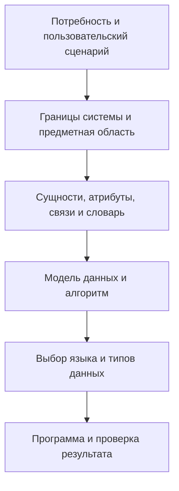
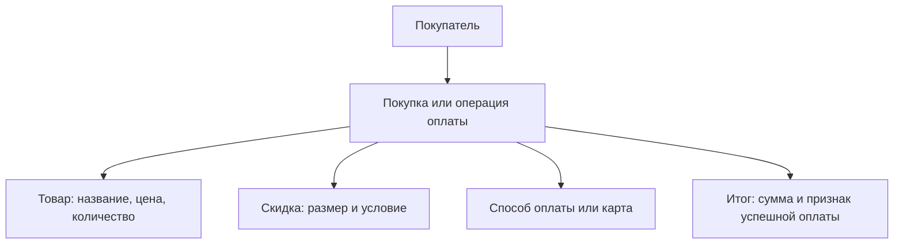
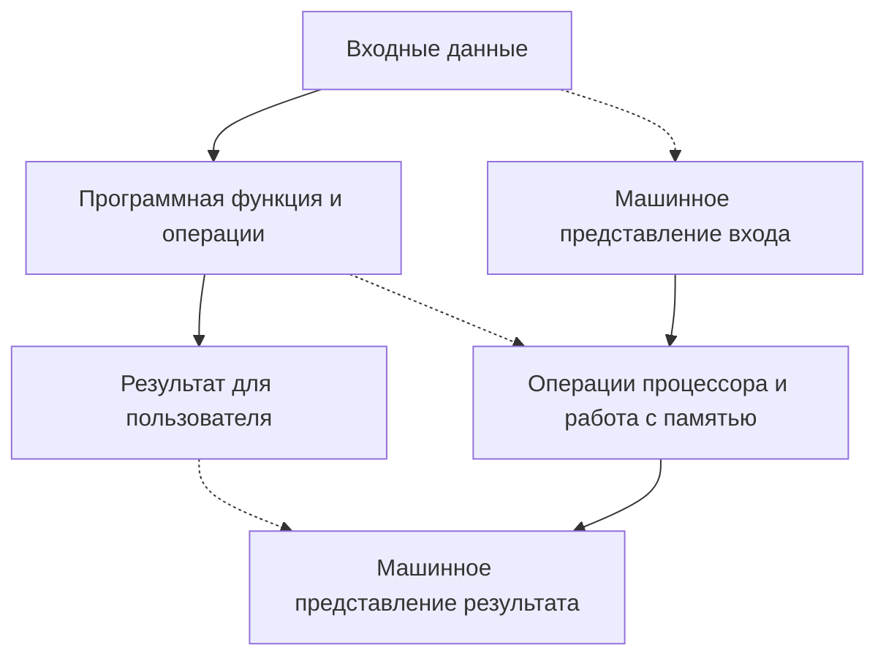

# Технологии программирования — типизация и представление данных

**Дата занятия:** 8 октября 2026 года.  
**Формат:** развернутый учебный конспект с разбором практических опытов на Python, C++ и C#.  
**Главная тема:** как превратить модель предметной области в данные программы, выбрать типы данных и проверить допустимость операций над ними.

> **Принцип чтения примеров.** В лекции преподаватель намеренно менял код, иногда запускал ошибочные фрагменты и наблюдал реакцию среды. Ниже различаются **исходный опыт**, **фактическое или ожидаемое поведение** и **исправленный вариант**. Нельзя автоматически считать любой показанный на экране фрагмент рабочей программой.

## 1. От анализа предметной области к типам данных

### 1.1. Продолжение практической работы

На предыдущем занятии выполнялся **пункт 6** практической работы: описание предметной области, построение ее модели (желательно диаграммы) и составление словаря терминов. Новое уточнение обозначено преподавателем как **6Д**: для атрибутов сущностей требуется подобрать **конкретные типы данных в выбранном языке реализации**. Если пункт 6 уже сдан вместе с типами, его можно уточнить; главное — не подменять свою задачу чужим примером.

Последовательность разработки, которой придерживается преподаватель:



**Сущность** — значимый объект рассматриваемой предметной области (покупатель, товар, скидка, карта оплаты). **Атрибут** — характеристика сущности: название товара, цена, размер скидки, номер карты. **Значение атрибута** должно получить программное представление: число, строку, логическое значение, дату, объект или набор элементов.

Типы полезно сначала обозначить **концептуально** («целое число», «денежная величина», «текст», «набор товаров»), а затем указать **реальный тип языка** (`int`, `str`, `decimal`, `List<T>` и т. п.). Концептуальная модель не обязана совпадать с внутренним устройством программы.

### 1.2. Учебный пример: расчет покупки

Предметная область: покупатель выбирает товары, предъявляет их к оплате, система определяет итоговую сумму, учитывает предусмотренную скидку или бонус, после чего фиксируется результат оплаты.



Потенциальные атрибуты и способы их представления:

| Сущность / атрибут | Смысл | Концептуальный тип | Замечание |
|---|---|---|---|
| Товар — название | Наименование | Строка | Сравнение и вывод текста |
| Товар — цена | Стоимость единицы | Денежное значение | Для финансовых расчетов предпочтительна десятичная арифметика или целые минимальные денежные единицы |
| Позиция — количество | Число единиц товара | Целое неотрицательное | Это отдельное свойство позиции покупки, не обязательно самого товара |
| Скидка — размер | Процент или сумма скидки | Число с установленными правилами | Важно указать, процент это или фиксированная сумма |
| Покупатель — имя | Текст | Строка | Не арифметическое значение |
| Карта — номер | Идентификатор | Строка | Нули слева сохраняются; арифметика с номером не нужна |
| Оплата — успешность | Состояние операции | Логический | `true` / `false`, `True` / `False` |
| Покупка — товары | Несколько позиций | Коллекция | Список, массив, таблица БД и т. п. |

**Границы системы определяют, какие атрибуты нужны.** Для терминала самообслуживания, который сканирует физически принесенные товары, описание состава товара может не участвовать в расчете оплаты. В веб-магазине подробное описание товара и **корзина как набор позиций** важны для пользовательского сценария. Атрибут может быть значим в реальной жизни, но не использоваться в выбранной программной функции.

**Различайте «товар» и «позицию покупки».** Цена и наименование характеризуют товар, а количество штук и скидка в конкретной покупке зачастую относятся к позиции или операции. Это уточнение полезно при дальнейшем проектировании моделей и БД.

### 1.3. Простые и составные данные

- **Простые значения:** целое число, вещественное число, логическое значение, символ (если язык выделяет такой тип).
- **Составные значения:** карта с номером и владельцем; покупатель с набором атрибутов; покупка со множеством товарных позиций.
- **Коллекции:** список, массив, кортеж, множество, словарь и другие средства хранения набора данных; это разные структуры с различными правилами доступа.

Составные типы могут **включать другие составные типы**: например, покупатель содержит сведения о карте. На стадии анализа допустимо нарисовать такую «матрешку», а конкретное оформление классами, структурами, таблицами или словарями выбрать позже.

## 2. Математическая модель и реализация алгоритма

Для демонстрации преподаватель использовал две цены и два количества:

| Переменная | Значение | Значение в модели |
|---|---:|---|
| `price_Po` | 12 | Цена первого товара |
| `price_To` | 120 | Цена второго товара |
| `6` | 6 | Количество первого товара; литеральная константа |
| `3` | 3 | Количество второго товара; литеральная константа |
| `s_sale` | результат | Общая стоимость |

Формула учебного расчета:

$$
S=p_1q_1+p_2q_2=12\cdot6+120\cdot3=432.
$$

**Математическая модель** описывает требуемую операцию независимо от языка. **Программная реализация** дополнительно требует определить типы переменных, смысл операций, правила хранения и преобразования результатов. Даже если формула «очевидна», разные языки могут вычислить измененный вариант по-разному.

Простые числа `6` и `3` прямо в выражении — **литералы** (литеральные константы). В реальном приложении количества обычно поступают от пользователя, из файла, из БД либо из другой части программы. Названия переменных желательно делать осмысленными: подсказки редактора помогают использовать длинные имена.

## 3. Представление, управление и организация данных

### 3.1. Что происходит с информацией

На уровне пользователя есть факты, вводимые данные и требуемые результаты. На уровне компьютера используются физические представления этих данных в памяти и алгоритм преобразования.



На слайдах различаются понятия:

| Понятие | Содержание | Примеры |
|---|---|---|
| **Представление данных** (*data representation*) | Кодирование отдельных элементов и конструирование структур на уровне вычислительной системы | Число в двоичном коде, текст в кодировке, объект в памяти |
| **Управление данными** (*data management*) | Хранение, обновление, удаление, поиск и выдача данных | Работа с файлами и БД |
| **Организация данных** | Согласованное представление и управление данными в приложении | Типы, структуры, коллекции, правила доступа |

Примеры долговременного хранения: **JSON**, **CSV** и базы данных. Из СУБД упоминались **PostgreSQL**, **SQLite**, а на презентации — Oracle, MySQL и Microsoft SQL Server. JSON и CSV — форматы данных, **не базы данных сами по себе**. SQLite — встраиваемая файловая реляционная СУБД; PostgreSQL обычно используется как серверная СУБД.

### 3.2. Три уровня организации данных

| Уровень | Основной вопрос | Пример «точка на плоскости» |
|---|---|---|
| **Логический (проектный)** | Как пользователь и аналитик понимают объект? | Точка имеет координаты `x`, `y` |
| **Уровень языка реализации** | Каким программным типом представить объект? | Два числа, кортеж, класс `Point`, структура |
| **Физический** | Как байты реально размещаются и интерпретируются? | Два значения с конкретной шириной и форматом в памяти |

Переход от одного уровня к другому **не происходит автоматически**: разработчик выбирает представление в соответствии с задачей и средствами языка. В качестве дополнительного упражнения преподаватель предложил продумать, **как представить точку с двумя координатами в программе**; это подготовка к следующей теме о составных типах и коллекциях.

## 4. Память, биты, байты и диапазон значений

### 4.1. Зачем типу данных размер

Программа при выполнении размещает код и необходимые данные в памяти компьютера. В лекции обсуждались оперативная память (**RAM / ОЗУ**) и постоянное хранение (**ROM / ПЗУ** как историческая иллюстрация, а также иные энергонезависимые накопители). Тип данных связан с тем, **как интерпретировать биты** и какие значения и операции допустимы.

- **Бит** имеет два состояния, условно `0` или `1`.
- **Байт** в рассматриваемых системах содержит **8 бит**.
- Из `n` бит можно сформировать **\(2^n\)** комбинаций; для 8 бит их 256.
- Для **беззнакового** целого в 8 бит диапазон — от `0` до `255`.
- Для 8-битного **знакового** целого в распространенном дополнительном коде — от `−128` до `127`.

```text
Число 5 в двоичной записи: 101₂
Хранение в 8-битном байте: 00000101₂
Число 65 в 8-битном представлении: 01000001₂
```

Нельзя рассчитывать, что память хранит «букву А» сама по себе: кодировка задает соответствие **числового кода и символа**. Например, латинская `A` имеет код `65` в ASCII; в Unicode также используется U+0041. Для кириллицы, эмодзи и других символов способ хранения зависит от кодировки (часто UTF-8), а не только от названия типа `char` или `str`.

### 4.2. Диапазон, точность и выбор представления

Выбирая тип, разработчик задает не просто «коробку», но и ограничения: **диапазон**, возможную **точность**, доступные **операции**, расходы памяти. Слишком узкий тип приводит к невозможности представить требуемое значение или к преобразованию с потерями.

**Уточнение к устному объяснению:** обычный `int` в C++ не бывает «любого размера». Стандарт задает минимальные гарантии и отношения между целочисленными типами, а фактический размер зависит от реализации. На распространенных современных платформах `int` — 32-битный, `short` — 16-битный, но полагаться на это без проверки нельзя. Для фиксированной ширины в C++ существуют типы `<cstdint>` (`std::int32_t`, `std::uint64_t` и т. д.), если соответствующая ширина поддерживается.

## 5. Первый пример на Python: ввод и вывод

Первый опыт показывает ввод текста и печать результата:

```python
name = input("Как тебя зовут? ")
print("Привет,", name, "!")
```

**Что здесь происходит:** `input()` возвращает строку (`str`), которая сохраняется в `name`; `print()` печатает несколько аргументов. По умолчанию он вставляет между ними **пробел** (`sep=" "`). Поэтому перед `!` получится дополнительный пробел:

```text
Как тебя зовут? Анна
Привет, Анна !
```

Если требуется аккуратная пунктуация, можно применить **f-строку**:

```python
name = input("Как тебя зовут? ")
print(f"Привет, {name}!")
```

Или управлять разделителем: `print("Привет, ", name, "!", sep="")`. Эти варианты **не дают буквально одинаковый результат**, если вручную добавить или удалить пробелы. Внутри строки пробелы значимы.

## 6. Расчет покупки на Python

Показанный на занятии смысл программы:

```python
price_Po = 12
price_To = 120
s_sale = price_Po * 6 + price_To * 3
print("Общий итог", s_sale)
```

Результат:

```text
Общий итог 432
```

У Python **не нужно указывать тип переменной при обычном присваивании**. Здесь оба значения — `int`, как и `s_sale` в исходной формуле. При изменении типа результата имя переменной продолжает указывать на полученный объект. Это пример **динамической типизации**, а не отсутствия типов.

## 7. Та же программа на C++: от ошибочного наброска к работающему коду

### 7.1. Исходный, некорректный вариант

На одном из экранов выражения из Python перенесены в C++ примерно так:

```cpp
#include <iostream>
using namespace std;

int main() {
    price_po: int = 12;  // ОШИБКА: не синтаксис объявления C++
    price_to: int = 120; // ОШИБКА: не синтаксис объявления C++
    s_sale = price_po * 6 + price_to * 3; // переменная не объявлена
    cout << "Hello, World!" << 25;
    return 0;
}
```

Это **не рабочий C++**. Запись `price_po: int = 12;` напоминает аннотацию типа в Python, но в C++ объявление выглядит как `int price_po = 12;`. Слова `price_po:` сами по себе могут трактоваться как метка, но остаток `int = 12` синтаксически неверен. У результата `s_sale` также должен быть объявлен тип.

### 7.2. Исправленный вариант

```cpp
#include <iostream>
using namespace std;

int main() {
    int price_Po = 12;
    int price_To = 120;
    int s_sale = price_Po * 6 + price_To * 3;
    cout << "Total = " << s_sale;
    return 0;
}
```

```text
Total = 432
```

| Конструкция | Python | C++ |
|---|---|---|
| Объявление числовой переменной | `price_Po = 12` | `int price_Po = 12;` |
| Вывод | `print(s_sale)` | `cout << s_sale;` |
| Точка входа в примере | Выполнение команд модуля | `int main()` |
| Завершение инструкции | Обычно новая строка | Обычно `;` |
| Типизация | Динамическая | Статическая |

`cout` — стандартный поток вывода, `<<` — оператор вставки в поток. `#include <iostream>` подключает соответствующие объявления. `main()` в таком примере — точка входа в программу. Названия переменных чувствительны к регистру: `price_Po` и `price_po` — разные идентификаторы.

## 8. Принципиальная разница: деление целых чисел

Преподаватель добавил вычитание доли цены первого товара:

$$
$S=12\cdot6+120\cdot3-\frac{12}{5}=429{,}6.$
$$

Однако одинаковая запись с оператором `/` может дать **разные результаты**.

**Python 3:**

```python
price_Po = 12
price_To = 120
s_sale = price_Po * 6 + price_To * 3 - price_Po / 5
print(s_sale)       # 429.6
print(type(s_sale)) # <class 'float'>
```

В Python 3 оператор `/` дает вещественное деление даже при двух целочисленных операндах. Для целочисленного деления есть `//`, но для отрицательных чисел `//` **округляет вниз**, а не просто отбрасывает дробную часть.

**C++:**

```cpp
int price_Po = 12;
int price_To = 120;
int s_sale = price_Po * 6 + price_To * 3 - price_Po / 5;
// 430: при делении int / int получается 2
```

В C++ целочисленное деление `12 / 5` возвращает `2`, остаток отбрасывается в направлении нуля. Поэтому получается `432 − 2 = 430`, а не `429.6`.

**Тонкость: смена типа переменной результата не исправляет уже произведенное целочисленное деление:**

```cpp
float s_sale = price_Po * 6 + price_To * 3 - price_Po / 5;
// Все равно 430.0f: правый операнд вычислен до присваивания float
```

**Исправление в C++:**

```cpp
double s_sale = price_Po * 6 + price_To * 3 - price_Po / 5.0;
// 429.6 (приближенно в двоичной арифметике)
```

Или `static_cast<double>(price_Po) / 5`. Следует различать **тип исходных операндов**, **тип промежуточного результата** и **тип переменной, в которую записывается результат**. Даже `double` обычно не хранит десятичное `429.6` математически точно: числа с плавающей точкой могут иметь погрешность представления.

## 9. Операция `+`: числа, строки, символы и указатели

Один и тот же знак может означать разные действия в зависимости от **типов операндов**. Это связано с правилами типизации и перегрузкой операторов.

### 9.1. Python: склейка строк и отказ смешивать число со строкой

```python
print("s_sale" + "product")  # s_saleproduct
print("Общий итог", "s_sale" + "product")  # Общий итог s_saleproduct
```

В кавычках написаны **литеральные строки**, а не имена переменных. Поэтому программа объединяет буквы `s_sale` и `product`, но **не подставляет** числовое значение `s_sale`.

```python
s_sale = 429.6
print("product" + s_sale)        # TypeError
print("product " + str(s_sale)) # product 429.6
print(f"product {s_sale}")       # product 429.6
```

Python принимает `str + str`, но не `str + float` и не `int + str`. Для отображения числа его преобразуют в строку явно или используют форматирование.

### 9.2. C++: почему два опыта ошибочны по-разному

**Опыт A** (на снимке экрана):

```cpp
cout << "Total = " << ("product" + s_sale);
```

Если `s_sale` — целое, то в C++ строковый литерал в этом выражении преобразуется к указателю на его первый символ; `указатель + целое` — **арифметика указателей**, а не склейка строк. При `s_sale = 430` вычисление адреса далеко за пределами литерала дает **неопределенное поведение**. Выражение может компилироваться: считать его безусловной ошибкой компиляции **неправильно**. Наблюдать случайный вывод или аварийное завершение как закономерный результат также нельзя.

**Опыт B** (после замены переменной на строковый литерал):

```cpp
cout << "Total = " << ("product" + "s_sale");
```

Теперь с обеих сторон `+` строковые литералы, которые не превращаются автоматически в `std::string`; сложение двух указателей **недопустимо**, поэтому компилятор сообщает ошибку.

**Корректный вывод без склейки:**

```cpp
cout << "Total = " << "product " << s_sale;
```

**Корректная склейка через библиотечные строки:**

```cpp
#include <string>
string result = string("product ") + to_string(s_sale);
cout << result;
```

**Важно:** `std::string` и строковый литерал вида `"text"` в C++ — разные сущности. Не стоит переносить правила работы с `str` из Python на строковые литералы C++.

### 9.3. Символ в одинарных кавычках

```cpp
cout << 12 + 's';
```

В распространенной ASCII-совместимой кодировке исполнения `'s'` имеет числовой код `115`, а выражение дает `127`. Это **арифметическое сложение**, а не склейка текста. Точное числовое значение символьного литерала зависит от кодировки исполнения.

В Python одинарные и двойные кавычки одинаково обозначают **строку**:

```python
type('s') == type("s")  # True
12 + 's'                # TypeError
```

В C++ `'s'` — символьный литерал типа `char`, а `"s"` — строковый литерал (массив символов с завершающим нулем). Подстановка одинарных или двойных кавычек принципиально меняет тип.

## 10. Контроль типов и выход за допустимый диапазон

### 10.1. Что обеспечивает проверка типов

Проверка типов анализирует, согласуются ли выражения, операторы, переменные и аргументы с правилами языка. Она позволяет выявлять часть ошибок **до запуска**, если язык и проверка статические, либо **при выполнении** операции. При этом **корректный по типам код не гарантирует математическую правильность результата**: возможны переполнение, потеря точности, ошибки алгоритма.

### 10.2. Эксперимент с `short` в C++

На снимке показано:

```cpp
short a1 = 34000;
short a2 = 1500;
cout << a1 + a2;
```

Математически `34000 + 1500 = 35500`. Но `34000` **не представимо в 16-битном знаковом `short`** (его обычный диапазон `−32768 … 32767`). Проблема возникает **уже при инициализации `a1`**, до выполнения сложения! При типичном 16-битном `short` и распространенном поведении преобразования получится `a1 = −31536`, а сумма будет `−30036`. Для преобразования целого значения, не представимого в знаковом типе, точные гарантии зависят от версии стандарта C++ и реализации; нельзя утверждать, что любой C++ всегда выдаст именно это число.

При этом выражение `a1 + a2` обычно вычисляется уже в типе **`int`** (целочисленные повышения). Поэтому наблюдаемое отрицательное число не доказывает «переполнение непосредственно в операции сложения».

**Безопасный пример:**

```cpp
int a1 = 34000;
int a2 = 1500;
cout << a1 + a2; // 35500
```

А если специально нужно проверять выход за диапазон 16-битного числа, следует сравнивать результат с `std::numeric_limits<short>::min()` / `max()` перед сужающим преобразованием.

**Важное сравнение с C#:** запись `short a1 = 34000;` с целочисленной константой вне диапазона вызывает **ошибку компиляции**, а не тихое получение отрицательного значения.

### 10.3. Числа с плавающей точкой и деньги

Типы `float` и `double` широко используются для приближенных вещественных расчетов, но из-за бинарного представления не обязаны хранить заданные десятичные дроби точно. Для денежных сумм часто применяют `decimal` в C# / Python (`decimal.Decimal`) либо хранение целых копеек/центов. **Decimal не гарантирует абсолютную точность любых вычислений:** нужны заданная точность, режим округления и бизнес-правила. Преподаватель обозначил тему форматов и погрешностей как материал для дальнейшего изучения.

## 11. Область видимости, объявления и затенение переменных

Еще один эксперимент проводился в C++. Сначала преподаватель поместил перед `main()` выражение с `price_Po`, хотя она была объявлена **только внутри `main()`**:

```cpp
int a = price_Po + 5; // ОШИБКА: price_Po в этой области не объявлена

int main() {
    int price_Po = 12;
    return 0;
}
```

**Исправление показанного опыта:**

```cpp
#include <iostream>
using namespace std;

double price_Po = 1.5; // глобальная переменная
int a = price_Po + 5;   // 6.5 преобразуется к int -> 6

int main() {
    int price_Po = 12;  // локальная переменная скрывает глобальную
    cout << a;          // 6
    return 0;
}
```

Имеются **две разные `price_Po`**: глобальная с типом `double` и локальная с типом `int`. Выражение при инициализации глобальной `a` использует **глобальную** переменную `price_Po = 1.5`; после добавления 5 получается `6.5`, затем при присваивании `int` дробная часть отбрасывается и сохраняется `6`. Локальная `price_Po = 12` в `main()` не изменяет уже вычисленное `a`.

Вариант со **строкой** вместо глобального `double` нельзя автоматически присвоить `int a`. В современных программах глобальное изменяемое состояние обычно минимизируют: сложнее проследить, где и когда значения изменяются.

## 12. Статическая, динамическая, сильная и слабая типизация

Это **две разные оси сравнения**, которые нельзя смешивать.

| Признак | Что характеризует | Примеры и нюансы |
|---|---|---|
| **Статическая типизация** | Типы выражений и допустимость многих операций проверяются до выполнения | C++, C#, Java; вывод типа `auto`/`var` не делает их динамическими |
| **Динамическая типизация** | Тип значений и проверка операций проявляются во время выполнения | Python, JavaScript, Ruby; значения все равно имеют определенные типы |
| **Сильная типизация** | Язык строго ограничивает некоторые неявные смешивания несовместимых типов | Python, например, запрещает `"5" + 7` |
| **Слабая типизация** | В языке распространены неявные преобразования между различными видами значений | Термин зависит от контекста; C/C++ часто называют более слабыми из-за преобразований и работы с указателями |

**Неоднозначность терминов:** «сильная/слабая» типизация не имеет единого стандартизованного бинарного критерия. C++ остается статически типизированным языком, хотя допускает множество неявных преобразований и низкоуровневые операции; Python динамически и достаточно строго типизирован в смысле несовместимости `str` с числами. C# и Java — статически типизированные языки с более жесткими ограничениями ряда преобразований.

Пример динамического связывания имени с разными по типу значениями в Python:

```python
value = 6       # объект int
value = "текст" # теперь объект str
```

В C++ нельзя повторно присвоить `int` строковый литерал, сохранив ту же переменную как `int`. В C# операция с некорректным явным/неявным преобразованием также может быть отклонена еще при компиляции.

## 13. Основные группы типов в рассматриваемых языках

### 13.1. Простые и структурированные типы

В презентации простые типы группировались на **целочисленные**, **вещественные**, **логические**, **символьные**. К структурированным относились **массив**, **строка**, **структура**, **перечисление**, **класс**. Это педагогическая классификация: формальная система типов разных языков устроена по-разному. Например, `str` в Python — объектный тип, `std::string` в C++ — библиотечный класс, а массив в C++ и `list` в Python имеют разные свойства.

**Python — типичные встроенные группы:**

```text
Числа:             int, float, complex
Логические:        bool
Текст:             str
Последовательности: list, tuple, range
Множества:         set, frozenset
Словари:           dict
Двоичные данные:   bytes, bytearray, memoryview
Отсутствие значения: None
```

`list` изменяем, `tuple` обычно используют для неизменяемой последовательности, `dict` хранит соответствия **ключ → значение**, `set` хранит уникальные элементы. Тип `int` в Python имеет **произвольную точность в пределах доступной памяти**, тогда как `float` обычно соответствует IEEE 754 binary64. Отдельного встроенного типа `char` нет: одна буква — строка длины 1.

**C++ — существенные группы:**

| Группа | Типы / средства | Особенность |
|---|---|---|
| Целые | `short`, `int`, `long`, `long long` и `unsigned`-варианты | Конкретная ширина зависит от реализации; возможны фиксированные ширины из `<cstdint>` |
| Символы | `char`, `char8_t`, `char16_t`, `char32_t`, `wchar_t` | Не эквивалентны полноценной Unicode-строке сами по себе |
| Вещественные | `float`, `double`, `long double` | Формат и точность частично зависят от платформы |
| Логический | `bool` | `true` и `false` |
| Составные | массивы, структуры, классы, перечисления | Отдельные правила инициализации и памяти |
| Библиотечные коллекции | `std::string`, `std::vector`, `std::map` и др. | Не являются встроенными арифметическими типами |

**Java — типичные фиксированные примитивы:**

| Тип | Ширина | Значения |
|---|---:|---|
| `byte` | 8 бит | `−128 … 127` |
| `short` | 16 бит | `−32768 … 32767` |
| `int` | 32 бита | `−2147483648 … 2147483647` |
| `long` | 64 бита | `−2^63 … 2^63−1` |
| `float` | 32 бита | Приближенное двоичное вещественное |
| `double` | 64 бита | Приближенное двоичное вещественное |
| `char` | 16 бит | UTF-16 кодовая единица, **беззнаковая** |
| `boolean` | Размер хранения не фиксирован спецификацией | `true`, `false` |

**Поправка к упрощенной таблице на слайде:** утверждение «`boolean` всегда занимает 8 бит» неверно как универсальное правило языка Java. Для `boolean` нет обязательного фиксированного размера хранения, равного одному байту. `char` в Java — кодовая единица UTF-16, а не обязательно целый Unicode-символ.

В C# существуют, в частности, `byte`, `sbyte`, `short`, `ushort`, `int`, `uint`, `long`, `ulong`, `float`, `double`, `decimal`, `bool`, `char`, `string`. `decimal` предназначен для десятичной арифметики; в Java аналогичную задачу часто решают с помощью библиотечного `BigDecimal`, а в Python — `decimal.Decimal`.

### 13.2. Как выбирать тип атрибута

| Назначение | Тип в Python | Тип в C# | Тип в C++ (пример) |
|---|---|---|---|
| Количество единиц | `int` | `int` | `int` / `std::int32_t` |
| Название | `str` | `string` | `std::string` |
| Признак успеха | `bool` | `bool` | `bool` |
| Сумма денег | `Decimal` | `decimal` | Целое число копеек либо десятичная библиотека |
| Дата и время | `datetime` | `DateTime` / `DateOnly` | `std::chrono` или отдельная библиотека |
| Набор товаров | `list[...]` | `List<T>` | `std::vector<T>` |
| Сущность со свойствами | `class` / `dataclass` | `class` / `record` / `struct` | `struct` / `class` |

Таблица — **проектная иллюстрация**, а не универсальная спецификация: в каждой задаче нужно уточнять максимальные значения, отрицательные значения, формат дат, обязательность поля, точность финансовых расчетов и способ сериализации/сохранения.

## 14. Операторы и преобразования

| Операция | Python | C++ | Существенное замечание |
|---|---|---|---|
| Сложение | `a + b` | `a + b` | Смысл зависит от типов; строки Python склеиваются |
| Умножение | `a * b` | `a * b` | В Python допустимо `"a" * 3` → `"aaa"`, но это не правило C++ |
| Деление | `a / b` | `a / b` | Python 3 возвращает вещественное; C++ при двух целых — целое |
| Целочисленное деление | `a // b` | `a / b` при целых | Для отрицательных чисел правила округления различаются |
| Остаток | `a % b` | `a % b` | Отличается знак результата при отрицательных операндах |
| Побитовое И | `a & b` | `a & b` | Применяется к целочисленным представлениям |
| Побитовое ИЛИ | `a \| b` | `a \| b` | Можно устанавливать флаги в маске |
| Сдвиг влево/вправо | `<<`, `>>` | `<<`, `>>` | В C++ `<<` также служит для вставки в поток; свойства сдвигов зависят от типов |

**Побитовые операции** полезны, когда каждое положение бита кодирует отдельный флаг: например, некоторый вход оборудования активен или неактивен. Для маски `0b0101` (биты 0 и 2 установлены) выражение `mask & 0b0100` проверяет третий бит, а `mask | 0b0010` устанавливает второй. При этом нельзя смешивать **логические** операции (`and`, `or` в Python; `&&`, `||` в C++) и **побитовые** операции (`&`, `|`).

**Преобразования типов:** явное преобразование (`int(...)`, `str(...)`, `static_cast<...>`) отличается от неявного. Важно заранее понимать, будет ли преобразование **без потерь**, **с округлением/усечением**, **с переполнением** либо **недопустимым**.

## 15. Что выполнить к следующему занятию

1. **Завершить пункт 6:** понятная модель своей предметной области и словарь терминов. Преподаватель не требовал чрезмерно подробной графики ради самой графики; смысл модели важнее оформления.
2. **Сделать уточнение 6Д:** для атрибутов собственных сущностей указать типы **конкретного языка** (можно выбрать язык реализации). Обязательно обосновать, почему тип соответствует диапазону и операциям.
3. **Подумать о наборах данных:** где нужны массивы, списки, коллекции или таблицы БД; нет необходимости преждевременно реализовывать все такие структуры.
4. **Дополнительно:** предложить несколько вариантов программного представления точки с двумя координатами; сравнить преимущества.
5. **При желании углубиться:** двоичное представление, побитовые операции и погрешности вещественной арифметики. Детальное изучение представления вещественных чисел было перенесено/оставлено факультативным.

**Роль ИИ-помощника (в лекции — GigaChat):** составить запрос применительно **к своей** задаче: «Для сущностей и атрибутов такого-то сценария предложи типы данных в таком-то языке; укажи допустимый диапазон, возможные потери точности, необходимость коллекций и обоснуй выбор». Ответ требуется **проверить** по справочнику языка и собственным тестам. Копировать демонстрационный пример преподавателя вместо решения своей задачи нельзя.

### Рабочая таблица для 6Д

| Сущность | Атрибут | Пример значения | Тип в выбранном языке | Обоснование / ограничение |
|---|---|---|---|---|
| Товар | Наименование | «Помидоры» | `str` (Python) | Текст |
| Товар | Цена | `12.50` | `Decimal` (Python) | Денежная сумма, контролируемое округление |
| Позиция покупки | Количество | `6` | `int` (Python) | Целое неотрицательное |
| Оплата | Успешна | `True` | `bool` (Python) | Два логических состояния |
| Покупка | Позиции | Набор товаров | `list[Position]` (Python) | Переменное количество элементов |

Эта таблица показывает **формат результата**, но не является готовым решением индивидуальной работы: ее нужно заполнить для собственной предметной области.

## 16. Итоги: что особенно важно запомнить

1. **Тип данных — часть проектного решения**, а не только синтаксис объявления переменной: он влияет на допустимые значения, операции, преобразования, точность и память.
2. **Одна и та же математическая запись не гарантирует одинаковое вычисление:** `12 / 5` в Python 3 и C++ при целых операндах — принципиальный пример.
3. **Ошибки с кодом неоднородны:** есть ошибка компиляции, исключение во время выполнения, неверное вычисление, поведение, зависящее от реализации, и неопределенное поведение. Эти случаи следует различать.
4. **Статическая/динамическая** и **сильная/слабая** типизация отвечают на разные вопросы. Динамическая типизация не означает отсутствие контроля.
5. **Строка, символ, числовой код и указатель — не одно и то же.** Для корректной работы нужны правила именно выбранного языка.
6. **Модель предметной области должна переходить в конкретную схему данных**, а не просто оставаться рисунком: пункт 6Д как раз связывает эти этапы.
