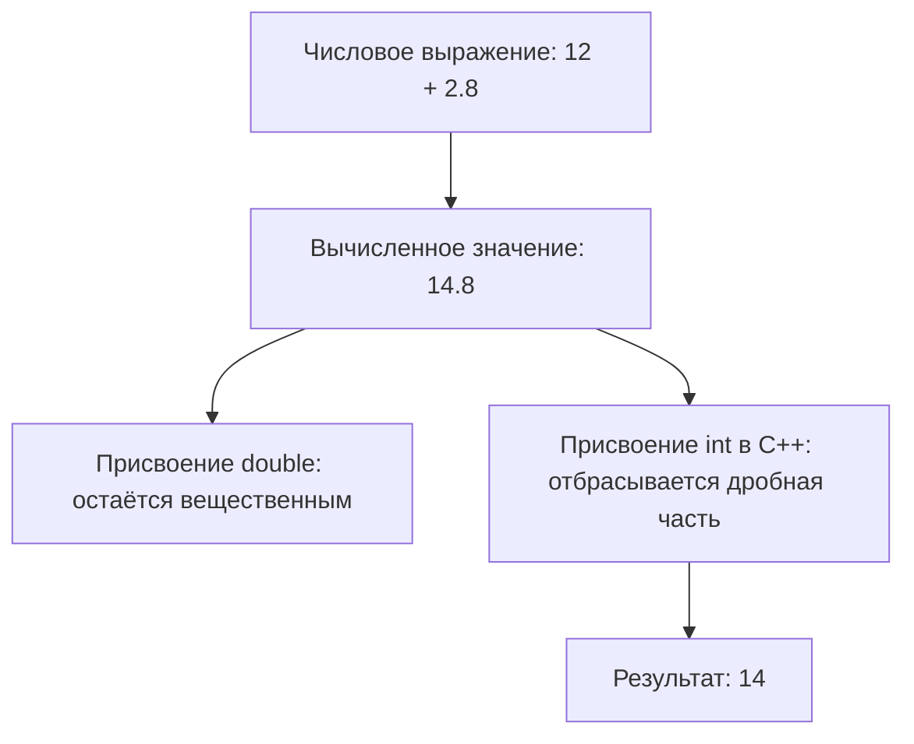
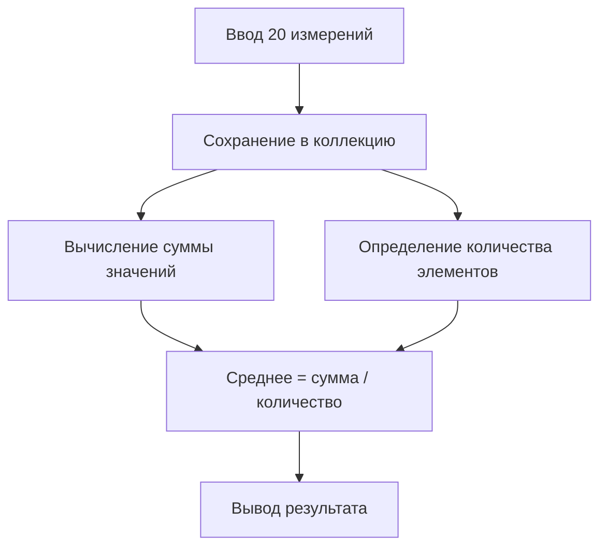
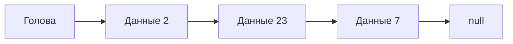
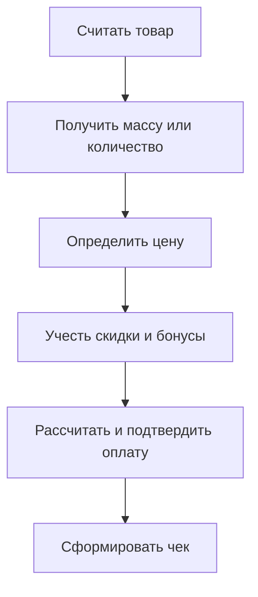
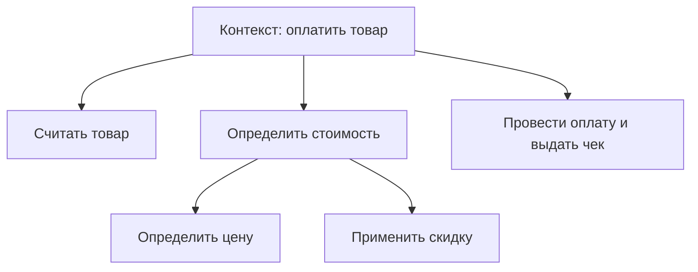
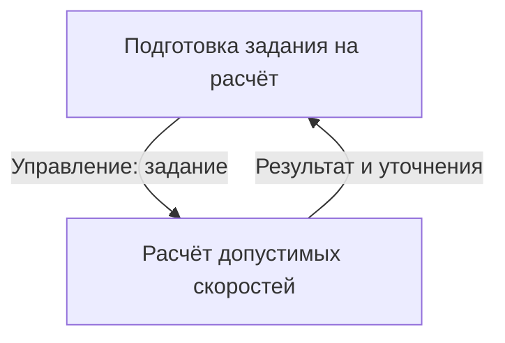

# Технологии программирования — конспект лекции

**Дата:** 12 октября 2026 года. **Тема занятия:** типы данных и преобразования, структуры хранения данных, переход от постановки задачи к программированию и структурное проектирование в SADT/IDEF0.

> Конспект восстановлен по машинной расшифровке и выбранным изображениям экранов. Примеры кода ниже приведены в работоспособной учебной форме: это не всегда посимвольная запись с экрана. Замечания о границах точности чисел и устройстве коллекций уточняют устные упрощения, но не изменяют смысл лекции.

## 1. План занятия и связь с предыдущими темами

В начале занятия преподаватель завершает блок о типизации и переходит к **преобразованиям типов**. Параллельно начинается практическое программирование небольших решений на Python и C++ с разбором поведения компилятора и интерпретатора. Вторая линия курса — **анализ и проектирование**: на основании сценария предметной области определить функции системы, данные на входе и выходе, ограничения и связи между функциями. Для этого применяется упрощённое структурное моделирование SADT и IDEF0.

Главная мысль: **данные, их типы и допустимые операции связаны**. Даже привычный знак `+` может означать сложение чисел или конкатенацию строк, а в некоторых комбинациях типов операция вообще недопустима. Тип необходимо выбирать не только по хранимому значению, но и по запланированным действиям с ним.

Условная последовательность разработки:

1. Определить задачу и объекты предметной области.
2. Уточнить необходимые данные и операции.
3. Выбрать типы и структуры хранения.
4. Разбить задачу на функции и описать потоки данных.
5. Реализовать и проверить отдельные алгоритмы.

## 2. Числовые типы: целые, вещественные и денежные данные

### 2.1. Целые значения

Целое число (`int` и другие целочисленные типы) кодируется битами. Размер представления задаёт диапазон значений. Для знаковых чисел распространено представление отрицательных значений **в дополнительном коде**; для беззнаковых отрицательные значения не предусмотрены. На битовом уровне доступны маски, поразрядные логические операции и сдвиги. Они остаются значимыми в C++, C#, Java и Python.

**Выбор:** целочисленный тип подходит для количества объектов, индексов, счётчиков и денежных сумм, выраженных в минимальных неделимых единицах (например, в копейках).

### 2.2. Фиксированная и плавающая точка

В модели **фиксированной точки** заранее задано положение разделителя целой и дробной частей. В двоичной дробной части позиции имеют веса `1/2`, `1/4`, `1/8` и далее. Например, `2,25` представимо точно как `10,01₂`:

$$
2{,}25 = 2^1 + 2^{-2}.
$$

Но не каждая десятичная дробь имеет конечную двоичную запись. Например, `0,1` представляется в обычной двоичной арифметике с округлением.

В распространённом формате **с плавающей точкой** число описывают знаком, значащими цифрами (мантиссой/сигнификандом) и порядком. Идея приближённо записывается как

$$
x = (-1)^s \times m \times 2^e.
$$

Это позволяет описывать и очень большие, и очень маленькие по модулю значения, но набор **точно представимых** чисел конечен. При сложении величин с сильно различающимися порядками маленькое слагаемое может не повлиять на результат из-за ограниченной точности. Такое явление называют потерей значимости при округлении.

**Текстовое воспроизведение рисунка.** При фиксированной двоичной точке позиции слева и справа от разделителя имеют веса:

| Часть | Разряды (пример) |
|---|---|
| Целая | `... 8 4 2 1` |
| Дробная | `1/2 1/4 1/8 1/16 ...` |

Число `2,25` раскладывается как `2 + 1/4`, то есть `10.01₂`. Модель с плавающей точкой отдельно хранит значащие биты и порядок, что увеличивает рабочий диапазон, но округляет часть десятичных дробей. Более широкий `double` уменьшает, а не устраняет эту погрешность.

### 2.3. `float`, `double` и ограниченность точности

В типичной реализации IEEE 754 типы `float` (binary32) и `double` (binary64) содержат примерно 24 и 53 двоичных значащих разряда соответственно. `double` обычно лучше сохраняет значащие цифры и работает с более широким диапазоном, **но не обеспечивает математически точную десятичную арифметику**.

Например, в Python:

```python
print(0.1 + 0.2)       # 0.30000000000000004
print((0.1 + 0.2) == 0.3)  # False
```

Поэтому сравнивать результаты вычислений с плавающей точкой строго через `==` зачастую некорректно. Если нужна проверка близости, задают обоснованный допуск:

```python
import math

print(math.isclose(0.1 + 0.2, 0.3, rel_tol=1e-9, abs_tol=1e-12))
```

Допуск зависит от задачи; `isclose` не заменяет точных денег или дискретных счётчиков. В C++ для сравнения также используют допуск, масштабируемый с требуемой точностью.

### 2.4. Представление стоимости

В лекции вопрос ставится на примере цены `2,25`: хранить её как целое или вещественное число? Простое решение `float`/`double` удобно, но в финансовых расчётах может дать недопустимое накопление погрешности.

На практике применяют либо **целое количество минимальных денежных единиц**, либо **десятичные типы** с явно определённым округлением:

```python
from decimal import Decimal, ROUND_HALF_UP

price = Decimal("2.25")
tax = Decimal("0.10")
result = (price + tax).quantize(Decimal("0.01"), rounding=ROUND_HALF_UP)
print(result)  # 2.35
```

В C# существует встроенный тип `decimal` и суффикс литерала `m`, например `2.25m`. В Python `Decimal` находится в библиотеке `decimal`. В стандартном C++ **нет встроенного точного десятичного аналога `decimal`**: применяют целочисленные суммы или специальные библиотеки/типы. Сам по себе `double` не решает проблему десятичной точности.

## 3. Преобразование типов и вычисление выражений

### 3.1. Неявное и явное приведение

Если в выражении встречаются разные типы, язык применяет правила преобразования. **Неявное** приведение выполняется автоматически, если оно разрешено; **явное** программист задаёт специальной записью. Эти правила различаются по языкам и контекстам: их нельзя вывести только из условной характеристики «строгая» или «слабая» типизация.

Пример C++:

```cpp
#include <iostream>

int main() {
    int a = 12 + 2.8;       // результат выражения 14.8, затем потеря дробной части
    double b = 12 + 2.8;    // хранится 14.8 (с обычной погрешностью binary64)
    std::cout << a << "\n" << b << "\n";
}
```

Преобразование `double` в `int` при присваивании `a` отбрасывает дробную часть по направлению к нулю. Оно не является математическим округлением. Компилятор может предупредить о сужающем преобразовании. Для целочисленного результата деления тоже важно сначала уточнить типы операндов:

```cpp
int sum = 7;
int count = 2;
double average = static_cast<double>(sum) / count;  // 3.5
```

В C# преобразования, способные потерять данные, обычно требуют явного указания:

```csharp
double value = 12 + 2.8;
int truncated = (int)value;
Console.WriteLine(truncated); // 14
```

В Python имя можно переназначить на объект другого типа:

```python
value = 12
print(type(value))   # <class 'int'>
value = 12.8
print(type(value))   # <class 'float'>
```

Это **динамическая типизация**, а не отсутствие типов у данных: тип есть у каждого объекта.

**Схема последовательных преобразований значений.**



При попытке складывать строки с числами Python сообщает об ошибке типа. Правильное преобразование для вывода — `str(value)` или f-строка. Объявление целочисленной переменной в C++ отличается от привязки имени к объекту в Python.

### 3.2. Числа, строки и ошибки совместимости

Фрагмент демонстрации использует ввод имени, чисел и печать результата. Здесь важно отличать **число** от **его строкового изображения**:

```python
price = 12.2
name = "Иван"

print(name + ": " + str(price))  # явное преобразование в строку
# print(name + price)            # TypeError
print(type(price))               # <class 'float'>
```

В Python `+` соединяет строки со строками, но не строку с `float` или `int`. Для удобного вывода используются f-строки: `print(f"{name}: {price}")`. Непосредственный вывод нескольких аргументов через `print(name, price)` также возможен; это не операция сложения.

### 3.3. Объект, имя, тип и расположение в памяти

В статически типизированном C++ объявление `int a = 12;` задаёт переменную определённого типа. Её адрес можно получить оператором `&a` и вывести через указатель. В Python запись `a = 12` привязывает имя к объекту; `type(a)` сообщает тип объекта, а `id(a)` — идентификатор объекта на время его существования. **`id()` не является универсальной документированной функцией получения физического адреса памяти** (хотя в CPython часто связан с адресом объекта).

Это объясняет, почему в Python имя может последовательно ссылаться на `int`, затем `float`, затем `str`, а действия и методы определяются текущим объектом.

## 4. Зачем нужны структуры данных

Постановка учебной задачи: имеются измерения роста **20 человек**; требуется вычислить средний рост. Сначала нужно решить, как ввести числа, как сохранить набор, где его хранить и как перебрать для суммирования. Записывать двадцать независимых переменных неудобно: нужен один объект, представляющий совокупность данных.

**Структура данных** — соглашение о размещении значений и правилах доступа, вставки, удаления и обхода. Выбор структуры зависит от предметной задачи, размера данных и преобладающих операций.

**Исходная задача на схеме.** «Дано: известен рост 20 человек; определить среднее значение». Возможный конвейер данных:



Выбор коллекции и типа числа должен быть сделан до реализации вычисления.

### 4.1. Статический массив

**Массив** обеспечивает индексированный доступ к элементам одного типа. В классической модели элементы размещены подряд, а адрес вычисляется по формуле

$$
\operatorname{addr}(A[i]) = \operatorname{base}(A) + i\,\operatorname{sizeof}(T).
$$

Индексирование обычно начинается с нуля: первый элемент `A[0]`, затем `A[1]` и так далее. Индекс — это смещение от начала последовательности, а не порядковый номер человека в естественной речи.

Пример массива в C++:

```cpp
#include <iostream>

int main() {
    int arrInter[5] = {10, 23, 6, 49, 12};
    std::cout << arrInter[0] << "\n"; // 10
    arrInter[2] = 100;
    std::cout << arrInter[2] << "\n"; // 100
}
```

В лекции на слайде показано объявление `int arrInter[17];`: `int` — тип элементов, `arrInter` — имя, `[17]` — количество элементов. Для массива из семнадцати элементов допустимы индексы от `0` до `16`; обращение за границы такого обычного C++-массива — ошибка, которую язык не обязан обнаружить во время выполнения.

В C#/Java создание массива отделено от задания его типа: `int[] intArray = new int[100];` (C#/Java по сути сходны, хотя синтаксис и детали отличаются); на слайде также есть пример инициализации набора значений.

**Текстовая копия основных элементов слайдов.**

```text
int arrInter[5] = {10, 23, 6, 49, 12};
          индекс:   0   1  2   3   4
          данные:  10  23  6  49  12
```

Базовый адрес `A[0]` соответствует нулевому смещению, `A[1]` — смещению на один элемент и т. д. В слайде с объявлением `int arrInter[17];` указан тип `int`, имя `arrInter` и размер `17` элементов. В C#/Java показана запись `int[] intArray = new int[100];` (тип, имя и размер задаются разными синтаксическими частями).

### 4.2. Динамические структуры и аналогия «скамейка — лужайка»

Лекционная аналогия: у обычного массива элементы «сидят на скамейке», места подряд и их число фиксировано; если хочется добавить нового участника внутрь последовательности, могут понадобиться переносы или новый массив. В **связанном списке** элементы «сидят на лужайке»: каждый узел хранится отдельно и указывает на следующий. Добавление/удаление узла возможно без перемещения всех остальных элементов, если нужная позиция уже найдена.

**Важно:** вставка в найденное место связанного списка требует изменения нескольких ссылок (обычно `O(1)`), но **поиск самого места** занимает до `O(n)`. Произвольный доступ `A[i]` в массиве обычно `O(1)`; обход до `i`-го узла связанного списка — `O(n)`.

**Текстовая схема сравнения.** У массива значения находятся в последовательных ячейках. В односвязном списке каждый отдельный узел хранит значение и адрес следующего:



Структура узла в C++: `struct Node { int data; Node* next; };`. Вставка между вторым и третьим узлом осуществляется изменением ссылок, а не физическим сдвигом всех элементов; сначала нужно найти точку вставки.

На слайде приведён набросок узла односвязного списка:

```cpp
struct Node {
    int data;
    Node* next;
};
```

Поле `data` хранит полезное значение, `next` — ссылку/указатель на следующий узел. Последний узел указывает на `nullptr`. В двусвязном списке есть ещё указатель на предыдущий узел.

**Осторожно с терминологией:** Python `list` и C# `List<T>` обычно реализованы как **динамические массивы**, а не как связные списки. В C++ `std::vector` — динамический массив, а `std::list` — связанный двусвязный список. В C# для связного списка существует `LinkedList<T>`.

### 4.3. Стек, очередь, хеш-таблица

**Стек (stack)** работает по правилу **LIFO** (*last in, first out* — последним пришёл, первым вышел). Основные операции — `push` (положить на вершину) и `pop` (забрать вершину). Применение: история вызовов, временное хранение, отмена последних действий.

**Очередь (queue)** работает по правилу **FIFO** (*first in, first out* — первым пришёл, первым вышел). В одном конце элементы добавляют, с другого получают. Применение: задания на обработку, сообщения, буферы.

**Хеш-таблица (hash table)** использует хеш-функцию, отображающую ключ в вычисляемый индекс/корзину; разные ключи могут попадать в одну корзину — это **коллизии**, требующие разрешения. Поиск, вставка и удаление в удачных условиях имеют среднюю сложность порядка `O(1)`, но худший случай может быть хуже. В Python характерный пример — `dict`.

**Стек (LIFO):** `push(A)`, затем `push(B)`, затем `push(C)`; `pop()` вернёт сперва `C`, затем `B`, затем `A`.

**Очередь (FIFO):** добавить `A`, `B`, `C`; последовательное извлечение вернёт `A`, затем `B`, затем `C`.

**Хеш-таблица на примере каталога:** ключ «Лермонтов» → `hash(ключ)` → индекс корзины → запись о книге. Хеш-функция преобразует ключ в число; при совпадении корзин механизм таблицы разрешает коллизию.

**Критерии выбора из сравнительного слайда:** если критичны индекс и перебор — массив/динамический массив; если часто меняется найденная позиция — связанный список; если работа с концом — стек или очередь; если нужен быстрый доступ по ключу — хеш-таблица.

### 4.4. Операции и компромиссы эффективности

| Структура | Обращение по индексу | Вставка в середину | Основное достоинство |
|---|---|---|---|
| Массив / динамический массив | Обычно `O(1)` | Обычно `O(n)` из-за сдвигов | Компактное последовательное хранение |
| Связанный список | `O(n)` | `O(1)` **после нахождения узла** | Перестройка ссылок без массового сдвига |
| Стек | Доступ преимущественно к вершине | Операции на вершине обычно `O(1)` | LIFO |
| Очередь | Доступ преимущественно к концам | Добавление/извлечение на концах обычно `O(1)` | FIFO |
| Хеш-таблица | По ключу, не по позиции | В среднем около `O(1)` | Быстрый поиск по ключу |

Это типичные оценки, а не обещание для любой конкретной библиотеки и реализации. При выборе коллекции задают вопросы: известен ли размер заранее; нужен ли быстрый произвольный доступ; часто ли вставляют/удаляют; важны ли порядок и уникальность ключей.

## 5. Практика с коллекциями Python

В Python список удобен для меняющегося набора данных:

```python
heights = [172, 168, 181, 175]
heights.append(179)           # добавить в конец
heights.insert(1, 170)        # вставить по индексу
heights.pop()                 # удалить и вернуть последний
print(heights[0])             # доступ к первому
print(sum(heights) / len(heights))
```

При изучении коллекций важно читать справку о **контракте функции**: какие типы и значения она принимает, что возвращает и какие ошибки вызывает.

```python
help(sum)
print(sum([2, 3, 5]))    # 10
# sum([2, "три"])      # TypeError: число и строка несовместимы
```

`sum` предназначена для суммирования числовых значений и ряда совместимых объектов, но не для склеивания списка строк. Строки можно соединять методом `"".join(strings)`; первоначальное имя `sum` не означает «объединить всё, что угодно».

В лекции через `help(sum)` показывается понятие **iterable** — объекта, элементы которого можно последовательно перебирать. Перебор выглядит так:

```python
for fruit in ["apple", "peach", "banana"]:
    print(fruit)
```

Python допускает списки с разными типами, но **для единообразных вычислений** однородный набор обычно удобнее:

```python
mixed = [12, "строка", 5.5]  # допустимая конструкция
# sum(mixed)                  # попытка сложить разные типы приведёт к ошибке
```

**Содержимое демонстраций в текстовом виде.** `type(12.2)` возвращает тип `float`, `type("abc")` — `str`. Пример `"текст" + число` вызывает `TypeError`; при выводе нужно использовать `str(число)` или форматирование. `help(sum)` описывает `sum(iterable, start=0)`: аргумент должен поддерживать итерацию, элементы должны иметь подходящую операцию сложения. Для строковой конкатенации используйте `"".join([...])`, а не `sum([...])`.

## 6. Простая структура как модель объекта предметной области

Некоторые сущности невозможно корректно описать единственным числом или обычным одномерным массивом. Например, **точка на плоскости** имеет два координатных свойства `x`, `y`, которые логически образуют одно целое. В C# лектор показывает определение структуры `Point`:

```csharp
public struct Point
{
    public double x;
    public double y;
}

Point a;
a.x = 12;
a.y = 23;
```

У такого нового типа есть поля разных типов, если это требуется, и к полям обращаются через точку. После определения типа можно передавать точку целиком в функции, рассчитывающие расстояние или проверяющие условия.

В Python близкая по смыслу учебная модель — словарь:

```python
point = {"x": 12.0, "y": 23.0}
print(point["x"])     # 12.0
```

Другие варианты — кортеж `(12.0, 23.0)`, `namedtuple`, `dataclass` или собственный класс. У кортежа позиции интерпретируются по соглашению, а у словаря есть именованные ключи. Для более сложной модели используются классы/структуры с проверкой данных и методами.

**Тонкость:** кортеж Python неизменяем как контейнер, но если его элемент содержит изменяемый список или словарь, внутренний объект может меняться. Неизменяемость кортежа не делает все вложенные объекты неизменяемыми.

**Точка как единая запись с двумя именованными полями:**

```text
Point
 ├─ x: double
 └─ y: double

Экземпляр a:
 a.x = 12
 a.y = 23
```

C#: `public struct Point { public double x; public double y; }`. В Python аналог можно представить словарём `{"x": 12, "y": 23}` или именованной структурой. Значения координат могут передаваться в алгоритмы как один логический объект.

## 7. Компиляция, интерпретация и ошибки

В лекции сравниваются C++ и Python. **Компилятор C++** до запуска программы анализирует исходный код, проверяет синтаксис и типы и формирует исполняемый результат. Ошибка компиляции препятствует получению нового исполняемого файла, но успешно скомпилированная программа всё равно может содержать ошибки выполнения и логики.

**Python** обычно сначала компилирует исходный текст в байткод, исполняемый виртуальной машиной; многие несовместимости объектов обнаруживаются уже при достижении соответствующего выражения. Поэтому начало скрипта может выполниться, после чего вызов выдаст `TypeError`, `NameError` или другую ошибку.

```python
print("Начало программы")
value = 10 + 2
print(value)
# print(value + " рублей")  # TypeError при исполнении этой строки
print("Конец программы")
```

Оператор `try` позволяет обработать **ожидаемую** ошибку и продолжить работу осмысленно:

```python
raw = "12.5"
try:
    value = float(raw)
except ValueError:
    print("Не удалось прочитать число")
else:
    print("Получено:", value)
```

Для C++ есть собственная обработка исключений, для C# — `try`/`catch`. Преподаватель объясняет её аналогией с готовкой: при отсутствии ингредиента можно прервать процесс, а можно предусмотреть способ исправить ситуацию и продолжить.

**Практический вывод:** средства разработки и сообщение об ошибке помогают локализовать несоответствие, но программист должен понимать ожидаемые типы, контракт функций и место, где может возникнуть сбой.

## 8. От сценария предметной области к функциональной модели

Задача моделирования — не сразу написать много строк кода, а сначала понять, **что система должна делать**, из каких действий состоит главная функция и какие данные между ними передаются.

В лекции разбирается пример **«Оплата товара»**. На верхнем уровне это один процесс, связанный с внешним миром:

- **Входные данные:** покупатель, товар/набор товаров и связанные сведения.
- **Управляющие правила:** правила торговли, ограничения, условия начисления скидок и бонусов, законодательные и внутренние нормы.
- **Выход:** товарный чек (бумажный или электронный) и результат расчёта.
- **Механизмы/исполнители:** покупатель, кассир, кассовая система, весы и иные технические средства; в конкретной модели надо отделять исполнителя от собственно входных данных.
- **Внешние взаимодействия:** например, обращение к банку при платеже, если это входит в границы выбранной модели.

Эта схема задаёт **контекст**: на уровне первого рисунка не нужно подробно перечислять внутренние шаги реализации.

**Схема бизнес-процесса «Оплата товара» (контекстное представление):**

```text
            Правила торговли, скидки, ограничения
                              |
                              v
Покупатель, товар ----> [ ОПЛАТА ТОВАРА ] ----> Товарный чек
                              ^
                              |
                 Кассир, весы, кассовая система
```

Банк/платёжный сервис может быть внешним участником, если бизнес-сценарий предусматривает такую интеграцию.

## 9. Методология SADT и семейство IDEF

**SADT** (*Structured Analysis and Design Technique*) — подход к структурному анализу и проектированию, в котором сложную систему последовательно описывают как совокупность функций, связанных потоками данных, управляющими ограничениями и средствами выполнения.

В лекции отдельно упоминается семейство стандартов IDEF: **IDEF0** — функциональное моделирование; **IDEF1/IDEF1X** — информационная модель; **IDEF2** — моделирование динамического поведения (исторический контекст); **IDEF3** — описание процессов; **IDEF4** — объектно-ориентированное проектирование. Эти обозначения относятся к различным методам, а не к обязательным «этапам» одной диаграммы.

### 9.1. Четыре типа стрелок IDEF0

Главный элемент IDEF0 — **функциональный блок** (прямоугольник с глагольным названием действия). Стрелки имеют строго определённое положение:

| Место присоединения | Тип | Что обозначает |
|---|---|---|
| Слева, к блоку | Input (I) — вход | Объект/данные, преобразуемые функцией |
| Сверху, к блоку | Control (C) — управление | Правила и условия выполнения |
| Справа, от блока | Output (O) — выход | Результаты функции |
| Снизу, к блоку | Mechanism (M) — механизм | Средства и исполнители выполнения |

На слайде также изображаются связи обращения к другим функциям; в упрощённой учебной модели сначала достаточно освоить четыре главные группы **ICOM**. Стрелки необходимо **подписывать содержательными именами**, а не использовать только как декоративные линии.

**Нотация IDEF0: ориентация стрелок задаёт их смысл.**

```text
                    Control: правила
                           |
                           v
Input: данные ---> [ ФУНКЦИЯ ] ---> Output: результат
                           ^
                           |
                  Mechanism: исполнитель
```

Стрелка **входа** входит слева, **управление** — сверху, **выход** выходит справа, **механизм** подходит снизу. Это и есть базовые ICOM-интерфейсы функции.

### 9.2. Контекстная диаграмма

Контекстная диаграмма описывает главную цель системы **одним функциональным блоком**. Она отвечает на вопросы: что поступает; какие правила управляют работой; что производится; кто и чем обеспечивает выполнение. Схема «Оплата товара» служит учебным образцом. Внешние участники и ограничения могут быть показаны стрелками без детализации внутренней логики.

### 9.3. Декомпозиция первого уровня

После контекста крупную функцию раскрывают несколькими более мелкими действиями. Для продажи товаров на слайде последовательно обсуждаются:

1. Взвешивание товара (если он весовой) и определение количества.
2. Считывание/опознавание товара.
3. Получение и сопоставление цены с товаром.
4. Учёт скидок и бонусов покупателя.
5. Расчёт суммы покупки и регистрация оплаты.
6. Формирование товарного чека.

Это **учебная функциональная схема**, а не исчерпывающее описание реальной кассовой системы. Детали и порядок зависят от сценария — например, требуется ли весовой товар, оплата картой или учёт бонусов. Между блоками проходят подписанные потоки: «идентификатор товара», «вес», «цена», «сумма», «подтверждение оплаты» и т. п. Каждый дочерний блок должен вносить вклад в главную функцию; декомпозиция не должна внезапно переключаться на посторонние задачи.

**Пример логического раскрытия оплаты товара.**



Реальная IDEF0-диаграмма также показывает правила и механизмы для каждого блока. Здесь последовательность упрощена ради иллюстрации функционального состава.

### 9.4. Декомпозиция следующих уровней

Если операция «Взвесить товар» ещё слишком крупная, её можно представить отдельной дочерней диаграммой, например: положить товар на весы → считать измерение → подтвердить/передать массу. **Нельзя** путать подробный внутренний алгоритм одного блока с равноправными крупными функциями первого уровня.

Важно согласование границ: внешние входы, управляющие воздействия, выходы и механизмы дочерней диаграммы должны соответствовать интерфейсу раскрываемого родительского блока. Правильная декомпозиция делает проект понятным и проверяемым.

**Иерархия контекстной диаграммы и декомпозиции.**



Первый контекстный блок задаёт границу системы; блоки первого уровня раскрывают её функции, а блоки следующего уровня раскрывают выбранную подфункцию. В полном IDEF0 дочерние схемы не нарушают интерфейсы родительских блоков.

## 10. Внутренняя связность и внешние связи функций

Лектор связывает структурное проектирование с двумя понятиями:

- **Внутренняя связность (cohesion)** — насколько тесно действия внутри функции/модуля служат одной чёткой задаче. Желательно, чтобы связность была высокой.
- **Внешняя связанность (coupling)** — насколько функции или модули зависят друг от друга. Желательно ограничивать ненужные зависимости и не делать внутреннее устройство одного модуля обязательным знанием другого.

На слайдах обсуждаются **управляющие** и **обратные** связи между работами: вышестоящая функция может передавать правила нижестоящей, а нижестоящая возвращать данные или сигналы обратно. Обратная связь важна при контроле качества, проверке результата и пересчёте. Для наглядности предлагается строить схемы так, чтобы отдельно было видно, **кто задаёт управление**, а **кто возвращает результат**.

**Прямая и обратная управляющая связи из слайдов.**



Прямая управляющая связь передаёт требования от вышестоящей функции вниз. Обратная управляющая связь возвращает сигнал, нужный для изменения или уточнения предыдущей работы, например результат контроля качества.

## 11. Инструменты, формат сдачи и практическое задание

Для учебного проекта **не обязательно** устанавливать профессиональный CASE-инструмент. Разрешены понятные схемы, выполненные вручную или в обычном графическом редакторе. В лекции упомянута программа **Ramus** как необязательный инструмент для IDEF0. На занятии также используются онлайн-компиляторы и учебные материалы по Python; в дальнейшем предполагается знакомство с WinPython/IDE.

**Ожидаемая работа по структурному проектированию:** взять выбранную задачу/сценарий, нарисовать её контекстную диаграмму, затем декомпозицию с подписанными стрелками и понятными названиями функций. При необходимости углубить отдельный блок. Следить за сохранением потоков между уровнями.

**Параллельная работа по программированию:** реализовать небольшой, разумно ограниченный фрагмент своей задачи на Python или C++ с объяснимыми типами и структурой данных, а не пытаться написать сразу всю большую систему. В конце занятия преподаватель отмечает **два основных направления работ** — проектные диаграммы и программную часть. Дополнительные задания/работа с классами и использование специального ПО названы **необязательными**; точные номера пунктов практического задания следует сверять с выданным преподавателем документом, поскольку речь распознана неоднозначно.

## 12. Короткий справочник перед практикой

| Нужно сделать | Подходящий вариант | На что обратить внимание |
|---|---|---|
| Посчитать количество, хранить индекс | `int` | Диапазон, знак, переполнение |
| Вычислять измерения | `double`/`float` по требованиям | Погрешность и допустимое сравнение |
| Обработать денежную сумму | Целые минимальные единицы или десятичная арифметика | Явное правило округления |
| Хранить однотипный набор фиксированного размера | Массив | Индексация с нуля, границы |
| Расти/уменьшать коллекцию | Динамический массив или связанный список | Компромисс доступа и вставок |
| Забрать последний добавленный элемент | Стек | LIFO |
| Обработать элементы в порядке прихода | Очередь | FIFO |
| Найти значение по ключу | Хеш-таблица/словарь | Коллизии и уникальность ключей |
| Хранить поля сущности (`x`, `y`) | Структура/класс/словарь | Имена и инварианты полей |
| Описать главную функцию и её окружение | Контекстная диаграмма IDEF0 | ICOM, один блок |
| Разобрать работу на подфункции | Диаграмма декомпозиции | Подписанные потоки и согласованные границы |

### Контрольные вопросы

1. Почему `0.1 + 0.2` не всегда равно `0.3` при сравнении двоичных вещественных чисел?
2. Когда достаточно `double`, а когда требуется точная десятичная арифметика?
3. Чем отличается неявное преобразование от явного? Как избежать потери дробной части?
4. Почему индекс первого элемента массива обычно равен нулю?
5. Чем отличается динамический массив от связанного списка?
6. В каких задачах используют стек, очередь и хеш-таблицу?
7. Почему список Python может хранить объекты разных типов, но `sum` не обязан их складывать?
8. Как отличить вход, управление, выход и механизм на IDEF0?
9. Что означает декомпозиция системы и зачем согласовывать интерфейсы между уровнями?
10. Почему при проектировании стремятся к высокой внутренней связности и ограниченной внешней зависимости?

**Итог:** хорошая реализация начинается не с синтаксиса, а с согласования предметной модели, типов, операций и функционального разбиения. Эти решения помогают избегать числовых ошибок, выбирать адекватные коллекции и получать объяснимую программу.
