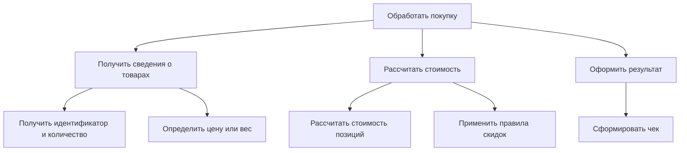
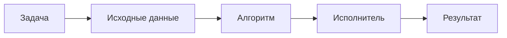
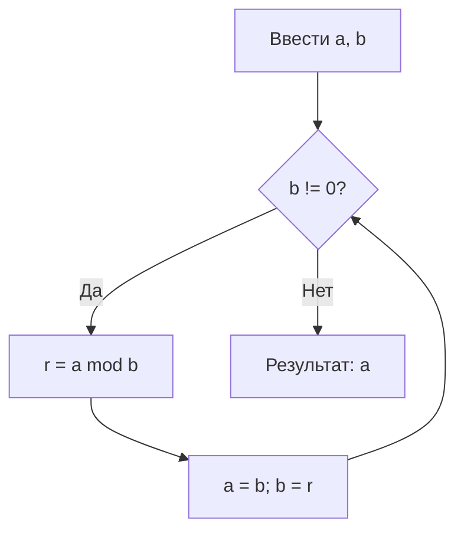
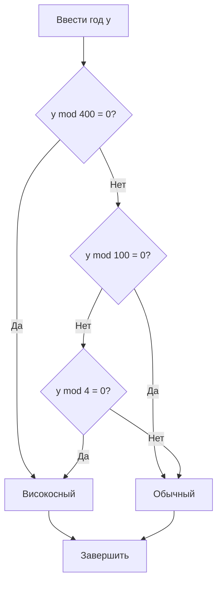
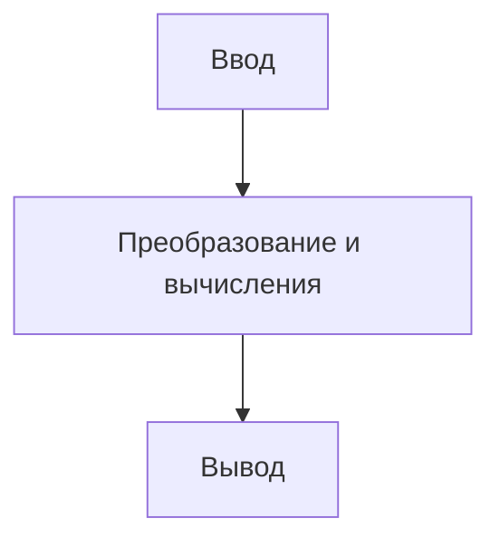
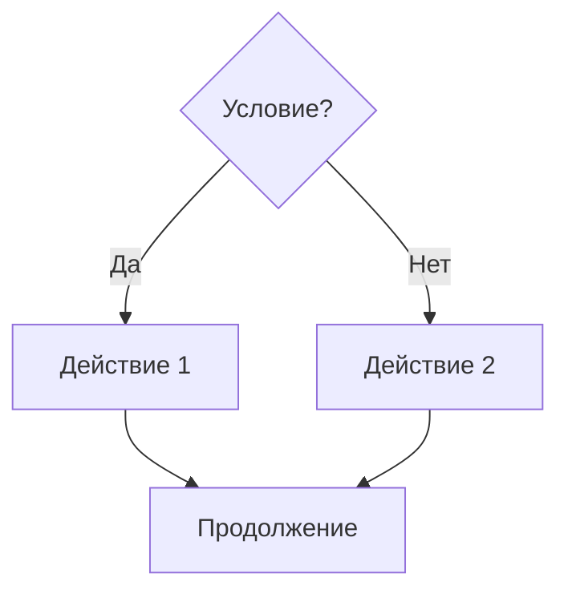

# Технологии программирования — алгоритмизация, реализация алгоритмов и ветвления

**Дата занятия:** 13 октября 2026 года.  
**Основные темы:** структурная декомпозиция задачи; выбор структур данных; понятие алгоритма и требования к нему; эффективность алгоритмов; алгоритм Евклида и проверка високосного года; линейная последовательность действий; система программирования и документация; модули Python и заголовочные файлы C++; логические выражения и условный оператор `if`.

> **Принцип занятия:** прежде чем писать программу, необходимо сформулировать входные данные, ожидаемый результат и последовательность элементарных действий. Программист должен понимать, что делает каждый шаг и при каких условиях выполнение завершается.

## 1. От сценариев предметной области к алгоритму

Разработка приложения начинается с постановки задачи и описания сценариев. Крупный сценарий следует **декомпозировать** на небольшие действия, которые затем можно реализовать программно. Например, «сформировать товарный чек» охватывает получение перечня товаров, определение количества или веса, чтение цен, расчёт позиций, применение скидок, суммирование и выдачу результата. Каждая такая функция может потребовать дополнительной детализации.

### 1.1. Структурная декомпозиция

При проектировании можно использовать контекстную диаграмму и диаграммы декомпозиции в духе **IDEF0**. В учебной работе предложена программа **Ramus**: она позволяет поддерживать иерархию диаграмм и переходить от общей функции к её составляющим. Однако цель задания — не освоение конкретного редактора, а понимание принципа разбиения. Допустимо нарисовать схему вручную или в ином графическом средстве.

Условная декомпозиция задачи «Обработать покупку»:



Эта схема показывает **иерархию функций**, а не полный набор стрелок управления IDEF0. Для формальной IDEF0-диаграммы отдельно учитывают входы, выходы, управляющие воздействия и механизмы исполнения.

[+] Правильно сформулированный конечный шаг можно реализовать без дополнительных догадок о смысле операции.  
[!] Формулировки «обработать», «сравнить», «рассчитать правильно» часто недостаточны: нужно уточнить **что именно**, **по какому правилу** и **какой результат** ожидается.

### 1.2. Проектирование и программирование — разные уровни

Описание «взвесить товар» или «начислить бонусы» может быть уместным в сценарии пользователя, но для реализации потребуется раскрыть его до проверяемых операций. Структурная схема отвечает на вопрос **«из каких частей состоит решение?»**, алгоритм — **«в какой последовательности и по каким правилам выполняются действия?»**, исходный код — **«как эти действия выражены средствами выбранного языка?»**.

## 2. Как выбор структуры данных влияет на алгоритм

Для единичных значений применяют встроенные типы — целые и вещественные числа, логические значения, строки. Для набора значений выбирают подходящий контейнер: массив, динамический массив, список, очередь, стек, словарь и другие коллекции.

| Данные и операции | Подходящая структура | Что учитывать |
|---|---|---|
| Последовательность чисел, много вычислений | Типизированный массив или массив NumPy | Компактность и численные операции |
| Изменяемая последовательность объектов Python | `list` | Удобная индексация и добавление в конец |
| Данные, извлекаемые в обратном порядке | Стек | Принцип LIFO |
| Заявки, обрабатываемые в порядке поступления | Очередь | Принцип FIFO |
| Поиск по ключу | Словарь | Быстрый доступ по ключу в типичных случаях |
| Частое добавление измерений в конец | Динамический контейнер | Необходимость операции `append` |

### 2.1. Python: имена, объекты, списки, массивы

В Python переменная-имя связана с объектом. Тип принадлежит **объекту**, а одно и то же имя может позднее указывать на другой объект:

```python
value = 12         # имя связано с объектом int
value = "двенадцать"  # теперь со строкой str
```

`list` может содержать ссылки на объекты разных типов, но такая неоднородность не всегда удобна для численных расчётов. В Python существуют и **типизированные массивы**, например стандартный модуль `array`, и библиотека **NumPy** для работы с числовыми массивами. **pandas** применяется для табличной обработки и анализа данных, но детально на занятии не рассматривалась.

```python
from array import array

measurements = array("d", [1.5, 2.0, 3.25])  # d — вещественные числа
print(sum(measurements))
```

[!] Утверждение «в Python нет массивов, только списки» неверно.  
[!] Для больших числовых наборов обычный список не всегда наиболее экономичен. Однако типизированный массив **не гарантирует ускорения любой операции**: скорость зависит от конкретного алгоритма и реализации.

В C++ существуют массивы и `std::vector`, а в C# — массивы и контейнеры вроде `List<T>`. При выборе структуры нужно оценивать доступ по индексу, вставку, удаление, необходимость сортировки, объём данных и операции, которые будут встречаться чаще всего.

## 3. Что такое алгоритм

**Алгоритм** — точное, понятное исполнителю предписание для преобразования допустимых входных данных в требуемый результат посредством последовательности шагов.



Наличие списка действий ещё не гарантирует, что перед нами корректный алгоритм. Он должен соответствовать задаче и быть формальным: исполнитель не обязан угадывать замысел автора. Исторически развитие алгоритмических методов связано с математикой, а в программировании те же идеи используются для поиска, сортировки, вычислений, преобразования данных и управления действиями.

### 3.1. Четыре задачи алгоритмизации

На занятии выделены четыре направления:

1. **Построение** нового алгоритма или модификация известного для поставленной задачи.
2. **Доказательство правильности** решения: верификация, тестирование, проверка результатов.
3. **Реализация и применение** разработанного или адаптированного алгоритма.
4. **Анализ эффективности** по времени, памяти и другим ресурсам.

Для многих практических задач выгоднее корректно адаптировать известное решение, чем «изобретать» новый метод. При этом наличие готового алгоритма не отменяет проверки его входных условий и корректности использования.

### 3.2. Виды алгоритмов

| Вид | Характеристика | Пример |
|---|---|---|
| **Детерминированный** | Последующие действия определяются правилами и текущим состоянием; при одинаковых допустимых входных данных результат повторим | Вычисление НОД |
| **Стохастический (вероятностный)** | Использует случайный выбор; результаты отдельных запусков могут различаться | Имитация броска игральной кости |
| **Эвристический** | Пользуется практическими правилами выбора; решение может быть нестрого оптимальным или не гарантированным | Поиск подходящего пути по приближённым признакам |

Вероятностный алгоритм не означает отсутствие правил. Он должен однозначно описывать, как формируется случайный выбор и какие действия выполняются при каждом исходе. В примере броска стандартной шестигранной кости допустимые значения — целые числа от 1 до 6.

### 3.3. Требования к алгоритму

1. **Определённые вход и выход.** Указать, какие данные разрешены и в какой форме выдаётся ответ.
2. **Конечность.** Решение на допустимых входах должно завершаться за конечное число шагов. При этом тело цикла можно описать небольшим набором повторяемых команд.
3. **Однозначность шагов.** Для каждого состояния должно быть ясно, что выполнить далее.
4. **Реализуемость.** Исполнитель обладает элементарными операциями, нужными для выполнения инструкции.
5. **Определённость результата.** При одинаковом входе детерминированное решение даёт одинаковый результат; при наличии случайности надо корректно оговорить её влияние.
6. **Массовость.** Алгоритм описывает класс однотипных задач, а не одну заученную пару чисел.

**Уточнение понятия «элементарный шаг».** Сложение двух чисел обычно можно принять за элементарную операцию. Но команда «сравнить яблоко и арбуз» неполна, пока не определён критерий: масса, цена, объём, калорийность, название в алфавитном порядке и т. д. Для строк нередко можно задать лексикографический порядок; для произвольных объектов нужно явно сформулировать способ сравнения.

**Формальный исполнитель** читает инструкции буквально. Он не исправит описание из соображений здравого смысла: если автор не предусмотрел выход после сообщения или неверно указал переход, программа выполнит именно написанное.

## 4. Анализ эффективности: почему важен размер входа

Для алгоритма важно не только получить правильный ответ, но и оценить затраты при увеличении количества данных **n**. В учебных оценках применяют асимптотическую нотацию **O(·)**, характеризующую скорость роста верхней границы затрат.

| Оценка | Как растут затраты | Типовая ситуация |
|---|---|---|
| `O(1)` | Не зависят от длины набора в принятой модели | Обращение к элементу массива по индексу |
| `O(log n)` | Растут медленно | Двоичный поиск в отсортированном массиве |
| `O(n)` | Пропорциональны размеру входа | Однократный проход по списку |
| `O(n log n)` | Быстрее линейного, но значительно лучше квадратичного роста | Многие эффективные алгоритмы сортировки |
| `O(n²)` | Квадратичный рост | Два вложенных прохода по n элементам |

Если сравниваются два числа, затрат немного. Для длинного массива тот же способ обработки, построенный на многократных сравнениях, может оказаться слишком медленным. Выбирая алгоритм, оценивают и **время**, и **дополнительную память**, а также то, как они изменяются при масштабировании задачи. Запись `O(1)` не означает, что операция выполняется за одно физическое машинное действие, а `O(n²)` не сообщает конкретное количество секунд.

## 5. Пример алгоритмизации: наибольший общий делитель

**НОД(a, b)** — наибольшее положительное целое число, делящее оба числа без остатка. Например, `НОД(12, 18) = 6`.

### 5.1. Почему школьное описание не всегда готово к реализации

Один из способов: разложить оба числа на простые множители, выбрать общие множители с учётом кратностей и перемножить их. Это математически понятно, но инструкция **«разложить на простые множители»** сама по себе уже требует отдельного алгоритма. Если исполнитель умеет только элементарные действия над числами, он не может выполнить такой пункт непосредственно.

[!] Запись «найти общие множители» также нуждается в пояснении, как представлены списки множителей и как учитываются повторения.

### 5.2. Алгоритм Евклида через остатки

Для неотрицательных целых чисел используется тождество

$$
\gcd(a,b)=\gcd(b,a\bmod b), \qquad b\ne 0.
$$

Повторяем замену пары `(a, b)` на `(b, a % b)`, пока `b` не станет равным нулю. После этого `a` — искомый НОД.



```python
def gcd_euclid(a: int, b: int) -> int:
    if a < 0 or b < 0:
        raise ValueError("Ожидаются неотрицательные целые числа")
    while b != 0:
        a, b = b, a % b
    return a

print(gcd_euclid(12, 18))  # 6
```

| Итерация | `a` | `b` | `a % b` |
|---|---:|---:|---:|
| Начальная | 12 | 18 | 12 |
| После первой замены | 18 | 12 | 6 |
| После второй замены | 12 | 6 | 0 |
| После третьей замены | 6 | 0 | — |

[+] Деление с остатком сводит задачу к меньшим числам и позволяет получить НОД без построения списка простых множителей.  
[!] Для пары `(0, 0)` НОД в стандартном математическом определении не задан; в некоторых программных библиотеках по соглашению возвращается `0`. При проектировании интерфейса это оговаривают отдельно.

### 5.3. Вариант последовательных вычитаний

Другой способ, представленный при обсуждении алгоритма Евклида: пока два положительных числа различны, вычитать меньшее из большего. Когда они равны, это НОД.

```python
a, b = 18, 12
while a != b:
    if a > b:
        a -= b
    else:
        b -= a
print(a)  # 6
```

[!] Алгоритм последовательных вычитаний в такой форме предназначен для **положительных** чисел. При нулевых входах он может не завершиться. Вариант с остатком обычно эффективнее, особенно когда числа сильно различаются по величине.

## 6. Пример алгоритмизации: проверка високосного года

Задача: по целому номеру года григорианского календаря определить, содержит ли он дополнительный день в феврале. Для положительных годов правило таково:

- если год кратен 400, он високосный;
- иначе, если год кратен 100, он обычный;
- иначе, если год кратен 4, он високосный;
- в остальных случаях он обычный.

Эквивалентное логическое выражение:

$$
\operatorname{leap}(y)=(y\bmod 400=0)\lor\bigl((y\bmod 4=0)\land(y\bmod 100\ne 0)\bigr).
$$

| Год | Делится на 4 | Делится на 100 | Делится на 400 | Результат |
|---:|:---:|:---:|:---:|---|
| 2024 | Да | Нет | Нет | [+] Високосный |
| 2026 | Нет | Нет | Нет | [+] Обычный |
| 1900 | Да | Да | Нет | [+] Обычный |
| 2000 | Да | Да | Да | [+] Високосный |



### 6.1. Ошибка перехода между пунктами

При разборе словесной инструкции выявлен методический дефект: после пункта **«вывести: год високосный»** выполнение могло формально переходить к следующему пункту **«вывести: год невисокосный»**. Исполнитель, не додумывающий за автора, вывел бы **два противоречивых сообщения**.

[X] Неправильно — два самостоятельных действия без остановки:

```python
if year % 400 == 0:
    print("Високосный")
print("Обычный")  # выполнится и после первого сообщения
```

[+] Правильно — ветви исключают друг друга:

```python
year = 2000
if year % 400 == 0 or (year % 4 == 0 and year % 100 != 0):
    print("Високосный год")
else:
    print("Обычный год")
```

Текст алгоритма должен явно указывать **завершение** либо **переход** после каждого окончательного результата. Этот пример показывает, чем проверка формальным исполнителем полезнее интуитивного прочтения.

### 6.2. Что уточнить в постановке задачи

Требуется определить допустимый диапазон годов, способ ввода и формат ответа: текст, логическое значение `True/False`, код или другое представление. Можно искать признак года в календарной базе, но для данной задачи удобнее использовать арифметическое правило без внешней базы. При обсуждении разработчик должен отделить **требование заказчика** от предположений о способе реализации.

## 7. Способы описания алгоритмов и линейные действия

Для представления последовательности действий упомянуты **словесно-формульный**, **структурный или блок-схемный**, **табличный** и **графовый** способы. Форму выбирают так, чтобы исполнитель мог проверить каждое условие, вычисление и переход.

Базовая управляющая структура **«следование»** (линейный алгоритм): действия выполняются сверху вниз без развилок и повторений. Типовая конструкция:



### 7.1. Склейка строк в Python

```python
name = "Вася"
new_name = "Привет, " + name
print(new_name)  # Привет, Вася
```

Для строк `+` означает конкатенацию. Строки Python **неизменяемы**: результат склейки представляет собой новый объект. Для многочисленных строковых фрагментов удобно использовать `"".join(parts)`; это обычно экономичнее многократного последовательного `+` внутри цикла.

[!] Если между фрагментами нужен пробел, его надо явно предусмотреть.  
[!] Оптимизация строк не означает, что два-три сложения следует обязательно заменять сложной конструкцией: важны масштаб и понятность кода.

### 7.2. Первая версия задачи про игральную кость

На занятии предложено начать зачётную программу с простого линейного сценария: получить имена игроков, сымитировать бросок, вывести выпавшее число очков. Проверку победителя и другие ветви добавить позднее.

```python
import random
import time

player1 = input("Имя первого игрока: ")
player2 = input("Имя второго игрока: ")
print("Первый бросок выполняет", player1)
time.sleep(1)  # необязательная задержка для эффекта ожидания
points = random.randint(1, 6)  # включительно: 1, 2, ..., 6
print("Выпало очков:", points)
```

Это **учебный вариант** исходной линейной версии, а не готовая полная реализация игры. Генерация случайного числа здесь выступает как действие, результат которого сообщается пользователю, без ветвления по исходу.

## 8. Система программирования: ядро, стандартная библиотека, внешние пакеты

Для создания программ нужны инструменты ввода кода, интерпретации или компиляции, запуска и отладки. Лекция использует Python (в том числе переносимый комплект **WinPython**) и примеры на C++.

Важно различать три уровня возможностей языка:

| Уровень | Пример Python | Пример C++ |
|---|---|---|
| Встроенные конструкции и операции | `if`, `+`, присваивание, `len`, `sum`, `print` | `if`, `+`, объявление переменных |
| Стандартная библиотека | `math`, `random`, `time`, `array` | `<cmath>`, `<iostream>`, `<string>` |
| Дополнительно устанавливаемые библиотеки | NumPy, pandas и др. | Сторонние библиотеки, подключаемые к проекту |

Разговорные обозначения «ядро языка», «встроенные модули» и «библиотеки» следует уточнять по документации: встроенные функции Python, модули его стандартной библиотеки и внешние пакеты — **не одно и то же**.

### 8.1. Где искать точные сведения

**Основной источник по Python:** [официальная документация](https://docs.python.org/3/), разделы *Tutorial*, *Library Reference*, *Built-in Functions*, *Language Reference*. Важна версия документации: описание новой функции может не соответствовать более старому интерпретатору.

**Справочник по C++:** [cppreference](https://en.cppreference.com/w/cpp), используемый для поиска синтаксиса, стандартных заголовков, функций и различий между версиями стандарта. Полезно обращать внимание на отметки C++11, C++17, C++20, C++23 и последующих стандартов. Он не является официальным текстом стандарта ISO, но служит подробным справочным ресурсом.

[+] Пользуясь первоисточниками, разработчик проверяет сигнатуры функций, допустимые типы, возвращаемые значения, исключения и требования к подключению модуля.  
[!] Ответы поисковых систем и генеративных моделей полезно перепроверять в документации конкретной версии.

## 9. Python: имя функции и подключение модуля

На занятии показана типовая последовательность: попытка вызвать математическую функцию непосредственно, сообщение об ошибке, поиск функции в справочнике, подключение правильного модуля и повторный запуск.

[X] Ошибка — функция `sqrt` не доступна по имени без импорта:

```python
x = 25
print(sqrt(x))
# NameError: name 'sqrt' is not defined
```

[+] Подключение целого модуля:

```python
import math

x = 25
result = math.sqrt(x)
print(result)  # 5.0
```

[+] Альтернативная форма, импорт конкретного имени:

```python
from math import sqrt
print(sqrt(25))
```

Форма `import math` делает источник имени явным и помогает избежать конфликтов между одноимёнными функциями разных модулей. После `import math` надо писать `math.sqrt(...)`, а не просто `sqrt(...)`, если второе имя отдельно не импортировано.

**Различие функций и операций:** возведение в степень можно записать как `x ** 2`, а квадратный корень — как `math.sqrt(x)` либо `x ** 0.5` для подходящих значений. На занятии также обсуждался просмотр функций вроде `factorial`, `gcd`, тригонометрических и логарифмических функций в справочнике `math`.

### 9.1. Встроенные преобразования типа

`input()` возвращает строку. Для арифметических вычислений её часто надо преобразовать:

```python
age = int(input("Сколько вам лет? "))
price = float(input("Введите цену: "))
```

[X] Неверное преобразование или нечисловой ввод могут привести к `ValueError`. Программа с реальным пользовательским вводом должна предусматривать обработку ошибочных значений.

### 9.2. Что относится к дополнительным пакетам

`math` входит в стандартную библиотеку Python и **не требует** отдельного `pip install math`. А вот NumPy и pandas, как правило, ставят отдельно или используют готовую сборку, где они уже присутствуют. В переносимых комплектах часть пакетов может быть предустановлена; наличие нужно проверять непосредственно в используемой среде.

## 10. C++: заголовки, пространство имён и стандартные функции

В C++ многие библиотечные средства объявлены в заголовочных файлах. Примеры:

```cpp
#include <iostream>
#include <string>
#include <cmath>

int main() {
    std::string name;
    std::cout << "Введите имя: ";
    std::getline(std::cin, name);
    std::cout << "Привет, " << name << '\n';
    std::cout << "Корень из 25: " << std::sqrt(25.0) << '\n';
}
```

Заголовок `<iostream>` необходим для потокового ввода-вывода, `<string>` — для `std::string`, `<cmath>` — для математических функций. Префикс `std::` указывает пространство имён стандартной библиотеки. Использование директивы `using namespace std;` может сделать учебный пример короче, однако в больших проектах часто предпочитают явные имена во избежание конфликтов.

[!] `#include` в общем случае подключает объявления и содержимое заголовка на этапе препроцессинга. Внешняя библиотека может дополнительно потребовать установки и настройки компоновки; **заголовок не равен установке всей библиотеки**.

## 11. Управляющая структура «выбор»: логические выражения

**Линейный алгоритм** не меняет маршрут выполнения. **Разветвляющийся алгоритм** выбирает действие по условию. Условие вычисляется в логическое значение `True`/`False` (в C++ — `true`/`false`).

### 11.1. Отношения и логические операции

| Смысл | Python | C++ |
|---|---|---|
| Равно | `==` | `==` |
| Не равно | `!=` | `!=` |
| Больше / меньше | `>` / `<` | `>` / `<` |
| Больше либо равно / меньше либо равно | `>=` / `<=` | `>=` / `<=` |
| Логическое И | `and` | `&&` |
| Логическое ИЛИ | `or` | `\|\|` |
| Логическое НЕ | `not` | `!` |

`and` истинно, когда истинны оба условия; `or` — когда истинно хотя бы одно; `not` меняет логическое значение на противоположное.

| A | B | `A and B` | `A or B` |
|---|---|---|---|
| `False` | `False` | `False` | `False` |
| `False` | `True` | `False` | `True` |
| `True` | `False` | `False` | `True` |
| `True` | `True` | `True` | `True` |

В Python `and` и `or` возвращают один из операндов, а не обязательно объект типа `bool`; при работе с собственно логическими условиями они ведут себя согласно таблице истинности. В C++ `&&` и `||` имеют логический результат.

```python
x = 25
print(x > 10 and x < 30)  # True
print(x < 10 or x == 25)   # True
print(not (x == 25))       # False
```

[!] `=` — присваивание, `==` — сравнение; их нельзя путать.  
[!] Нужны скобки там, где они устраняют неоднозначность сложного выражения. Важно проверять порядок вычисления операций.

### 11.2. Простая и полная формы `if`

**Неполное ветвление:** выполнить действие, только если условие истинно.

```python
if x > 0:
    print("Число положительное")
```

**Полное ветвление:** выбрать ровно одну из двух ветвей.

```python
if x % 2 == 0:
    print("Чётное")
else:
    print("Нечётное")
```

**Множественный выбор:**

```python
if x > 0:
    print("Положительное")
elif x < 0:
    print("Отрицательное")
else:
    print("Ноль")
```



### 11.3. Последовательные и вложенные проверки

Варианты `if` отличаются смыслом:

```python
# Две независимые проверки — могут выполниться обе ветви.
if x >= 0:
    print("Неотрицательное")
if x % 2 == 0:
    print("Чётное")

# Взаимоисключающие ветви — сработает одна.
if x > 0:
    print("Положительное")
elif x == 0:
    print("Ноль")
else:
    print("Отрицательное")
```

Вложенные условия помогают формализовать последовательный выбор: например, по координатам `(x, y)` определяют четверть декартовой плоскости. Сначала проверяют знаки координат и случай нахождения на осях, затем уточняют четверть.

```python
x, y = 2, -3
if x == 0 or y == 0:
    print("Точка лежит на одной из осей")
elif x > 0 and y > 0:
    print("I четверть")
elif x < 0 and y > 0:
    print("II четверть")
elif x < 0 and y < 0:
    print("III четверть")
else:
    print("IV четверть")
```

В C++ пример выбора четверти построен на операторах `if`, `else if` и `else`. Там блоки обычно выделяются `{ ... }`, тогда как Python определяет вложенность **отступами**.

### 11.4. Синтаксис Python: двоеточие, отступ и REPL

```python
if True:
    print("Ку-ку")
```

Двоеточие после условия обязательно; вложенный блок должен иметь согласованный отступ. Общепринятый отступ — **четыре пробела**. В интерактивной оболочке Python при вводе многострочного блока появляется приглашение продолжения `...`; завершение ввода блока может потребовать пустой строки. При написании файла `.py` интерактивное приглашение не включают в текст программы.

[!] Смешивание табуляций и пробелов способно вызвать ошибки отступов. Для учебных примеров рекомендуется единообразно использовать четыре пробела.

## 12. Запуск программы из файла `.py`

Практический порядок работы:

1. Создать новый текстовый файл с расширением `.py` в редакторе среды разработки.
2. Вписать программу без интерактивных приглашений `>>>` и `...`.
3. Сохранить файл понятным именем.
4. Запустить модуль средствами среды (для IDLE обычно **Run Module**, клавиша **F5**).
5. Проверить ввод, вывод и поведение для нескольких тестовых значений.

Пример программы `parity.py`:

```python
number = int(input("Введите целое число: "))
if number % 2 == 0:
    print("Чётное число")
else:
    print("Нечётное число")
```

[+] Для `4` программа сообщает «Чётное число», для `5` — «Нечётное число».  
[!] Если оставить `input()` без подсказки, пользователь может не понять, что требуется ввести: программа будет просто ожидать данные.  
[!] При переносе программы на другой компьютер учитывают версию Python и наличие используемых пакетов. Новые синтаксические возможности могут не поддерживаться старым интерпретатором.

## 13. Следующий этап: циклы

После линейных действий и условий изучаются **повторения**. Их используют, когда последовательность команд нужно выполнять многократно: например, вычислять НОД по алгоритму Евклида или повторять броски кости по правилам игры.

```python
# Общее представление цикла с условием.
while условие:
    действие
```

Здесь `условие` и `действие` — обозначения, а не готовые переменные. Выбирая цикл, необходимо сформулировать: начальное состояние, условие продолжения, действие, изменяющее состояние, и условие завершения.

На данном занятии циклы лишь предварительно анонсированы: основной практический акцент сделан на **условиях `if` / `else` и их логических выражениях**. Развёрнутый разбор цикла Евклида намечен на следующее занятие.

## 14. Практические задания и критерии самопроверки

### Задание 1. Декомпозиция собственного сценария

Подготовить контекстное представление выбранной функции и разбить её на подфункции, затем при необходимости детализировать один из элементов глубже. Для этого разрешено пользоваться Ramus, графическим редактором или ручной схемой. **Ключевой критерий:** разбиение должно быть понятно, а листья декомпозиции — достаточно определёнными для дальнейшей алгоритмизации. Выполнение задания обсуждалось на четверг.

### Задание 2. Определение високосного года

Составить понятный алгоритм проверки високосности и представить логику ветвления. Обязательно охватить правила делимости на 4, 100 и 400; предусмотреть единственный итоговый ответ; проверить крайние примеры: 1900, 2000, 2024, 2026. **Кодирование** на Python либо C++ обозначено как дополнительная, необязательная практическая часть; достаточно самостоятельно попробовать `if` / `else`, при желании — вложенный или составной вариант.

### Задание 3. Знакомство с языком и документацией

Посмотреть официальный учебник Python и справочник C++, найти описание логических операторов и условных конструкций. Полезно самостоятельно набрать короткие примеры и проверить результат. Не ограничиваться механическим копированием: разбираться, откуда берётся каждое имя и почему выбран именно этот оператор.

### Задание 4. Первая версия зачётной программы

Для собственной предметной задачи наметить минимальную работающую версию: **ввод → действия → вывод**. В демонстрационном варианте использовалась игра с броском кости. Затем можно добавить условия, например определение победителя, и перейти к будущей версии с повторениями. Для дополнительного самостоятельного изучения предусмотрены примеры на Python и C++, а также упражнения по массивам и структурам.

### Итоговый контроль

- [+] Формулировка задачи позволяет назвать входы, выходы и допустимые значения.
- [+] Каждый шаг алгоритма имеет понятного исполнителя и не требует догадок.
- [+] Все ветви завершаются или явно соединяются с последующими действиями.
- [+] Выбор структуры данных соответствует основным операциям над данными.
- [+] Примеры протестированы на обычных и граничных значениях.
- [+] Неизвестные имена функций проверены по документации и правильно подключены.
- [!] Нельзя считать математическое описание автоматически готовым к исполнению кодом.
- [!] Нельзя подменять корректность алгоритма удачным результатом одного запуска.

**Обобщение:** движение от декомпозиции к реализации происходит через точную постановку задачи, формальные шаги алгоритма, выбор структур данных и управляющих конструкций. Знание языка нужно дополнять умением проверять собственную логику, читать документацию и оценивать качество получаемого решения.
