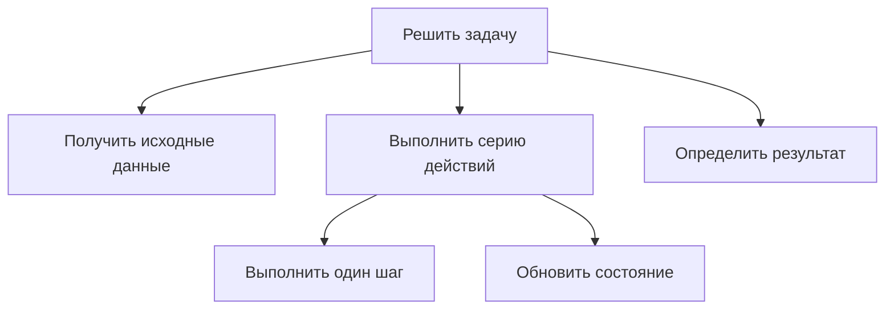

# Технологии программирования — 15 октября 2026 года

**Тема занятия:** организация повторений в алгоритмах; циклы в C++, C# и Python; модульное проектирование, сцепление и связность; функции, параметры, локальные данные и возвращаемые значения.

## 1. План и связь с предыдущими занятиями

Занятие объединяет два уровня программирования:

1. **Алгоритмический:** как реализовать ветвления и повторения, когда число повторений известно и когда заранее неизвестно; как завершать цикл.
2. **Проектный:** как разложить решение на независимые подзадачи, оформить подзадачи функциями и связать их через входные и выходные параметры.

Python используется как доступный язык для реализации и обсуждения алгоритмов. Сравнительные примеры приводятся для C++ и C#. Цель — понять конструкцию решения, а не освоить исчерпывающе синтаксис каждого языка.

### Повторение: контекстная диаграмма и декомпозиция

Контекстная диаграмма представляет **целевую задачу в целом**, а не небольшую вспомогательную функцию. Далее её декомпозируют на составные работы и, при необходимости, ещё на один уровень. Основой может служить соответствующий вариант использования (*use case*) ранее разработанной модели.

В IDEF0 у работы различают входные данные (слева), выходные результаты (справа), управляющие ограничения и правила (сверху), механизмы исполнения (снизу). При детализации необходимо сохранять **согласованность граничных стрелок**: существующие входы и управления родительской работы должны быть учтены в её декомпозиции, а не «обойти» все дочерние работы. Одно бизнес-правило может ограничивать несколько подзадач, если это оправдано по смыслу.

Рассмотренный пример — обработка покупки товара, включающая взвешивание, расчёт и работу с бонусами. Правила расчёта бонусов задаются заказчиком; стандарты или другие ограничения также следует подать на те операции, к которым они действительно относятся.

[+] В учебной работе важнее продемонстрировать осмысленную декомпозицию, чем обязательно использовать конкретный графический редактор. Если нет уверенности в механизме выполнения операции, не нужно выдумывать его.

## 2. Повторение условий: логические операции и високосный год

### 2.1. Условия в Python

Оператор `%` вычисляет остаток от деления. Выражение `n % 2 == 0` истинно для чётного целого числа. Логическое `and` требует истинности обеих частей, `or` — хотя бы одной, `not` отрицает условие. Приоритет операций не следует угадывать: для сложной проверки удобны скобки.

```python
n = 12
print(n % 2)                 # 0
print(n % 2 == 0)            # True
print(n % 2 == 0 and n > 15) # False
print(n % 2 == 0 or n > 15)  # True
```

Отдельное упражнение — **определить, является ли введённый год високосным**. Правило григорианского календаря:

- год кратен 400 — високосный;
- иначе год кратен 100 — не високосный;
- иначе год кратен 4 — високосный;
- остальные годы — не високосные.

```python
year = int(input("Введите год: "))
is_leap = year % 400 == 0 or (year % 4 == 0 and year % 100 != 0)
print("Високосный" if is_leap else "Не високосный")
```

[+] `2000` — високосный; `1900` — нет; `2024` — да; `2025` — нет. Это самостоятельные контрольные примеры, позволяющие проверить смысл логической формулы.

### 2.2. Ввод и истинность значений

`input()` возвращает **строку**. Если для вычисления нужно число, требуется явное преобразование, например `int(input(...))`. При вводе букв вместо числа возникнет `ValueError` (не `TypeError` в данном типичном случае).

| Значение | Логическая интерпретация `bool(...)` |
|---|---|
| `0`, `0.0` | `False` |
| Любое ненулевое число, в том числе `-5` | `True` |
| `""` (пустая строка) | `False` |
| `" "` (строка с пробелом) | `True` |
| `None` | `False` |

[!] Нельзя путать строку `"0"` с числом `0`: непустая строка `"0"` истинна. Ввод и проверка типа данных — разные задачи. Обработка неправильного ввода была обозначена, но не стала самостоятельной темой занятия.

## 3. Три принципиальные схемы цикла

Повторяющийся алгоритм организован через **тело цикла** и механизм управления повторением.

| Схема | Когда проверяется условие | Число выполнений тела | Типичный синтаксис |
|---|---|---|---|
| Цикл со счётчиком | Встроенный механизм управления счётчиком | Может быть нулевым; рассчитано на известный диапазон | `for` |
| Цикл с предусловием | До очередного входа в тело | От нуля | `while` |
| Цикл с постусловием | После выполнения тела | Не менее одного | `do ... while` в C++ и C# |

Образный пример — пробежка: заранее назначить семь кругов; бегать, пока сохраняется условие; пробежать один круг, а затем решать, продолжать ли.

[+] **Итерация** — одно выполнение тела цикла. *Счётчик итераций* — отдельная программная переменная; он есть далеко не в каждом цикле.


**Суть учебного примера.** Синтаксис for со счётчиком, C# и C++; рядом — применение for к алгоритму Евклида, где число повторений заранее не известно.


## 4. `for`: повторение с параметром

Классический `for` в C++ связывает инициализацию, проверку и изменение переменной управления:

```cpp
for (int i = 1; i <= n; ++i) {
    // Действия, выполняемые на каждой итерации.
}
```

`int i = 1` выполняется перед циклом; `i <= n` проверяется до очередной итерации; `++i` выполняется после тела. Внутри могут находиться любые необходимые инструкции. В C# структура управления аналогична, но вывод в консоль выполняют, например, через `Console.WriteLine(...)`.

[!] Цикл `for` технически допускает сложные условия и несколько переменных, однако для алгоритма, в котором число повторений неопределённо, обычно понятнее `while`. Важен смысл, а не просто возможность записать условие в выбранном синтаксисе.

### 4.1. Алгоритм Евклида с вычитанием

Для **положительных** целых `a` и `b` можно находить наибольший общий делитель, вычитая меньшее из большего, пока они не станут равны:

```cpp
int gcd_subtraction(int a, int b) {
    // Предусловие: a > 0, b > 0.
    while (a != b) {
        if (a > b) {
            a -= b;
        } else {
            b -= a;
        }
    }
    return a;
}
```

Для `18` и `12` последовательность пар: `(18,12)` → `(6,12)` → `(6,6)`; результат — `6`. Количество итераций заранее не задано. Если числа изначально равны, тело `while` не выполнится ни разу.

**Составное присваивание** `a -= b` означает `a = a - b`; аналогично определяются `+=`, `*=`, `/=`. Составную запись выбирают ради ясности и удобства, но утверждать, что она во всех языках и ситуациях обязательно быстрее, нельзя: это зависит от компилятора, типов и контекста.

[!] Для нулевых или отрицательных входов приведённый алгоритм вычитания без дополнительных проверок непригоден. В прикладных задачах часто эффективнее вариант Евклида с остатком от деления (`%`).


**Суть учебного примера.** Блок-схема while с проверкой до тела и реализация алгоритма Евклида через вычитание.


## 5. `do ... while`: сначала действие, потом проверка

В C++ и C# постусловие удобно для сценариев, в которых пользователь должен **хотя бы один раз** выполнить операцию, а решение о повторе принимает только после результата:

```cpp
int x = 0;
do {
    double y = std::sin(x);
    std::cout << x << "\t" << y << '\n';
    ++x;
} while (x < 4);
```

Независимо от первоначальной истинности условия первое выполнение тела происходит. При записи `do { ... } while (...);` точка с запятой после `while` в C++ обязательна.


**Суть учебного примера.** Постусловие do while: тело выполняется до первой проверки. В демонстрации рассчитываются и выводятся значения синуса.


### 5.1. Эквивалент в Python

В Python **нет отдельного оператора `do ... while`**. Поведение воспроизводят обычным `while` с условием выхода внутри:

```python
while True:
    word = input("Введите слово: ")
    print(f"Введено: {word}")
    answer = input("Повторить? (y/n): ").strip().lower()
    if answer != "y":
        break
```

Это не единственный вариант реализации, но он сохраняет идею: операция происходит хотя бы раз, запрос о повторении — после неё.

## 6. `break` и `continue`: два различных перехода

- **`break`** досрочно завершает ближайший охватывающий цикл и передаёт управление инструкции после него.
- **`continue`** завершает лишь текущую итерацию и передаёт управление механизму следующего повторения. Цикл целиком не прекращается.

```python
for i in range(1, 7):
    if i == 5:
        break
    if i % 2 == 0:
        continue
    print(i)
# Вывод: 1, 3
```

Сначала `i = 1` выводится; для `2` выполняется `continue`; для `3` — вывод; для `4` — пропуск; при `5` срабатывает `break`. Число `6` уже не рассматривается.


**Суть учебного примера.** Пример продолжения итераций через continue: чётные значения пропускаются, а не завершают весь цикл.


### 6.1. Палиндром: вложенный алгоритм и цикл взаимодействия

В одном из примеров пользователь вводит слово, два индекса движутся навстречу друг другу, а на каждом шаге сравниваются симметричные символы. После проверки пользователь может ввести новое слово. Здесь полезно отличать **внутренний** цикл проверки от **внешнего** цикла повторения диалога.

```python
def is_palindrome(text: str) -> bool:
    left, right = 0, len(text) - 1
    while left < right:
        if text[left] != text[right]:
            return False
        left += 1
        right -= 1
    return True

while True:
    word = input("Слово: ")
    print("Палиндром" if is_palindrome(word) else "Не палиндром")
    if input("Ещё? (y/n): ").strip().lower() != "y":
        break
```

[!] Это нормализованная учебная реализация идеи, а не дословная копия демонстрировавшегося кода. Она проверяет **точное** совпадение символов: регистр, пробелы и пунктуация не игнорируются. Если нужны более общие правила, входные данные сначала нормализуют.


**Суть учебного примера.** Разбор проверки палиндрома и последующего запроса продолжения через do while в C#; два уровня повторения выполняют разные роли.


## 7. Разновидности `while` в Python

### 7.1. Предусловие и имитация счётчика

```python
i = 0
while i < 5:
    print(i)
    i += 1
# 0, 1, 2, 3, 4
```

Здесь число итераций известно, хотя синтаксис — `while`. Ключевой момент: счётчик обязательно должен изменяться так, чтобы в конечном счёте условие могло стать ложным.

### 7.2. Неизвестное количество повторений

В учебной игровой модели некоторый показатель увеличивается или уменьшается в зависимости от введённых событий. Пока показатель остаётся в допустимом диапазоне, действия повторяются. Количество итераций нельзя определить по одному лишь заголовку цикла: оно зависит от входных данных.

```python
energy = 5
while 0 < energy < 10:
    event = int(input("Число события: "))
    if event % 2 == 0:
        energy -= 1
    else:
        energy += 1
    print("Текущая энергия:", energy)
```

[!] Код демонстрирует логику изменяемого состояния, но прекращение цикла не гарантируется **за фиксированное число шагов**: ввод может долго чередовать увеличение и уменьшение. Имя `energy` информативнее условного `i`, потому что это не счётчик итераций.

### 7.3. `else` у циклов

У Python есть дополнительная ветка `else` у `while` и `for`. Она выполняется **только если цикл завершился без `break`**, включая случай, когда тело не выполнилось ни разу.

```python
for candidate in [2, 4, 6, 7, 8]:
    if candidate % 2 != 0:
        print("Первое нечётное:", candidate)
        break
else:
    print("Нечётных значений нет")
```

`continue` сам по себе не отменяет `else`. Поэтому интерпретация `else` как «ветка, когда условие стало False» неполна: решающее исключение — выход через `break`.

## 8. Итерация по последовательности: `for ... in` и `range`

Python использует `for` прежде всего как **перебор элементов итерируемого объекта**:

```python
for item in ("one", "two", "three"):
    print(item)

for letter in "ITMO":
    print(letter)
```

Перебираемыми объектами могут быть список, кортеж, строка и другие коллекции или итераторы. Цикл получает элементы в порядке, определяемом этим объектом. Он не обязан выбирать элемент «наугад».

Встроенный `range(start, stop, step)` задаёт арифметическую последовательность целых чисел; граница `stop` **не включается**.

```python
list(range(3))          # [0, 1, 2]
list(range(1, 6, 2))    # [1, 3, 5]
list(range(5, 0, -2))   # [5, 3, 1]

for _ in range(5):
    print("Повторение")
```

[+] `for _ in range(5)` — обычная идиома для «выполнить пять раз», когда номер итерации не требуется. Сам объект `range` не хранит заранее созданный список всех чисел.

## 9. От большого скрипта к функциям

Рассмотрен пример программы, объединяющей ввод данных, многократный ход игры с кубиком, подсчёт очков и определение победителя. В небольшом упражнении её ещё можно прочитать сверху вниз, но при росте объёма становится трудно менять и проверять части независимо.

**Два повода выделять функции:**

1. **Проектирование сверху вниз.** Подзадачи уже определены при декомпозиции, их нужно реализовать и согласовать входы/выходы.
2. **Рефакторинг существующего кода.** Программа уже написана, но крупные независимые блоки логики лучше вынести и вызывать по имени.

Python-файл `.py` — модуль. В нём могут находиться несколько функций и основной код. Функции также могут располагаться в отдельных модулях, которые подключают через `import`. Выбор границ файлов — отдельная задача по отношению к выбору границ функций.



[+] Хорошая функция выражает законченное действие, имеет понятное назначение и может быть протестирована без необходимости запускать всю систему.


**Суть учебного примера.** Два пути появления функций: заранее запланированная декомпозиция либо выделение подзадач из разросшегося кода при рефакторинге.


## 10. Модульное проектирование: внутреннее единство и внешние зависимости

**Модульное проектирование** делит систему на части с автономной ответственностью и осмысленными интерфейсами. Желательны:

- **высокая связность внутри модуля (high cohesion):** его действия решают одну согласованную задачу;
- **слабое сцепление между модулями (low coupling):** один модуль как можно меньше зависит от внутренних деталей другого.

В русскоязычных учебных материалах слова «связность» и «сцепление» иногда смешиваются. Чтобы не путать противоположные критерии, полезно ориентироваться на термины *cohesion* (внутреннее единство) и *coupling* (межмодульная зависимость).


**Суть учебного примера.** Основные понятия модульного проектирования: модуль как самостоятельная структурная единица; процедурный модуль может соответствовать функции, а в ООП — классу.


**Суть учебного примера.** Иллюстрация двух групп компонентов с сильными внутренними связями и малым числом связей между группами: требуемое слабое сцепление.


### 10.1. Связность внутри модуля (*cohesion*)

Логика группировки операций характеризуется тем, насколько тесно они относятся к **единой ответственности**:

| Тип связности | Смысл | Практический вывод |
|---|---|---|
| Функциональная | Все действия обеспечивают один законченный результат | Наиболее желательна |
| Последовательная | Выход одного действия служит входом следующего | Часто приемлема |
| Информационная (по данным) | Действия работают с одной структурой данных | Может быть оправдана общим интерфейсом |
| Процедурная | Действия объединены последовательностью исполнения | Слабее; проверить назначение |
| Временная | Действия выполняются в одну фазу времени | Не означает общую ответственность |
| Логическая | Объединены схожие на вид операции с разными целями | Часто требует разделения |


**Суть учебного примера.** Сравнение функциональной, последовательной, информационной, процедурной, временной и логической связности модулей.


### 10.2. Сцепление между модулями (*coupling*)

Модули могут обмениваться только нужными данными либо напрямую зависеть от структур и управляющей логики друг друга. Первое обычно лучше. Примеры, обсуждавшиеся в материале:

| Сцепление | Что связывает модули | Оценка |
|---|---|---|
| По данным | Передаются конкретные параметры | Обычно слабое и предпочтительное |
| По образцу (структуре) | Передаётся составной набор данных | Приемлемо при устойчивом интерфейсе |
| По управлению | Один модуль направляет ветвление другого управляющим сигналом | Более сильная зависимость |
| По общей области данных | Совместно используются изменяемые глобальные данные | Риск побочных эффектов |
| По содержимому | Один модуль использует внутреннее устройство другого | Наиболее нежелательно |

Условные оценки качества на учебных схемах — **относительная классификация**, а не универсальная числовая метрика, достаточная для оценки любой программы.


**Суть учебного примера.** Градации сцепления от обмена значениями до доступа к содержимому чужого модуля; рост зависимости ухудшает модульность.


[+] При проектировании полезно начать с функциональных требований к каждому варианту использования: какие действия образуют одну подзадачу, какие данные она принимает, что возвращает и какие внешние зависимости необходимы.

## 11. От декомпозиции к контракту функции

Определение функции требует ответа на четыре вопроса:

1. **Имя и назначение:** какую операцию реализует функция?
2. **Параметры:** какие сведения нужны ей извне?
3. **Внутренние данные и алгоритм:** что вычисляется внутри?
4. **Результат и способ передачи:** что получает вызывающий код?

Формально интерфейс можно описать так:

```text
имя_функции(аргумент_1, аргумент_2, ...) -> результат
```

Для поиска НОД по входам `18` и `12` результат равен `6`. На уровне проектирования не важно, написана ли функция на C++, C# или Python; важны назначение, допустимые входы и гарантированный выход.


**Суть учебного примера.** Алгоритмическая декомпозиция бизнес-операции на действия: оформить, проверить, изменить количество, передать товар.


**Суть учебного примера.** Граница между проектом функции и реализацией: что передаётся, что возвращается, как именуются и передаются параметры.


### 11.1. Объявление и вызов в Python

Определение создаёт функцию, а вызов передаёт конкретные аргументы:

```python
def sum_two(a, b):
    result = a + b
    return result

first = 18
second = 12
answer = sum_two(first, second)
print(answer)  # 30
```

`a` и `b` в заголовке — **параметры** функции; `first` и `second` при вызове — **аргументы**; `result` — внутренняя локальная переменная. Совпадение имён переменных снаружи и внутри не обязательно. Строка `return` завершает выполнение функции и отдаёт вычисленное значение вызывающей стороне.


**Суть учебного примера.** Передача двух входных значений в функцию и получение отдельного выходного значения; визуальная модель внутренних переменных.


### 11.2. Передача объектов в Python

В Python имена связаны с объектами; при вызове **локальное имя параметра связывается с тем же объектом**, что и соответствующий аргумент. Это часто называют *call by sharing* или *передачей с совместным использованием объекта*. У неизменяемого `int` изменение локального имени не меняет значение во внешней переменной:

```python
def change_number(value):
    value += 1
    return value

n = 18
m = change_number(n)
print(n, m)  # 18 19
```

Но изменение **содержимого изменяемого** объекта, переданного аргументом, может быть видно снаружи:

```python
def append_item(items):
    items.append(3)

numbers = [1, 2]
append_item(numbers)
print(numbers)  # [1, 2, 3]
```

[!] Нельзя просто приравнивать этот механизм к копированию значения в C++ или утверждать, что «любое изменение параметра меняет аргумент». Семантика C++/C# зависит от типов и выбранного механизма передачи.


**Суть учебного примера.** Связывание локальных параметров с объектами аргументов и формирование возвращаемого значения; схема движения данных.


## 12. Учебное построение функции: от неудачного варианта к рабочему

В разборе сначала создавалась функция с двумя входами и промежуточной переменной `d`, получаемой делением. Далее код был упрощён для понятной демонстрации передачи значений. Смысл промежуточного варианта — показать локальное вычисление, а не предложить полезный алгоритм сложения.

```python
# [!] Промежуточная учебная идея: результат дробного деления.
def experimental(a, b):
    d = a / b
    result = d * b
    return result

print(experimental(25, 12))  # 25.0, тип float
```

Оператор `/` в Python даёт результат с плавающей точкой; при `b == 0` возникнет `ZeroDivisionError`. Из-за особенностей чисел с плавающей точкой равенство `d * b == a` для произвольных чисел не гарантируется.

```python
# [+] Простой законченный вариант функции.
def sum_two(a, b):
    return a + b

print(f"Сумма {25} и {12} равна {sum_two(25, 12)}")
```


**Суть учебного примера.** Исполнение примера с делением: результат выводится как 25.0, а не целое 25; обсуждается роль операции деления и динамической типизации.


### 12.1. `print` не заменяет `return`

`print()` совершает побочный эффект — печать текста. `return` предоставляет результат для дальнейшего использования. Для оформления в виде функции исходные ветви `if/elif/else`, которые прямо печатали возрастную категорию, могут вместо этого **возвращать текст**:

```python
def age_message(age: int) -> str:
    if age < 10:
        return f"Возраст {age}: младше 10"
    elif age < 15:
        return f"Возраст {age}: от 10 до 14"
    else:
        return f"Возраст {age}: 15 и старше"

age = int(input("Возраст: "))
message = age_message(age)
print(message)
```

[+] Возвращаемое значение можно записать в файл, обработать иной функцией или вывести; это делает расчёт менее зависимым от конкретного интерфейса.

**Процедурный стиль:** функция, предназначенная главным образом для печати, может вызываться как действие без присваивания результата. В Python и она технически является функцией; если явно не вызвать `return` с результатом, возвращается `None`.

```python
def show_age(age: int) -> None:
    print(f"Возраст: {age}")

show_age(5)  # [+] Выводит значение; результат функции — None.
```

### 12.2. Строки с подстановками, отступы и значения по умолчанию

Строка `f"Возраст: {age}"` подставляет значение выражения в фигурных скобках. Для строкового результата удобно отделять вычисление от `print`.

Тело после `def`, `if`, `while` или `for` задаётся **отступом**. В Python это часть синтаксиса. Обычно используют четыре пробела на уровень; при копировании фрагментов в другой редактор отступы следует проверять.

```python
def greeting(name="Иван"):
    return f"Привет, {name}!"

print(greeting())       # Привет, Иван!
print(greeting("Анна")) # Привет, Анна!
```

В примере `name="Иван"` задаёт значение по умолчанию; вызов без явного аргумента корректен. Правила глобальных переменных и тонкости объектной модели оставлены для следующих занятий.


**Суть учебного примера.** Практический переход от прямого вывода в ветвлениях к отдельной функции обработки возраста, значениям return и последующему print.


## 13. Задания и критерии готовности

### Задание по декомпозиции и требованиям

Нужно взять **собственную прикладную задачу**, связанную с моделью предметной области и соответствующим вариантом использования, и разложить её на подзадачи по процедурной логике. Допускается диаграмма, выполненная не в Ramus: оценивание прежде всего касается понимания декомпозиции и согласованности её входов/выходов. Указание типов данных непосредственно в Ramus на этом этапе не является обязательным условием сдачи.

### Упражнение на ветвления

Реализовать определение високосного года с применением остатка от деления и логических операторов. Вывод может содержать строку «високосный» / «не високосный». Проверить граничные годы, кратные 4, 100 и 400.

### Зачётное задание на функции (ALF)

Основной предложенный вариант: взять исходный алгоритм на C++ с циклом `do ... while`, реализующий **итерационный расчёт корня последовательными приближениями**, запустить, понять ход вычисления и **выделить вычислительную часть в отдельную функцию**. Определить входные аргументы, внутренние временные переменные и возвращаемый результат. Сам по себе вывод чисел не заменяет продуманного интерфейса функции.

[!] Точная исходная программа задания не воспроизводится по памяти: при выполнении необходимо использовать предоставленный преподавателем текст алгоритма. Перевод на Python допустим, но требует явной замены `do ... while` и корректных отступов.

**Упрощённая альтернатива, прямо разрешённая преподавателем:** взять любой понятный ранее изученный алгоритм (например, поиск НОД, проверку високосности или другой пример с `while`), который написан одним блоком, и переоформить его как отдельную вызываемую функцию. Здесь важнее правильно передать параметры и результат, чем выбрать трудный алгоритм.

```python
# [+] Пример альтернативы: законченная функция с предусловиями.
def gcd(a: int, b: int) -> int:
    a, b = abs(a), abs(b)
    while b:
        a, b = b, a % b
    return a

print(gcd(18, 12))  # 6
```

### Минимальный контрольный список для самостоятельной проверки

- [ ] Понятно, какая задача решается и где проходит граница каждой подзадачи.
- [ ] Есть входные значения, понятный результат и осмысленные имена.
- [ ] Выбранный цикл соответствует смыслу повторения и имеет понятное условие завершения.
- [ ] `break` и `continue` не перепутаны.
- [ ] Вызов функции передаёт нужные аргументы; возвращаемое значение используется по назначению.
- [ ] Проверены типичные и граничные входные данные, а также отступы Python.

## 14. Сводка различий C++ / C# / Python

| Вопрос | C++ / C# | Python |
|---|---|---|
| Повторить известное число раз | `for (инициализация; условие; шаг)` | `for i in range(n)`; возможно `while` со счётчиком |
| Предусловие | `while (условие) { ... }` | `while условие:` |
| Постусловие | `do { ... } while (условие);` | Отдельного синтаксиса нет, обычно `while True` + `break` |
| Пропустить остаток итерации | `continue` | `continue` |
| Завершить цикл | `break` | `break` |
| Выполнить ветку только без `break` | Нет прямого аналога `for/while ... else` | `for/while ... else` |
| Разделитель тела | Фигурные скобки (типично) | Значащие отступы |
| Объявить функцию | Указывают сигнатуру с типами в зависимости от языка | `def name(parameters):` |
| Возвратить значение | `return` | `return` (без явного результата — `None`) |
| Многофайловая организация | Заголовки/исходники, сборка, пространства имён и др. | Модули `.py`, импорт через `import` |

## 15. Главное, что следует усвоить

1. Ветвление выбирает путь алгоритма, цикл повторяет действия, функция выделяет законченный вычислительный шаг.
2. Сначала определяют **смысл и условие завершения** повторения, затем подбирают конкретный оператор языка.
3. Правильно спроектированная функция имеет понятный контракт: имя, параметры, локальную реализацию и результат.
4. Наращивать код в одной большой последовательности неудобно: декомпозиция и рефакторинг позволяют контролировать сложность.
5. Стремятся к сильному внутреннему единству модулей и минимальным ненужным связям между ними.
6. Основной практический результат занятия — самостоятельно преобразовать понятный участок алгоритма в функцию, вызвать её и проверить полученный результат.
