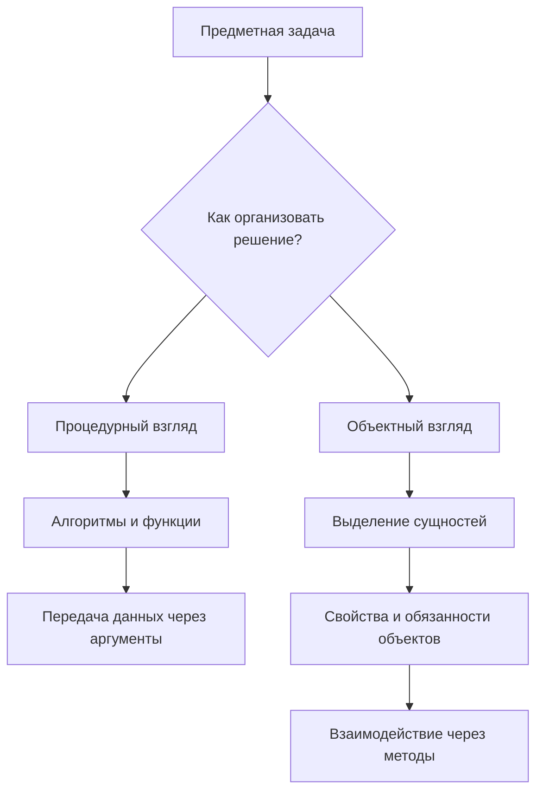
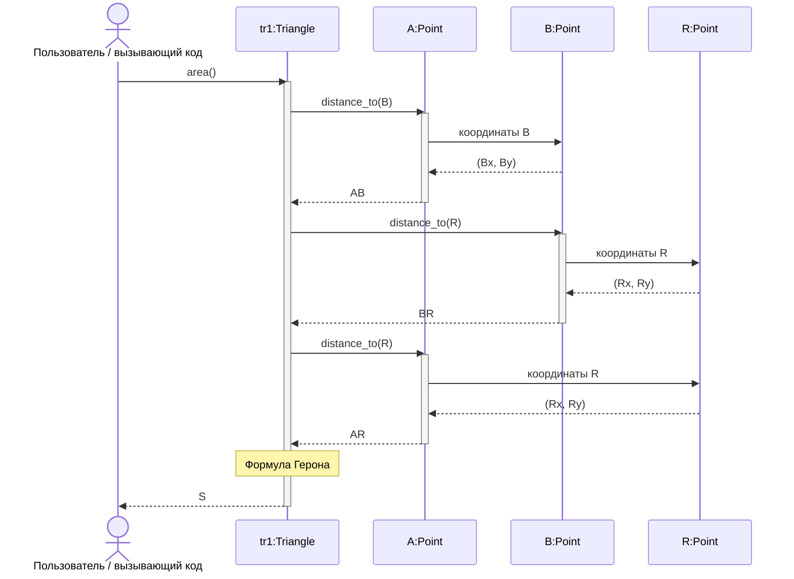
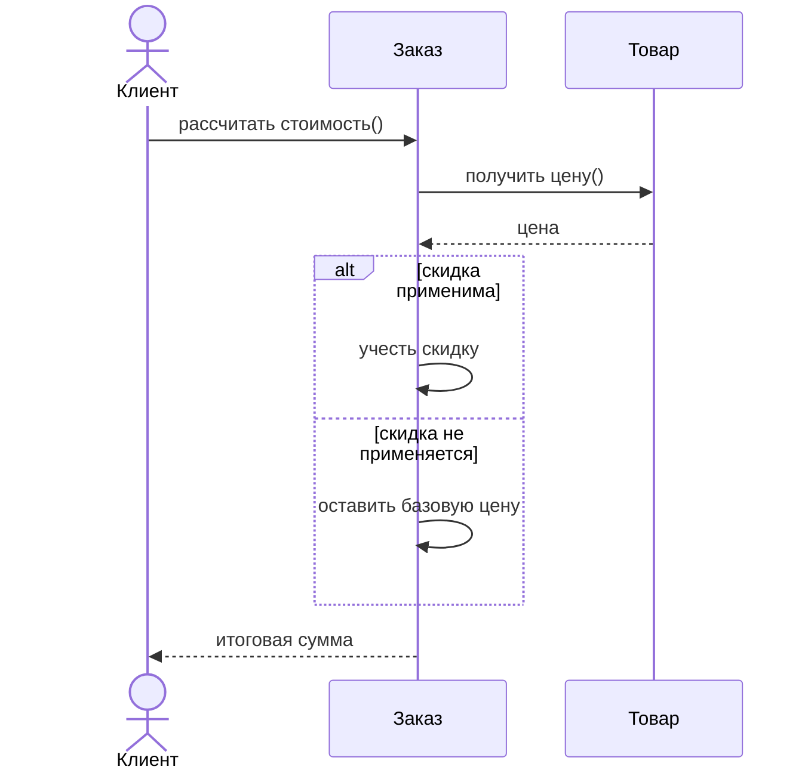
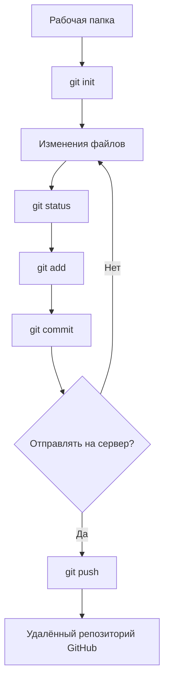
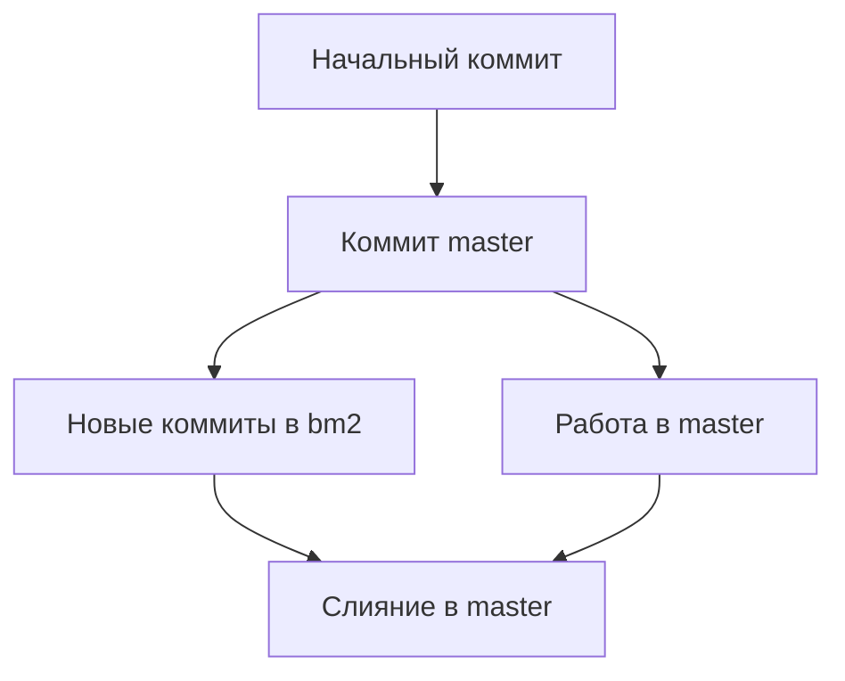
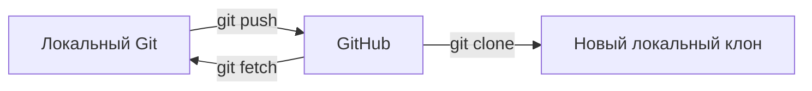

# Технологии программирования — 20 октября 2026 года

**Тема:** объектно-ориентированное представление программной системы, UML-диаграмма последовательности, основы Git и GitHub, применение LLM в работе разработчика.

## 1. Цели занятия и подготовка к зачёту

Основной учебный результат — научиться переходить от анализа предметной области к распределению обязанностей между объектами, представлять конкретное взаимодействие объектов на UML-диаграмме последовательности и применять систему контроля версий Git с публикацией результата на GitHub.

Преподаватель выделил следующие направления практической работы:

| Направление | Требуемое действие | Что представить |
|---|---|---|
| Объектная модель, задание P3 | Построить **диаграмму последовательности взаимодействия объектов для одного конкретного сценария**, а не общую системную схему | Подготовленную диаграмму по заданию |
| Git и GitHub | Установить Git, освоить основные консольные действия, организовать локальный репозиторий и по возможности связать его с GitHub | Результат работы с Git/GitHub, прежде всего ссылку на репозиторий с собственными файлами |
| Применение LLM | Выполнить учебные эксперименты с ИИ как помощником разработчика | Краткий отчёт в Word об основных действиях, ответах и собственных выводах |

На занятии указано, что диаграмма P3 и освоение Git/GitHub относятся к основным зачётным результатам. **Диаграмму классов, диаграмму состояний и диаграмму деятельности для зачёта готовить не требуется**: дополнительные UML-схемы можно выполнять по желанию. Написание собственного дополнительного приложения или игры также обозначено как необязательная практика. При обсуждении работы с Git преподаватель отдельно допускал начать как минимум с локального Git, если подключение к GitHub вызывает затруднения, однако предполагаемый отчётный результат — опубликованный репозиторий.

**Срок, названный на занятии:** подготовить основные материалы к пятнице соответствующей учебной недели. Занятие по диаграммам классов планировалось на четверг; в пятницу — заключительное занятие. Конкретный формат отправки всех результатов следует соотнести с опубликованными методическими указаниями преподавателя.

## 2. UML и место диаграммы последовательности

UML (*Unified Modeling Language*) — унифицированный язык графического моделирования для анализа и проектирования систем. В UML разные диаграммы отвечают на разные вопросы:

| Диаграмма | Что показывает | Статус относительно рассматриваемого задания |
|---|---|---|
| Вариантов использования (*use case*) | Участников и цели взаимодействия с системой | Отправная точка для выбора сценария |
| Последовательности (*sequence diagram*) | Объекты, сообщения между ними и порядок взаимодействий | **Основная практическая задача P3** |
| Классов (*class diagram*) | Классы, свойства, операции и отношения | Тема следующего занятия, необязательна для зачёта |
| Состояний (*state machine*) | Состояния объекта и переходы по событиям | Дополнительная тема |
| Деятельности (*activity diagram*) | Потоки действий, решения, ветвления | Дополнительная тема |
| Коммуникации / кооперации (*communication / collaboration*) | Связи взаимодействующих объектов и сообщения | Упомянута как альтернативный вид диаграмм взаимодействия |

### 2.1. Принципиальное различие: системная и объектная детализация

Общая схема взаимодействий может изображать пользователя, целое приложение, базу данных, платёжный сервис и другие внешние системы. Она полезна для представления архитектуры, но **не заменяет** детализацию одного внутреннего сценария, необходимую для P3.

В задании нужно определить, **какие конкретные объекты реализуют выбранную операцию**, какими данными они располагают, какие методы вызывают и какой результат возвращают. Такая диаграмма должна быть достаточно предметной, чтобы разработчик смог по ней распределить операции по классам и написать реализацию.

Для примера «оформить покупку» общей системной схемы «Покупатель → Магазин → Банк» недостаточно. Частный сценарий может описывать расчёт стоимости позиции заказа, распределение обязанностей между заказом, строкой заказа, товаром и компонентом расчёта скидки. Это **учебная иллюстрация масштаба детализации**, а не дополнительное обязательное задание.

## 3. Декомпозиция: от процедур к объектам

### 3.1. Модуль в логическом и физическом представлении

Программу можно декомпозировать по нескольким уровням:

- **Логический уровень:** функции, методы, классы и их ответственности.
- **Физический уровень:** файлы и каталоги. В Python файл `.py` обычно выступает модулем; пакеты организуют модули в более крупные пространства имён. Обычная папка и полноценный пакет в зависимости от устройства проекта не всегда одно и то же.

При процедурном подходе декомпозиция прежде всего ориентируется на **алгоритмы и функции**, которые принимают и обрабатывают данные. При объектном подходе исходной единицей рассуждения часто становится **сущность предметной области**, объединяющая состояние и поведение.



### 3.2. Проблема разрозненных переменных

При простой геометрической задаче координаты двух точек можно хранить в `ax`, `ay`, `rx`, `ry`. Функции вычисляют расстояние и площадь круга. Это корректная реализация, но связь переменных с понятиями «точка» и «фигура» обеспечивается в основном соглашением об именах.

Когда появляются несколько фигур, три и более вершины, списки объектов, выбор фигуры с максимальной площадью и модификация свойств, возрастает риск сложной структуры вложенных списков и кортежей. Преподаватель использовал это расширение требований как аргумент в пользу объектной модели: каждая фигура становится отдельной сущностью, которой можно поручить определённые действия.

Объектный подход не означает отказ от функций. Он меняет **расположение ответственности**: данные и операции, естественным образом относящиеся к объекту, представляются совместно. При преимущественно вычислительных задачах с простыми потоками данных процедурное решение может оставаться рациональным; **ООП не объявляется обязательным для каждой программы**.

### 3.3. Анализ, проектирование и программирование

- **OOA — Object-Oriented Analysis:** выделить существенные сущности, их атрибуты, поведение и отношения в предметной области.
- **OOD — Object-Oriented Design:** определить программные объекты, распределить обязанности и спроектировать их взаимодействие для конкретных сценариев.
- **OOP — Object-Oriented Programming:** реализовать проект средствами языка программирования.

**Абстракция** — выделение существенных свойств объекта и отвлечение от второстепенных деталей применительно к конкретной задаче. У одной предметной области могут быть разные полезные модели в зависимости от цели разработки.

## 4. Сквозной пример: геометрические фигуры

### 4.1. Площадь круга как процедурная задача

Имеются две точки на плоскости: центр круга `A = (ax, ay)` и точка `R = (rx, ry)` на окружности. Радиус равен расстоянию между ними:

$$
r=\sqrt{(r_x-a_x)^2+(r_y-a_y)^2}, \qquad S_{\text{круга}}=\pi r^2.
$$

Можно написать функцию, принимающую четыре координаты. Она вычислит результат, но **сущность круга** будет представлена лишь именами переменных и договорённостью о том, что такое пара точек. При расширении системы этой модели может оказаться недостаточно.

### 4.2. Переход к треугольнику

Для треугольника понадобятся три точки `A`, `B`, `R`, три длины сторон и формула Герона:

$$
a=|BR|,\qquad b=|AR|,\qquad c=|AB|,
$$

$$
p=\frac{a+b+c}{2}, \qquad S_{\text{треугольника}}=\sqrt{p(p-a)(p-b)(p-c)}.
$$

Если в программе появляется список многих треугольников с поиском минимальной или максимальной площади, целесообразно явно представить **каждый треугольник** как объект с тремя точками и операцией вычисления площади. Это избавляет вызывающий код от необходимости каждый раз передавать шесть координат и вручную организовывать множество связанных переменных.

### 4.3. Кому поручить вычисление расстояния?

Рассматривались два варианта проектирования:

1. **Вариант 1:** объект `Triangle` сам вычисляет все три расстояния по координатам вершин и затем площадь. Он несёт слишком много низкоуровневой геометрической работы.
2. **Вариант 2:** объект `Point` знает свои координаты и предоставляет операцию вычисления расстояния до другой точки; `Triangle` запрашивает три расстояния и вычисляет площадь. Это наглядно показывает разделение обязанностей.

Второй вариант соответствует обсуждавшемуся принципу GRASP **Information Expert (Информационный эксперт)**: ответственность уместно поручать тому объекту, который обладает необходимой информацией. Также затрагивалась идея единственной ответственности: изменение формулы геометрического расстояния не должно вынуждать переписывать детали вычисления площади каждой фигуры.

| Объект | Данные | Обязанность |
|---|---|---|
| `Point` | `x`, `y` | Определять расстояние до другой точки |
| `Triangle` | Ссылки на три `Point` | Запрашивать длины сторон, рассчитывать площадь |
| Вызывающий код | Ссылка на треугольник | Запросить площадь и получить результат |

**Схематическая запись:** `tr1.area()` вместо передачи всех координат во внешнюю функцию. Название метода здесь нормализовано для примера; важна именно принадлежность операции объекту `tr1`.

### 4.4. Иллюстративная реализация на Python

Следующий компактный код **поясняет обсуждавшуюся объектную схему**; это не дословная запись программы, запущенной преподавателем.

```python
from dataclasses import dataclass
from math import hypot, sqrt

@dataclass(frozen=True)
class Point:
    x: float
    y: float

    def distance_to(self, other: "Point") -> float:
        return hypot(self.x - other.x, self.y - other.y)

@dataclass(frozen=True)
class Triangle:
    a: Point
    b: Point
    r: Point

    def area(self) -> float:
        ab = self.a.distance_to(self.b)
        br = self.b.distance_to(self.r)
        ra = self.r.distance_to(self.a)
        p = (ab + br + ra) / 2
        return sqrt(max(0.0, p * (p - ab) * (p - br) * (p - ra)))

tr1 = Triangle(Point(0, 0), Point(3, 0), Point(0, 4))
print(tr1.area())  # 6.0
```

[+] Вызов `tr1.area()` возвращает площадь через методы объектов точек. Здесь точки заданы как неизменяемые объекты; защита от некорректных входных данных в полноценном приложении требует отдельного проектирования. Значение `max(0.0, ...)` защищает от небольшого отрицательного значения подкоренного выражения из-за погрешности вычислений и само по себе не заменяет проверку корректности геометрии.

## 5. Диаграмма последовательности для вычисления площади

### 5.1. Участники и сообщения

В выбранном сценарии взаимодействуют вызывающий код, объект треугольника `tr1` и три объекта точек `A`, `B`, `R`. Треугольнику поступает запрос на площадь; затем он получает три стороны и возвращает результат.



**Примечание к нотации:** запрос координат другой точки изображает логику демонстрационного проектирования. В реальном коде другой объект может предоставлять свойства непосредственно, а UML-диаграмма может не детализировать тривиальное чтение атрибутов. Важна последовательность ответственности, а не буквальное число служебных вызовов.

### 5.2. Базовые элементы UML-нотации

| Элемент | Значение |
|---|---|
| Прямоугольник с названием объекта | Участник взаимодействия; возможна запись `имя:Класс` |
| Вертикальная пунктирная линия | **Линия жизни** (*lifeline*) — существование участника во времени рассматриваемого взаимодействия |
| Сплошная стрелка | Передаваемое сообщение или вызов операции |
| Пунктирная стрелка назад | Возврат управления или результата; при понятном контексте может быть опущена |
| Узкий вертикальный прямоугольник | **Фокус управления** (*activation*): интервал выполнения операции |
| Сообщение создания объекта | Появление нового объекта; начало его линии жизни может быть ниже верхней границы схемы |
| Крест в конце линии жизни | Уничтожение объекта |
| Условный фрагмент `alt`, `opt` | Варианты выполнения по условиям, ветвление |

**Как читать последовательность:** сверху вниз. Каждому сообщению соответствует отправитель и адресат; обратные сообщения помогают увидеть, где формируется результат. Объекты одного класса могут встречаться на схеме несколько раз как разные экземпляры.

### 5.3. Пример ветвления



Это вспомогательный пример синтаксиса ветвления, а не замена основного геометрического примера и не требование строить схему для интернет-магазина.

### 5.4. Как выполнить практическое задание P3

1. Выбрать **один** понятный сценарий из предметной модели или ранее разобранного варианта использования.
2. Назвать конкретное действие и его результат (например, «рассчитать площадь треугольника»), не ограничиваясь общим «пользователь работает с системой».
3. Перечислить объекты, которые реально нужны для реализации действия.
4. Для каждого объекта определить, какими данными он обладает и за что отвечает.
5. Расположить объекты в диаграмме, провести линии жизни.
6. Изобразить вызовы и возвращаемые значения в фактическом порядке; при необходимости добавить ветвления и создание объектов.
7. Проверить, что операции не «висят в воздухе»: у каждого вычисления должен быть разумный владелец.
8. Сопоставить схему с возможной реализацией: можно ли по ней написать методы и организовать передачи данных?

[!] Частая ошибка — сделать только взаимодействие с внешней системой («пользователь — приложение — сервер») и не раскрыть взаимодействие **объектов выбранного частного сценария**. Такая общесистемная схема не отвечает основному требованию P3.

## 6. Применение LLM как помощника разработчика

В рамках практической части обсуждались большие языковые модели (*Large Language Models*, LLM) и использование ИИ на стороне разработчика — **не устройство нейросетей изнутри**, а получение объяснений, вариантов решения и анализа ошибок.

Предлагались следующие виды упражнений:

| Практика | Что передать модели | Что оценить |
|---|---|---|
| Проверка собственного решения | Условие и выбранные типы данных | Верность выбора и качество аргументации |
| Роль наставника | Уровень подготовки, язык программирования и непонятный метод | Доступность объяснения и простой пример |
| Обсуждение алгоритма | Задачу о НОД либо другую известную задачу, возможные виды циклов | Обоснование алгоритма и выбора `for`, `while` или `do...while` |
| Рефакторинг | Небольшую программу, например бросание кубика | Предложение функций и реализацию принципа **DRY** (*Don't Repeat Yourself*) |
| Объяснение ошибки | Сообщение компилятора или интерпретатора, фрагмент проблемного кода | Понимание причины ошибки и корректности объяснения |

Для эксперимента с ошибками допускается намеренно изменить ранее рабочий небольшой пример и затем попросить модель пояснить причину сбоя. Это не означает, что нужно намеренно портить окончательный вариант программы.

**Предлагаемый отчёт:** короткий документ Word с выполненными действиями, наиболее полезными или ошибочными ответами модели и **собственными выводами**. На вопрос о формате преподаватель уточнил, что отчёт по работе с ИИ можно представить в Word, отразив основные действия и результаты.

### 6.1. Как сформулировать полезный запрос

```text
Я изучаю Python на начальном уровне.
Задача: выбрать цикл для вычисления НОД двух натуральных чисел.
Мой вариант решения: [вставить небольшой фрагмент].
Проверь корректность. Объясни, почему этот тип цикла подходит,
приведи один короткий пример и назови возможные ошибки.
Не переписывай всю программу без необходимости.
```

Ключевые составляющие запроса: **контекст → задача → исходная попытка → конкретный вопрос → желаемый уровень детализации**. Полученный ответ следует проверять собственным тестированием и сопоставлением с изученными правилами, а не считать автоматически верным.

## 7. Git и GitHub: назначение и различия

**Git** — распределённая система контроля версий: отслеживает изменения в проекте, хранит историю коммитов, поддерживает ветви и объединение изменений. С Git можно работать **полностью локально**, даже без учётной записи на GitHub.

**GitHub** — сервис размещения Git-репозиториев и совместной работы через сеть. Это не другое название Git и не обязательный компонент для локального версионирования. Файлы можно размещать на GitHub через веб-интерфейс и без работы в командной строке; локальный Git при этом остаётся отдельным инструментом.

| Понятие | Смысл |
|---|---|
| **Рабочая директория** (*working tree*) | Файлы проекта в каталоге на компьютере |
| **Репозиторий** (*repository*) | Структура Git для хранения истории и ссылок на версии |
| **Индекс / staging area** | Набор изменений, подготовленных к следующему коммиту |
| **Коммит** (*commit*) | Зафиксированный набор изменений, автор, сообщение и уникальный идентификатор |
| **Ветка** (*branch*) | Именованная ссылка на последовательность коммитов; позволяет развивать разные варианты проекта |
| **Удалённый репозиторий** (*remote*) | Другая копия репозитория, например размещённая на GitHub |
| **`origin`** | Распространённое имя удалённого репозитория; не специальная обязательная ветка |

### 7.1. Базовый рабочий цикл Git



`git init` инициализирует репозиторий, `git add` помещает изменения в индекс, `git commit` записывает снимок подготовленных изменений в историю, `git push` передаёт соответствующие коммиты в связанный удалённый репозиторий.

[!] **`git add` — ещё не коммит, `git commit` — ещё не публикация на GitHub.** Отправка изменений и получение изменений с сервера — отдельные операции.

### 7.2. Проверка Git в PowerShell

Преподаватель демонстрировал консоль PowerShell в Windows и работу с ранее созданным репозиторием `DemoGit`.

```powershell
cd .\DemoGit

git --version
git status
git branch
```

В демонстрационной среде отображалась версия `git version 2.56.0.windows.2`; число относится к показанному установленному экземпляру, а не к минимальному требованию для выполнения упражнений. Команда `git status` выводила текущую ветку и состояние рабочей области, включая сообщение, что нечего фиксировать и рабочая директория чиста (`nothing to commit, working tree clean`). Также показывалось, что локальная ветка может опережать соответствующую удалённую на один коммит — это сигнал необходимости публикации через `push`, а не ошибка компиляции.

### 7.3. Инициализация и первый коммит: воспроизводимый пример

Команды ниже — аккуратный **учебный сценарий на основе разобранных действий**, а не дословный журнал команд преподавателя.

```powershell
mkdir DemoProject
cd DemoProject

git --version
git config --global user.name "Student Name"
git config --global user.email "student@example.com"
git init

git status
# Создайте или измените в этом каталоге файл, например main.py.
git add main.py
git commit -m "Add first example"
git log --oneline
git status
```

Для подготовки **всех** нужных изменений можно использовать `git add .`, однако он добавляет в индекс и нежелательные файлы, если не настроен `.gitignore`; поэтому перед фиксацией необходимо проверять `git status`.

**Важно:** `user.name` и `user.email` определяют авторство коммитов, а **не являются логином и паролем GitHub**. Для сетевой аутентификации обычно применяют авторизацию через менеджер учётных данных, токен или SSH-ключ; пароль учётной записи GitHub в качестве обычного пароля для `git push` через HTTPS использовать нельзя.

### 7.4. Ветки: создание, переключение, слияние

При демонстрации существовали ветки `bm1`, `bm2`, `bm3` и `master`. Команда `git branch` перечисляет локальные ветки; звёздочка `*` обозначает текущую. Для перехода на ветку преподаватель показывал старую универсальную команду `git checkout` и более специализированную `git switch`.

```bash
git branch               # список локальных веток
git status               # текущая ветка и изменения
git branch bm1           # создать ветку bm1
git checkout bm1         # переключиться (исторически распространённый способ)
git switch master        # современный способ переключения
git switch -c feature-x  # создать новую ветку и сразу перейти в неё
```

**Ветка не является независимой папкой с копией файлов**: это линия истории коммитов. При переключении Git приводит рабочие файлы к состоянию целевого коммита, учитывая ограничения на незакоммиченные изменения. В новой ветке можно безопаснее развивать экспериментальную функцию, не меняя содержимое основной ветки до объединения.



В демонстрации разбиралось объединение изменений `bm2` с основной веткой:

```bash
git switch master
git merge bm2
git log --oneline --graph --all
```

[!] При несовместимых изменениях одних и тех же участков файлов возможен **конфликт слияния**; Git не может автоматически угадать предпочтительную версию, и разработчик должен разрешить конфликт вручную. Демонстрация команды `merge` сама по себе не означает, что конфликт обязательно возникал.

Для удаления уже не нужной локальной ветки используется `git branch -d bm1`. Более рискованный вариант `-D` принудительно удаляет ссылку на ветку даже без проверки слияния. Преподаватель предупреждал об осторожности при удалении и рекомендовал перед переключением сохранять законченную работу коммитом. Уточнение: в Git также можно временно сохранять неоконченные изменения через `stash`, но это **не было основной темой занятия**.

### 7.5. История изменений

```bash
git log
git log --oneline
```

Коммиты имеют хеш-идентификатор, автора, дату и текстовое сообщение. На примере показывалась история изменений файлов, в том числе добавление `.gitignore` и другие записи. Сообщение коммита должно объяснять выполненное изменение: например, «Добавлена функция вычисления площади» или «Исправлена проверка ввода». История позволяет понимать развитие проекта и при необходимости обращаться к более ранним версиям; конкретные команды отката подробно не отрабатывались.

## 8. Публикация на GitHub и обмен изменениями

### 8.1. Связь локального и удалённого репозиториев

Основной сценарий: создать репозиторий на GitHub, затем настроить для локального репозитория удалённый адрес и выполнить отправку изменений. Название `origin` традиционно используется для такой связи.

```bash
# Адрес должен быть адресом ВАШЕГО созданного репозитория.
git remote add origin https://github.com/ACCOUNT/REPOSITORY.git

git remote -v
git branch --show-current
git push -u origin master
```

`ACCOUNT/REPOSITORY` — условные заполнители. Команда `git push -u origin master` применима, если **текущая отправляемая локальная ветка называется `master`**. Если она называется `main`, команда соответственно должна быть `git push -u origin main`. Удалённый репозиторий может быть настроен с уже существующим коммитом, поэтому при реальной синхронизации сначала нужно проверить согласованность историй.

Преподаватель обращал внимание, что в одном примере на GitHub основной веткой служила `main`, а в локальном Git использовалась `master`. Это разные имена веток, не особый механизм копирования файлов: при публикации можно создать одноимённую удалённую ветку и отдельно решить, какая ветка считается основной.



### 8.2. Отправка, получение и клонирование

| Команда | Результат |
|---|---|
| `git push origin master` | Отправить коммиты выбранной локальной ветки в удалённую `master` при обычной настройке соответствий |
| `git fetch origin` | Получить сведения об удалённых ветках и коммитах **без автоматического изменения рабочей ветки** |
| `git pull` | Получить удалённые изменения и интегрировать их в текущую ветку с учётом настроек Git |
| `git clone URL` | Создать новую локальную копию удалённого репозитория |
| `git remote -v` | Посмотреть адреса подключённых удалённых репозиториев |

Если ветку создали или отредактировали **в веб-интерфейсе GitHub**, локальный Git не получает эти изменения автоматически: потребуется как минимум `git fetch`, а для непосредственной работы — выбор соответствующей ветки и настройка её отслеживания, например `git switch --track origin/feature-x`.

[!] `fetch` **не сливает** изменения в текущие файлы автоматически. `push` не происходит сам по себе после коммита. Команду `pull` не следует путать с клонированием: `clone` создаёт репозиторий заново, а `pull` используется при работе с уже существующим.

### 8.3. GitHub без консоли и интеграция с IDE

В качестве более удобных интерфейсов были упомянуты поддержка Git/GitHub в IDE, включая **Visual Studio** и **PyCharm**, и графические средства типа **GitHub Desktop**. Суть операций остаётся той же: выбор файлов, фиксация коммита, ветвление, отправка и получение изменений. Консольный путь разобран для понимания механизма, а не как единственный разрешённый способ будущей профессиональной работы.

На GitHub также можно создать репозиторий, ветку и коммит непосредственно через браузер либо загрузить файлы. При этом локальный репозиторий и удалённый репозиторий остаются разными состояниями, требующими явного обмена изменениями.

### 8.4. Минимальная самопроверка перед отправкой результата

- [ ] Установленный Git отвечает на `git --version`.
- [ ] Локальная папка содержит нужные исходные файлы и Git-репозиторий.
- [ ] `git status` понятен; в индекс не попали лишние большие или конфиденциальные файлы.
- [ ] Выполнен как минимум один осмысленный коммит; история видна через `git log`.
- [ ] Понятна текущая ветка и, при необходимости, создана отдельная рабочая ветка.
- [ ] Если используется GitHub, настроен правильный адрес `origin` и выполнен `push`.
- [ ] По ссылке на GitHub можно увидеть файлы и историю, которые должны быть представлены преподавателю.

## 9. Наиболее важные выводы

1. Декомпозиция в процедурном подходе исходит из **алгоритмов**; объектный подход делает явными **сущности, их состояние и обязанности**.
2. Принцип **Information Expert** помогает определить, какой объект отвечает за вычисление на основе имеющихся у него данных.
3. **ООА → OOD → OOP:** от выделения объектов переходят к проектированию сообщений и только затем к коду.
4. UML-диаграмма последовательности для зачётной задачи должна описывать **один конкретный внутренний сценарий** с объектами и сообщениями, а не ограничиваться внешним контекстом системы.
5. **Git ≠ GitHub**: Git фиксирует историю и работает локально, GitHub предоставляет удалённое размещение и совместную работу.
6. Базовая цепочка работы — изменение файла, `git add`, `git commit`, при необходимости `git push`. Ветки позволяют изолировать варианты разработки, а `fetch` помогает узнавать об удалённых изменениях.
7. LLM пригодна для объяснения типов данных, алгоритмов, функций, ошибок и рефакторинга. **Её ответы требуют критической проверки**, а не механического копирования.

## 10. Краткий терминологический справочник

| Термин | Определение |
|---|---|
| Абстракция | Модель существенных свойств сущности относительно решаемой задачи |
| Объект | Экземпляр сущности с определённым состоянием и поведением |
| Класс | Описание структуры и поведения объектов определённого типа |
| Атрибут | Данные/состояние, связанные с объектом |
| Метод | Операция, связанная с объектом или классом |
| GRASP | Набор принципов распределения обязанностей в объектном проектировании |
| Information Expert | Поручение ответственности объекту, располагающему нужными сведениями |
| Lifeline | Линия жизни участника на диаграмме последовательности |
| Activation | Интервал исполнения операции участником диаграммы |
| Staging area | Индекс изменений, подготовленных к коммиту |
| Commit | Зафиксированный снимок изменений в истории Git |
| Branch | Указатель на текущую вершину соответствующей линии коммитов |
| Merge | Интеграция изменений разных веток |
| Remote | Настроенная ссылка на другой Git-репозиторий |
| Push / Fetch | Публикация локальных коммитов / получение удалённых данных без автоматического слияния |
